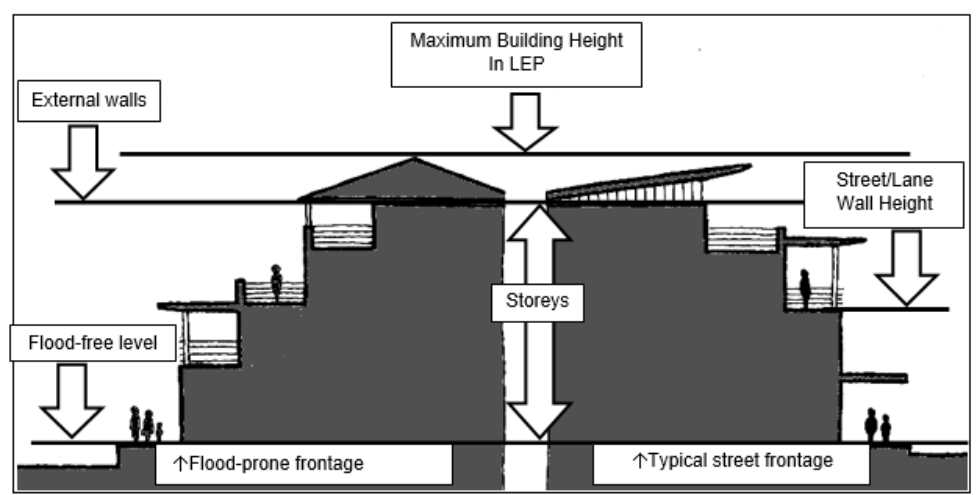

#### 4.2.5.2 Building Height

#### OBJECTIVES

• Establish the primary controls to encourage financially-viable redevelopment that addresses scenic quality, character and residential amenity.

• Limit both the visual impact of multi-storey buildings upon the scenic quality of these coastal settings, and provide for view sharing across each centre.

• Vary the maximum building height for each development in proportion to the size and frontage of the development site.

• Maintain the established pedestrian-friendly scale of two storey facades facing all streets.

• Promote a sunlit outdoor environment as the setting for a vibrant village centre, maintaining existing levels of sunlight along footpaths during the middle of the day.

• Ensure that village centre dwellings will receive satisfactory levels of midwinter sunlight.

• Encourage variations in building form that create a varied silhouette or profile, and that contribute to a regionally-distinctive architecture.

#### CONTROLS

a New buildings and alterations or additions to existing buildings shall not exceed the maximum building height specified in Clause 4.3 and 4.3A of Central Coast LEP 2022.

b Where the maximum building height permitted under Central Coast LEP 2022 is indicated in Table 1 the additional provisions specified in the corresponding row in Table 1 apply:

| Max. LEP Height 'm' | Max Height in Storeys | Max External Wall Height in 'm' | Max Street/Lane Wall Height in Storeys/m |
|---|---|---|---|
| 19.75 | 6 | 18.25 | 2 8.75m |
| 17 | 5 | 15.5 | 2 8.75m |
| 14.25 | 4 | 12.75 | 2 8.75m |
| 11.5 | 3 | 10 | 2 8.75m |

#### Table 1

c An 8.75m high and 2 storey façade will apply to all frontages of properties that have an interface with a street or laneway or common boundary with a residential zone.

d The measurement of maximum heights incorporate the following reference points:

i Maximum Height for the Building - Specified in Central Coast LEP 2022 refer to clause 4.3, 4.3A and the Height of Buildings Map;

ii External Wall - means walls that enclose a building, other than end walls above the pitching point of any inclined roof (such as a gable-end) or the sides to any attic's dormer window;

iii Storey - defined in Central Coast LEP 2022;

iv Street/Lane Wall Height - The vertical distance measured in metres or storeys at the centre of the street or laneway frontage from the average of the street/laneway levels at each end of the frontage to the parapet level of the frontage. The parapet level is the horizontal plane in which at least two thirds of the length of the top of the façade is situated.

The highest point of any roof provides an absolute limit to the height of buildings, and is intended to encourage the use of gently-pitched roofs that contribute to desirable variations in the silhouette and the profile of each building, but not to accommodate an additional storey that is enclosed by taller walls or by steeply pitched roofs that would increase the desirable scale or bulk of a building.

v The highest point of any roof provides an absolute limit to the height of buildings, and is intended to encourage the use of gently-pitched roofs that contribute to desirable variations in the silhouette and the profile of each building, but not to accommodate an additional storey that is enclosed by taller walls or by steeply pitched roofs that would increase the desirable scale or bulk of a building.

> [Picture on page 7: a picture, saved as a picture (images/ch-04-02-peninsula-centres-page-7-23.gif, 150 dpi).]

#### Figure 4.2.5: Cross-section illustrating reference points for building heights
