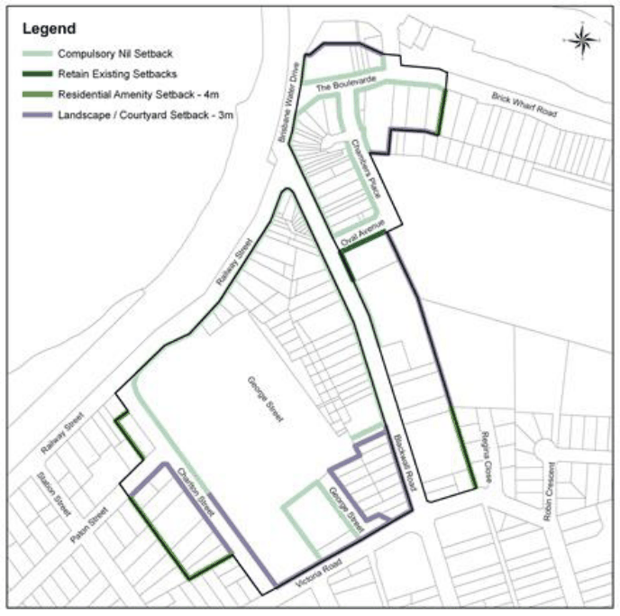
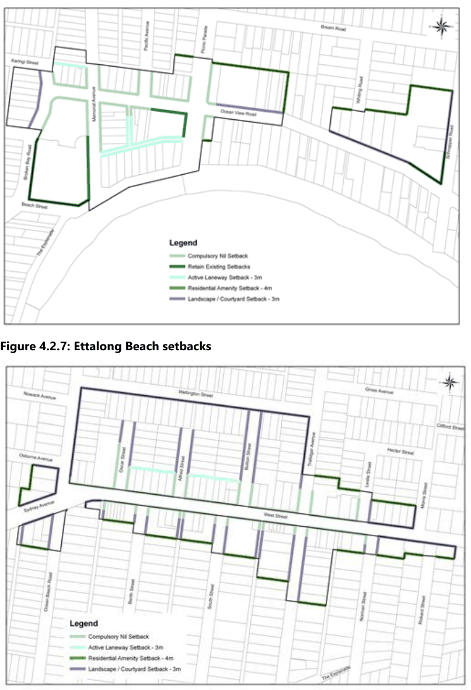
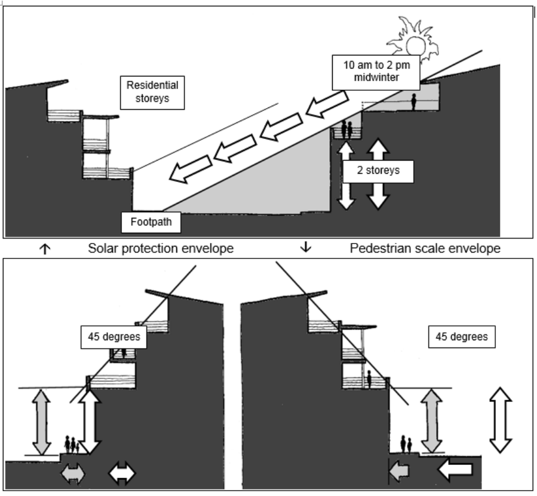

#### 4.2.5.3.1 Controls - Street Setbacks

a Street setbacks are to comply with those outlined in Figures 4.2.6, 4.2.7 and 4.2.8.

> [Picture on page 8: a picture, saved as a picture (images/ch-04-02-peninsula-centres-page-8-15.gif, 150 dpi).]

#### Figure 4.2.6: Woy Woy setbacks

> [Picture on page 9: a picture, saved as a picture (images/ch-04-02-peninsula-centres-page-9-1.gif, 150 dpi).]

#### Figure 4.2.7: Ettalong Beach setbacks

#### Figure 4.2.8: Umina Beach setbacks

b Existing levels of midwinter sun along public footpaths between the hours of at least 10am and 2pm must be maintained by a building envelope that is projected at the appropriate solar altitude angle from the adjacent street kerb.

c Any part of a building that is above 7m or 2 storeys in height whichever is the lesser is to be set back in accordance with a pedestrian envelope that is projected at 45o from the façade at a point not higher than 7m or 2 storeys in height whichever is the lesser at a point not higher than for any boundary that has a frontage to a public right of way such as a street or lane. To maintain the pedestrian-friendly scale of existing low rise buildings.

d Minor variations of building envelopes are desirable in the following situations in order to avoid the appearance of continuous horizontal building forms:

i At street corners where a vertical emphasis or landmark location is appropriate, and to allow reasonable potential for the redevelopment of corner properties;

ii On wide sites where vertical structures or balconies can provide effective contrasts to continuous horizontal forms with regular steps that might otherwise occur;

iii Any façade that penetrates a solar envelope should not be wider than 5m or taller than 4 storeys, and resulting shadows that are cast across a footpath or neighbouring façade should be relatively narrow and fast-moving;

iv Variations of a pedestrian envelope should not have a total width that is greater than 30% of any façade’s width, and no single variation should exceed a width of 5 metres or 4 storeys;

v Variations may include enclosed floor space or roofed balconies, where permitted by Council (see Figure 4.2.9) are constructed above public footpaths to accommodate outdoor dining;

vi Awnings, eaves, balustrades and parapets may project beyond the pedestrian envelope, but generally should not project beyond the solar envelope unless glazed or substantially of transparent construction.

e Any part of a non-residential building that is above 8.75m or 2 storeys in height is to be set back at least 3 m from any side boundary that does not have frontage to a public right of way.

f In general, increased setbacks are only acceptable along street frontages that are subject to flooding, where ground level shopfronts may be setback up to 3m in order to accommodate flood-free pedestrian access along elevated terraces.

g Permissible encroachments may where permitted by Council include balconies constructed above public footpaths that are designed to accommodate outdoor dining.

h Permissible variations include café shopfronts at ground level only, setback from the street frontage to accommodate “outdoor” tables.

> [Picture on page 11: a picture, saved as a picture (images/ch-04-02-peninsula-centres-page-11-1.gif, 150 dpi).]

Figure 4.2.9: Building envelopes - Cross sections through street and laneway frontages
