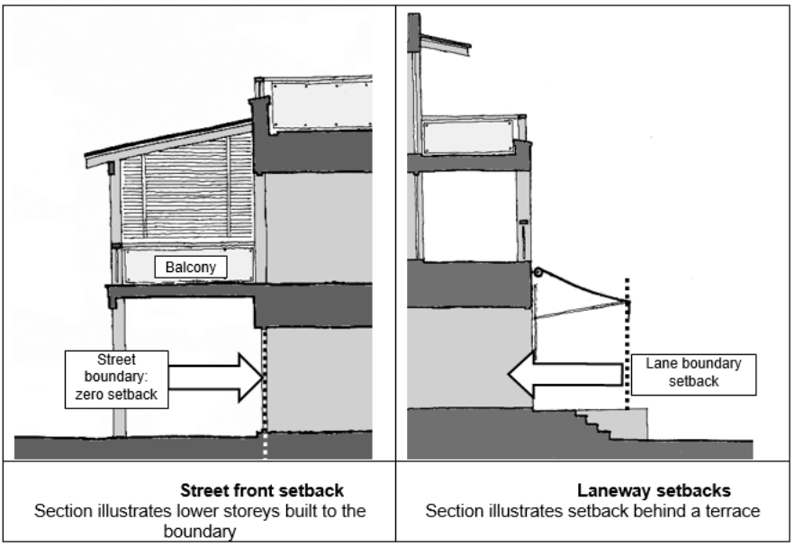

#### 4.2.5.3.2 Controls - "Active" Laneway Setbacks

a Laneway setbacks are to comply with the setbacks on Figures 4.2.7 - 4.2.8.

b Laneways defined as "Active" Laneways on Figures 4.2.7 - 4.2.8 are to be setback at least 3m from the laneway frontage to increase sunlight that is available at street level, improving environmental amenity, as well as stimulating pedestrian and retail activity.

c "Active" Laneway setbacks should accommodate publicly-accessible spaces such as terraces or forecourts that are suitable for outdoor dining.

> [Picture on page 12: a picture, saved as a picture (images/ch-04-02-peninsula-centres-page-12-1.gif, 150 dpi).]

#### Figure 4.2.10: Street front setback

#### Figure 4.2.11: Laneway setbacks
