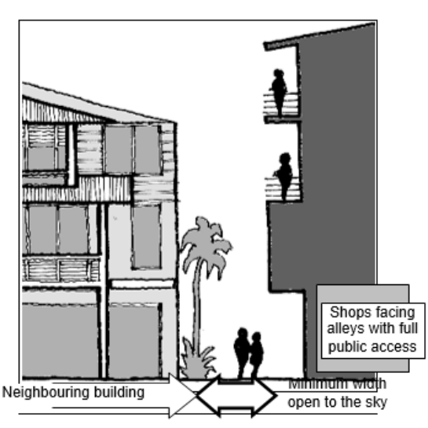
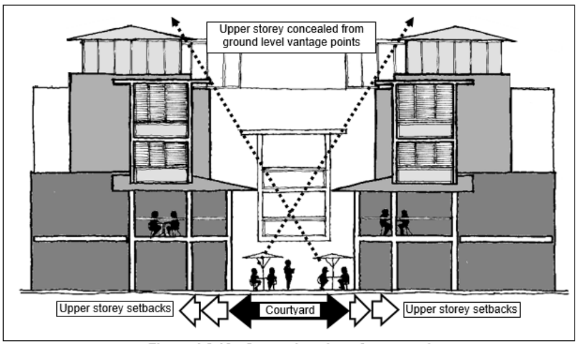

#### 4.2.5.3.4 Controls - Alleyways and courtyards

a Alleyways or courtyards should be located and designed to provide strategic benefits:

i Existing levels of “main-street” retail and pedestrian activity must not be eroded;

ii New public access should enhance the Centre’s existing pedestrian network;

iii Settings for outdoor activity should demonstrate high levels of amenity that include reasonable levels of daylight and midwinter sunlight at street level, plus protection from cold winter winds;

iv “Open spaces” should contribute to effective articulation of building forms, enhancing the overall level of variations that are displayed by structures along each street;

v Above-ground open space contributes to high levels of residential amenity related to daylight, sunlight, ventilation and the outlook from each dwelling.

b Alleyways generally should incorporate the following dimensions, locations and features:

i A minimum width of 3 metres, open to the sky above and sufficient for landscaped planters that are at least 1 metre wide with sufficient soil volume for canopy trees;

ii Provide limited public access to residential lobbies or alternatively, provide full public access between streets and lanes, with shopfronts along at least 30% of the overall length;

iii Be located immediately next to any existing alleyway or courtyard upon a neighbouring property;

iv Be overlooked by windows and balconies that are designed to satisfy the Residential Amenity section of this Chapter.

> [Picture on page 13: a picture, saved as a picture (images/ch-04-02-peninsula-centres-page-13-17.gif, 150 dpi).]

#### Figure 4.2.12: Accessible alleyways - viewed from the street frontage

c Courtyards generally should incorporate the following dimensions, locations and features:

i Located only where they face a public street frontage that receives midday sunlight,

ii Located no closer than 25 metres from an existing street corner where they would not erode either the role or the visual prominence of existing corner shop-fronts or building forms,

iii Accommodating continuous shopfronts around a publicly-accessible space that is open to the sky above and is suitable for pavement dining,

iv Minimising disruption to established shop-frontages as well as maximising both the visibility and the proximity of new shopfronts to existing public footpaths, with “street level” dimensions that generally should not exceed 8 metres to 10 metres (measured as site frontage and courtyard depth), and

v Overlooked by windows and balconies that are designed to satisfy the Residential Amenity section of this Chapter.

d Around alleyways and courtyards that are publicly-accessible, walls should incorporate upper storey setbacks in order to enhance amenity at street-level:

i The third and fourth storeys should be setback at least 1m from the face of lower storey walls to avoid the appearance of sheer vertical walls; and

ii Any fifth or sixth storey (where permitted) should have an additional setback sufficient to conceal that storey from vantage points located within the alleyway or courtyard at “street level”

> [Picture on page 14: a picture, saved as a picture (images/ch-04-02-peninsula-centres-page-14-13.gif, 150 dpi).]

Figure 4.2.13: Street elevation of courtyard - Highlighting desired dimensions at ground level and upper storey setback
