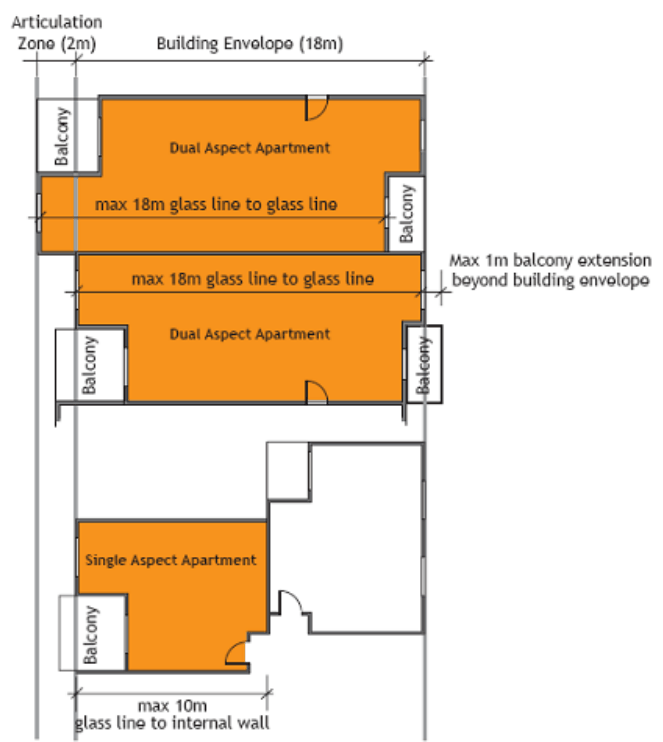

#### 4.2.5.5 Building Depth

#### OBJECTIVES

▪ To achieve the development of thin cross section buildings and narrow commercial floorplates to improve amenity and promote sustainable design and building management practices where living and working environments are not reliant on artificial lighting, heating and cooling.

▪ To ensure that building design provides adequate amenity for occupants in terms of sun access and natural ventilation.

▪ To ensure that the bulk of the development is in scale with the desired future character.

#### CONTROLS

The following building depth controls shall apply: a Commercial development:

i The maximum depth of office floors with windows in one side is 10m,

ii The maximum depth of office floors with windows in two opposite sides should be 20m.

b Residential flat development:

i The maximum internal plan depth of residential flat buildings is to be 18m from glass line to glass line,

ii Single aspect apartments are to have a maximum internal plan depth of 10m from glass line to internal face of wall.

c Where residential flat developments are proposed to be wider than 18m the Applicant must demonstrate how satisfactory daylighting and natural ventilation are to be achieved (refer to the Internal and External amenity section of this chapter for satisfactory daylighting and natural ventilation requirements).

> [Picture on page 16: a picture, saved as a picture (images/ch-04-02-peninsula-centres-page-16-1.gif, 150 dpi).]

Figure 4.2.14 - Building Depth - Source: Residential Flat Design Code, Planning NSW 2002
