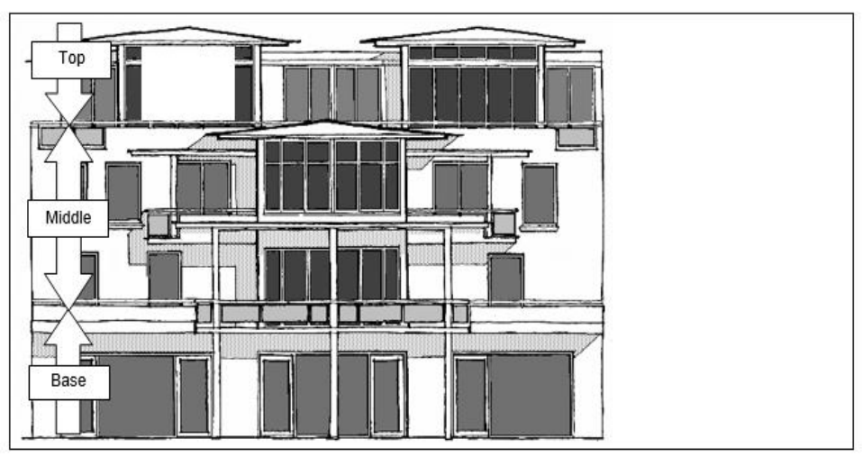

#### 4.2.6 BUILDING ARTICULATION

#### 4.2.6.1 Building Facades

#### OBJECTIVES

▪ To ensure that buildings are of a high architectural quality that contribute to the desired character of the centre.

▪ To ensure that building facades are of an appropriate scale, rhythm and proportion that respond to the desired character of the centre.

▪ To ensure building elements are integrated into the overall building form and design.

▪ To employ a variety of architectural design techniques that disguise the scale and bulk of multi storey buildings.

#### CONTROLS

a All building facades shall be modulated and articulated this can be achieved through the following:

i Define a base, middle and top related to the overall proportion of a building;

ii Express datum lines using cornices, a change in materials, texture or colour or setbacks;

iii Use a variety of window types to express building uses;

iv Use recessed or extended balconies and deep windows.

> [Picture on page 17: a picture, saved as a picture (images/ch-04-02-peninsula-centres-page-17-17.gif, 150 dpi).]

Figure 4.2.15: Street elevation illustrating appropriate form of three and four storey buildings

Penthouse level on upper storeys of buildings should be broken into pavilion structures separated by roofs or terraces b The silhouette of each building should contribute to the overall diversity of form within each centre:

v Within each façade, vary the level of roofs, external walls and parapets in order to avoid simple cubic forms and flat roofs that tend to accentuate scale and bulk,

vi Each top storey should incorporate stepped floorplans or separate pavilion structures, capped by highly-articulated roof forms that contribute to diversity of building silhouettes.

e Street level facades should be divided into a series of vertical panels that vary in width from 2 to 6metres, in order to reflect the design diversity of traditional village centres comprising of rows of individually designed narrow fronted shop-dwellings.

f The width of any part of a single building above 2 storeys shall not exceed 30m on any on any elevation facing the street.

g Building facades must be designed to respond to solar access by using solar protection elements such as eaves, louvers and awnings.

h Balconies shall not run the full length of any façade but should be designed in short lengths so as not create the appearance of monolithic building forms.

i Balconies and windows to habitable rooms should be situated to encourage opportunities for passive surveillance to public areas.

j All building elements including shading devices, awnings/colonnades, signage, drainage pipes and communication devices must be co-ordinated with the overall façade design.

k Plant and equipment should be concealed within the fabric of each building in order to promote high standards of urban design and amenity:

i Plant, equipment and ductwork should not be surface-mounted on roofs, terraces, or exterior walls,

ii Services, pipes and ductwork should not be visible from any public frontage,

iii Services, pipes or ductwork should be concealed in the entrances to parking or delivery areas that face a street or laneway,

iv Plant and equipment should be designed and located to prevent exposure of nearby dwellings to unreasonable odours or noise,

v If individual air-conditioning units are used they must not be visible from the street.
