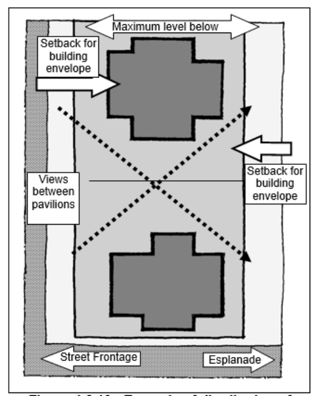

#### 4.2.6.2 Top Floor Design and Roof Forms

#### OBJECTIVES

▪ Ensure that roof design responds to the desired character and contributes to the overall design and environmental performance of buildings.

▪ Ensure that the design of the top storey of buildings minimises visual bulk, provides articulation and prevents any increased overshadowing.

#### CONTROLS

a On larger sites where additional height is permitted due to site frontage and area in accordance with Clause 4.3A of the Central Coast LEP 2022 and Table 1 of this chapter, the top storey must be distributed to disguise the scale and bulk of multi storey buildings and in order to retain view corridors that are wide enough to allow filtered views to the water from other properties within the centre.

b The upper storey of buildings should be articulated with differentiated roof forms, predominantly low pitched roofs surrounded by wide eaves, rather than flat roofs set behind parapets that accentuate the scale and bulk of multi-storey buildings.

c Design of roofs must respond to solar access, for example by using eaves and skillion roofs.

d Service elements such as lift overruns, plant equipment, chimneys, vent stacks, water storage, communication devices, solar panels etc. must be integrated into the overall design of the roof so as not to be visible from the street.

e Roofing colours within the Ettalong Village Centre must be in accordance with the Heritage Colour Scheme. An example of heritage colours is the Heritage and Traditional Colours range by Pascol Paints Australia Pty Ltd.

f The number, design and location of television and radio antennas should be limited to one common mast per building.

g Satellite dishes should not be installed on roof-tops, and should be restricted to small units located on private balconies or terraces to conceal their appearance from street level vantage points.

> [Picture on page 19: a picture, saved as a picture (images/ch-04-02-peninsula-centres-page-19-12.gif, 150 dpi).]

#### Figure 4.2.16: Example of distribution of upper storey floor area
