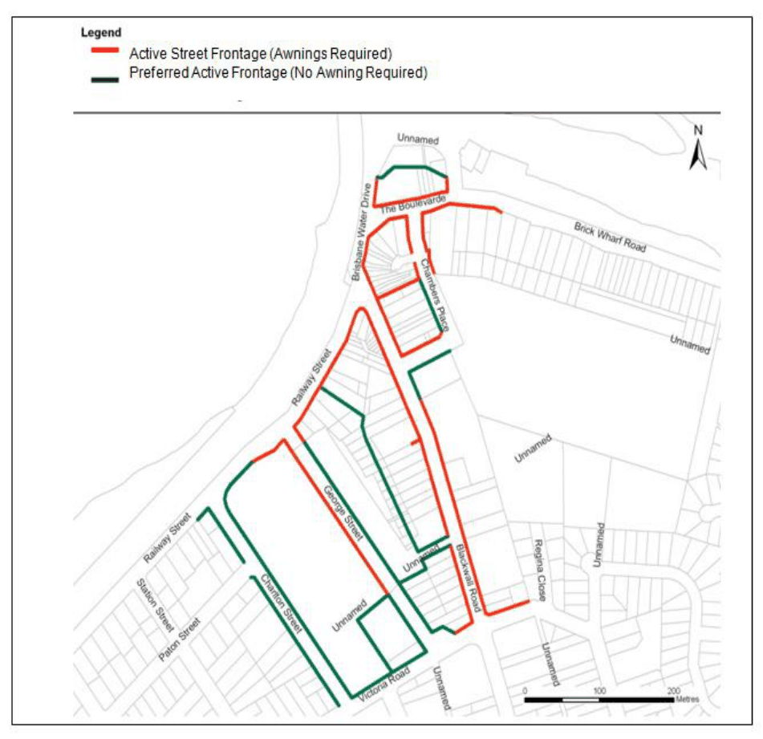
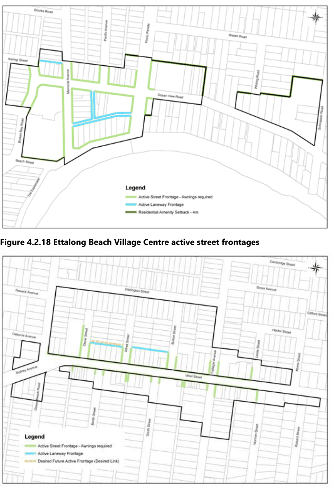
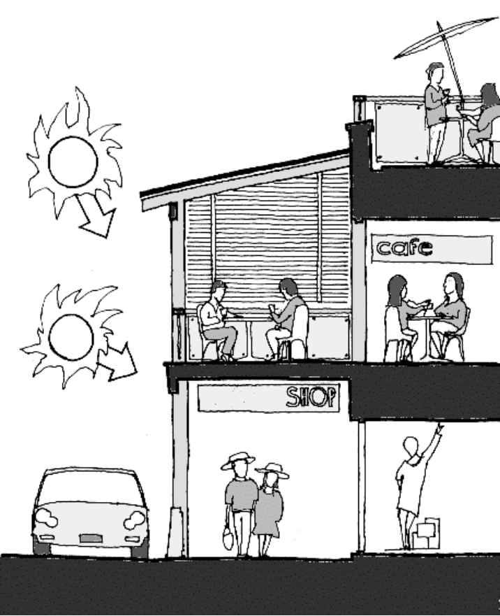
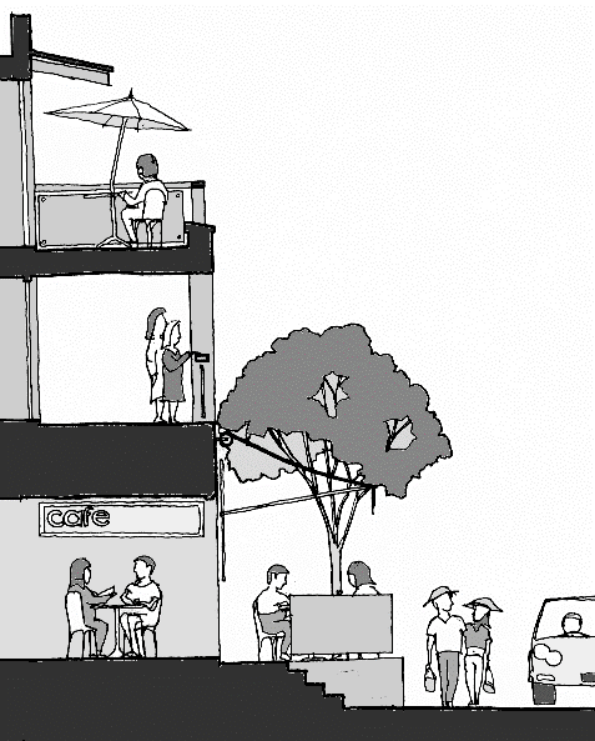
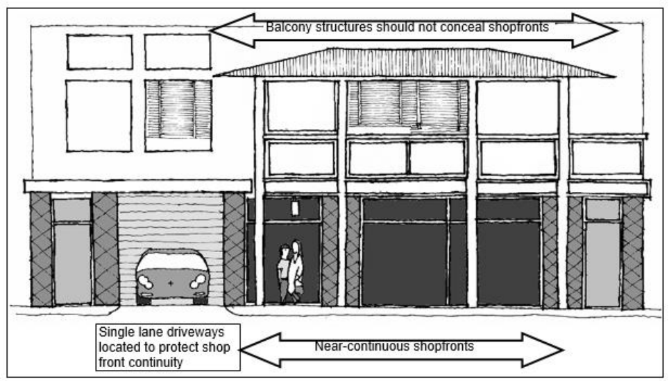

#### 4.2.6.4 Active Street & Active Laneway Frontages

#### OBJECTIVES

▪ Maintain and enhance the established “main street” retail environment, particularly by concentrating pedestrian activity along existing retail frontages.

▪ Encourage a new secondary retail frontage along "active" laneways in proportion to market demand for retail and business floor space.

▪ To have ground floor facades that enhance the public domain, amenity and safety.

▪ Co-ordinate the design of shopfronts, business signs and the landscaping of public areas according to "main street" principles.

▪ To have street frontages suitable for active business uses.

▪ To promote pedestrian activity in the public domain.

▪ Conceal on-site parking and services from street frontages.

#### CONTROLS

a Active street & active laneway frontages are defined as one of a combination of the following at street level:

i Entrance to retail;

ii Shopfront;

iii Glassed entries to commercial and residential lobbies occupying less than 50% of the street frontage to a maximum of 12m frontage.

iv Café or restaurant if accompanied by an entry from the street;

v Active office uses, such as reception, if visible from the street; and

vi Public building if accompanied by entry.

b Active street & active laneway frontages are required at ground level for all areas indicated on Figures

4.2.17 - 4.2.19.

#### Figure 4.2.20 Woy Woy Town Centre Active Street Frontages

> [Picture on page 21: a picture, saved as a picture (images/ch-04-02-peninsula-centres-page-21-2.gif, 150 dpi).]

#### Figure 4.2.17 Woy Woy Town Centre Active Street Frontages

> [Picture on page 22: a picture, saved as a picture (images/ch-04-02-peninsula-centres-page-22-1.gif, 150 dpi).]

#### Figure 4.2.18 Ettalong Beach Village Centre active street frontages

#### Figure 4.2.19 Umina Beach Village Centre active street frontages

c Ground floor articulation for shopfronts along active street frontages must not be more than 1.2m deep.

d Buildings must not have continuous length of blank walls at street level.

e Provide clear glazing to all street frontage windows.

f The sill height of street frontage windows must not be more than 1.2m above street level.

g Main street frontages should not accommodate fire exits, service cupboards, vehicle or service entrances, control valves and meters for piped services which would intrude upon the continuity of shopfronts or design of facades facing any street:

i Vehicle access, fire exits, service cupboards, valves and meters should be accessed via secondary street or laneway frontages. Valves and metres should where possible, located in secured cabinets that are associated with carpark entrances rather than intruding upon street facades,

ii Where vehicle access, fire exits, cabinets etc. must be located along a street frontage, their width should be minimised and they should be integrated with the design of shopfronts.

h New pedestrian spaces or links should only be created where they would enhance existing levels of retail and pedestrian activity.

i On-site car parking and service areas should not be visible from any street frontage, and should be located in basements or behind occupied floor space such as shops.

> [Picture on page 23: a picture, saved as a picture (images/ch-04-02-peninsula-centres-page-23-13.gif, 150 dpi).]

Figure 4.2.20: Activity along street frontages. A setting for concentrated retail and pedestrian activity j Along active laneways, visible pedestrian and retail activity should be promoted at street level in conjunction with safe and efficient vehicle access:

i Facades should be set behind pedestrian forecourts that are open to the sky above, suitable for outdoor dining and separated from traffic, but should not be used for parking at-grade,

ii Facades should accommodate new shopfronts along at least 50% of each site frontage, protected by retractable awnings or balconies, and

iii Facades also should accommodate building entrances, fire exits and service cupboards, plus vehicle and service entrances that are designed to maximise safety for pedestrians and motorists.

k Above-ground facades also should contribute to the levels of visible activity:

i In certain areas of Woy Woy indicated in Figure 4.2.17 footpaths may be overhung by first-floor balconies that are designed primarily to accommodate outdoor dining,

ii Restaurants and other businesses at first floor level should have extensive windows that permit views to and from street level, and

iii Dwellings at first floor level or above should have a combination of balconies and extensive windows that permit views to and from the street, fitted with adjustable exterior screens to provide shade and privacy.

> [Picture on page 24: a picture, saved as a picture (images/ch-04-02-peninsula-centres-page-24-14.gif, 150 dpi).]

Figure 4.2.21: Activity along a laneway. A shared zone for pedestrian activity and vehicle access l Publicly-accessible areas that erode the level of on-street activity are not compatible with “main-street” design principles and are not permitted for example:

i Indoor arcades or narrow dark alleyways that do not promote a high-amenity setting for outdoor pedestrian activity, or where shopfronts are concealed from the street restricting their commercial potential;

ii Wide courtyards and piazzas, particularly at street-corner locations, that interrupt the continuity of existing shop-fronts along any street and disperse pedestrian activity away from existing footpaths.

m For properties that are defined as flood-prone, pedestrian access to shopfronts should be provided via arcades that are open to the street frontage:

i Facing streets, access may be either via open “arcades” that are set into the street façade and elevated above the flood level, or direct from street level to each shop and building entrance via individual stairs and ramps;

ii Facing laneways, alleyways or courtyards, access may be via terraces that are open to the sky, either elevated above the flood level, or at street level with individual access to each shop and building entrance;

iii All transitions from streets or laneways up to elevated indoor floors should incorporate barrier-free access that is suitable for people with impaired mobility, according to requirements of the Federal Disability Discrimination Act plus the relevant Australian Standard;

iv Where elevated terraces or arcades are used, their finished level should be consistent with any existing structures upon neighbouring properties, and the location of stairs or ramps should provide direct access to all shop or business tenancies;

v Vehicle entrances and ramps should be integrated with the level and alignment of forecourts, terraces or arcades to maximise pedestrian safety;

vi Service and vehicle entrances should be integrated with the design quality and the commercial presentation of street-level facades.

n Vehicle entrances should not disrupt the general continuity of shop-fronts or the commercial significance of corner locations, and should be at least 20 metres from a street corner or another entrance.

o Vehicle entrances should address road and pedestrian safety, particularly along footpaths and near crossings.

p The width of openings should be minimised, with driveways preferably limited to one-way passages not wider than 3.5 metres, supported where necessary by directional warning lights that are visible from cars approaching along the street, plus queuing space to enable vehicles to pass safely.

q Security shutters should be set at least 6 metres from a street or laneway frontage, and shutters, doors, plus wall and ceiling finishes within that setback should match the design standard of shopfronts and street facades.

r Between any garage shutter and the street or laneway frontage, pipework and service ducts should be concealed behind walls and above ceilings.

> [Picture on page 26: a picture, saved as a picture (images/ch-04-02-peninsula-centres-page-26-1.gif, 150 dpi).]

#### Figure 4.2.22: Configuration and design of lower storey street facades
