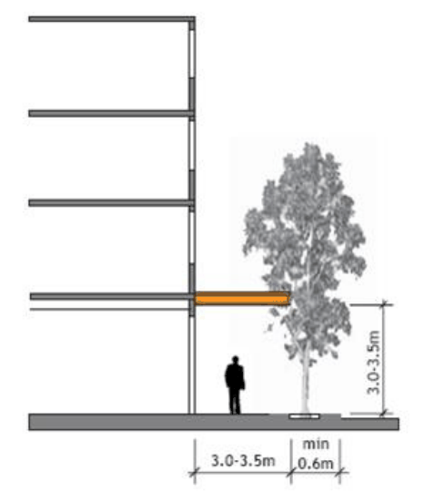

#### 4.2.6.6 Awnings

#### OBJECTIVES

▪ To improve pedestrian amenity by providing sun and rain protection by the provision of continuous awnings or colonnades.

▪ Ensure that awnings are in keeping with the desired streetscape character and with the development in scale and design.

#### CONTROLS

a Awnings are required along all "active” street frontages (see Figures 4.2.17 - 4.2.19).

b Awning heights are to be between 3m and 3.5m except where integration with an adjoining properties awning requires variation in this case awning height must not be greater than 4.2m.

c Awnings and posts (where applicable) are to be setback a minimum of 600mm from the face of the kerb.

d Awnings should maximise protection from summer sunlight and should be of opaque materials rather than glazed in order to minimise the need for intensive maintenance.

e Awnings and balconies (where permitted above footpaths) should have vertical fascias that are at least 0.3m deep in order to support a continuous band of business signs.

f In Ettalong awnings should promote the heritage theme and provide character to the streetscape:

i Awnings are to be enhanced with posts, either structural or non-structural which reflect the heritage character of the streetscape and can be constructed with or without brick support piers with sandstone capping and associated heritage trim.

ii Awnings are to be either

- Bull nose

- Skillion

- Over vertical or under vertical

- Overhead gable

iii Where posts are structural supports, the awning is to be designed so that if anyone of the posts was damaged, removed or knocked out, the structure would still be supported by the remaining posts.

> [Picture on page 28: a picture, saved as a picture (images/ch-04-02-peninsula-centres-page-28-1.gif, 150 dpi).]

#### Figure 4.2.23 - Awning Height

Source: Residential Flat Design Code, Planning NSW 2002
