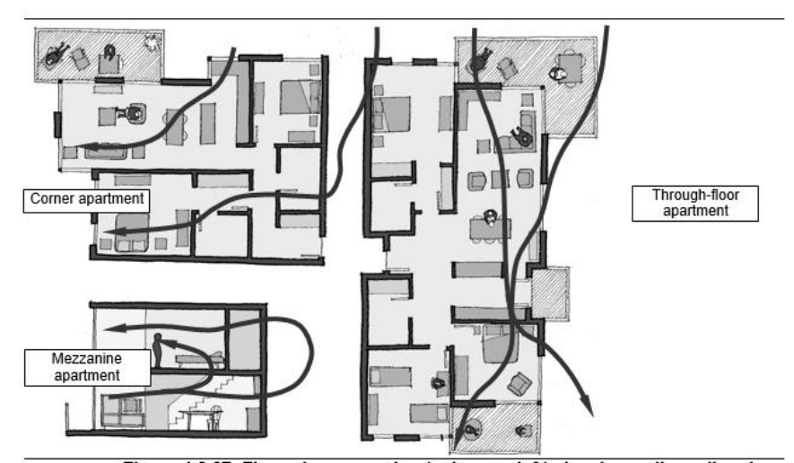

#### 4.2.7.4 Ventilation

#### OBJECTIVES

▪ To ensure that new developments provide high standards of residential amenity by ensuring all apartments provide all habitable rooms with direct access to fresh air.

▪ To provide natural ventilation to non-habitable rooms where possible.

▪ To reduce energy consumption by minimising the use of mechanical ventilation, particularly air conditioning.

▪ To provide workplaces with opportunities for natural ventilation.

#### CONTROLS

a At least 60% of proposed dwellings must have natural cross ventilation.

b At least 25% of all kitchens are to be naturally ventilated. All kitchens in a residential building shall not be located more than 8m from an external wall.

c All habitable rooms are to have operable windows or doors to the outside which open to at least 45% of the window or door area.

d Use the building layout and section to increase the potential for natural ventilation. Possible solutions include:

i Facilitating cross ventilation by designing narrow building depths and providing dual aspect apartments (cross-through and corner apartments);

ii Facilitating convective currents by designing units which draw cool air in at lower levels and allow warm air to escape at higher levels (e.g. Maisonette and two-storey apartments);

iii Dwellings should be planned with windows in two external walls to facilitate cross-ventilation, for example “corner” apartments and “through-floor” apartments;

iv Minimising interruptions in air flow through the apartment. The more corners or rooms airflow must negotiate, the less effective the natural ventilation;

v Grouping rooms with similar usage together, for example, keeping living spaces together and sleeping spaces together. This allows the apartment to be compartmentalised for efficient summer cooling or winter heating.

> [Picture on page 31: a picture, saved as a picture (images/ch-04-02-peninsula-centres-page-31-18.gif, 150 dpi).]

Figure 4.2.24: Floor plans and section (at bottom left) showing well-ventilated dwelling types e Select doors and operable windows to maximise natural ventilation opportunities established by the apartment layout. Design solutions include:

i Locating small windows on the windward side (facing the prevailing winds) and larger windows in the leeward side (away from the prevailing winds) of the building thereby utilising air pressure to draw air through the apartment;

ii Using higher level casement or sash windows, clerestory windows or operable fanlight windows including above internal doors -to facilitate convective currents. This is particularly important in apartments with only one aspect;

iii Select windows which the occupants can reconfigure to funnel breezes into the apartment, such as vertical louvered, casement windows and externally opening doors.

f In development for office or business uses at least 90% of all workspaces must be within 8m and direct line of sight of a perimeter window.

g Provide operable windows for 90% of the workspaces.
