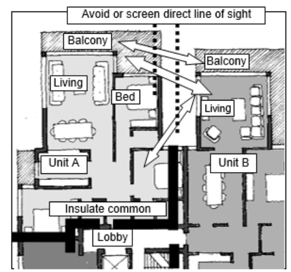

#### 4.2.7.5 Visual Privacy

#### OBJECTIVE

▪ To provide reasonable levels of visual privacy externally and internally during the day and night without compromising views and passive surveillance.

#### CONTROLS

a All development must comply with the Building Separation Controls in this chapter to ensure adequate visual privacy for building occupants.

b Neighbouring buildings and/or dwellings should have an appropriate orientation and an adequate separation in order to prevent unreasonable direct views into any dwelling.

c Buildings must be designed to provide privacy without compromising access to light and air. This can be achieved through design features:

i Off-setting windows of apartments in new development and windows in adjacent development;

ii Recessing balconies and/or vertical fins between adjacent balconies;

iii Using solid or semi-transparent balconies;

iv Using louvers or screen panels to windows and/or balconies;

v Providing vegetation as a screen between spaces;

vi Incorporating planter boxes into walls or balustrades to increase visual separation between areas;

vii Utilising pergolas or shading devices to limit overlooking of lower apartments or common and private open space.

d Transparent balustrades are to be avoided.

> [Picture on page 33: a picture, saved as a picture (images/ch-04-02-peninsula-centres-page-33-1.gif, 150 dpi).]

#### Figure 4.2.25: Privacy considerations for neighbouring dwellings
