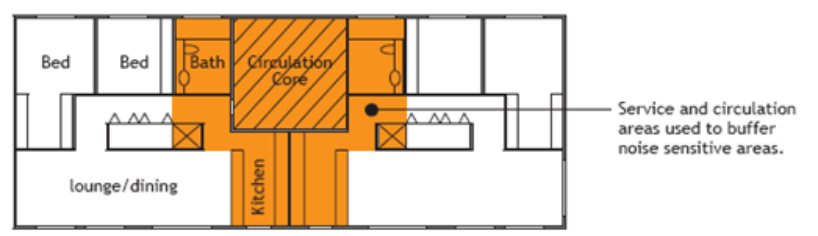

#### 4.2.7.6 Acoustic Privacy

#### OBJECTIVES

▪ To ensure that new development provides high standards of residential amenity by ensuring acoustic privacy for all occupants of the development.

▪ To ensure that residential apartments adjoining main roads, and other noise generating areas are designed and constructed to minimise the impact of external noise.

#### CONTROLS

a All developments must comply with the Building Separation controls in this chapter to ensure adequate acoustic privacy for building occupants.

b All developments are to meet or exceed the sound insulation provisions and standards of the Building Code of Australia (BCA).

c Buildings shall be designed to minimise the impact of traffic or railway noise with careful planning, design construction and materials in accordance with the relevant Australian Standard.

d Dwellings should be designed to minimise noise transition by, but not limited to:

i Grouping uses according to the noise level generated;

ii Using storage or circulation zones within an apartment to buffer noise from adjacent apartments, mechanical equipment or corridors and lobby areas, minimising the amount of shared walls with other apartments;

iii Using service areas/corridors to buffer noise sensitive areas such as bedrooms from noise generators including traffic, railway line, service and loading vehicle entries;

iv Incorporating appropriate noise shielding or attenuation techniques into the design and construction of the building.

e Mechanical plant should be located away from habitable rooms unless acoustically-insulated according to the applicable standards.

f Premises operating after hours (such as cafes, restaurants, entertainment facilities and the like) are to be designed to minimise the impacts of noise, associated with late night operation on nearby residents.

> [Picture on page 34: a picture, saved as a picture (images/ch-04-02-peninsula-centres-page-34-4.gif, 150 dpi).]

#### Figure 4.2.26 - Group Service and Circulation Areas for Acoustic Privacy

Source: Residential Flat Design Code, Planning NSW 2002
