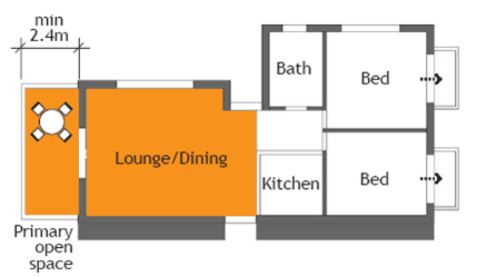

#### 4.2.7.7 Private Open Space

#### OBJECTIVES

▪ Ensure that private open space is functional, responsive to the environment promoting the enjoyment of outdoor living for apartment residents.

▪ Ensure that private open space (balconies, decks, terraces) are integrated into the overall design of development.

▪ Balcony design should allow views and casual surveillance of the street while providing for safety and visual privacy.

#### CONTROLS

a For each dwelling with a private entrance at ground level, provide open space as landscaped garden courtyards or terraces:

i At least 50m2 including one area which may include a verandah or terrace that sits above a basement carpark;

ii Measuring at least 5m x 5m to accommodate a variety of activities as well as landscaping that includes at least shrubs and at least one tree;

iii The minimum dimension for any private courtyard is 3.5m.

b Private open space (outdoor) for ground and podium level apartments should be differentiated from common areas by:

i a change in level and/or;

ii screen planting, such as hedges and low shrubs; and/or

iii up to 1.2m solid wall with at least 30% transparent component above and gate to common open space.

c For all units not at ground/podium level private open space should be provided as terraces or balconies with a minimum area of:

i 8m2 for each one bedroom unit (as a single space);

ii 12m2 for each two bedroom unit (as one or more spaces);

iii 16m2 for each unit with three or more bedrooms (as one or more spaces);

iv including one area measuring at least 2.5m x 2.5m which can comfortably accommodate an outdoor table setting or seating.

d The primary open space should be directly accessible from the main living area.

e Balcony or terrace design shall incorporate building elements such as pergolas, sun screens, shutters, operable walls and the like to respond to the street context, building orientation and residential amenity.

> [Picture on page 35: a picture, saved as a picture (images/ch-04-02-peninsula-centres-page-35-9.gif, 150 dpi).]

#### Figure 4.2.27 - Primary Open Space adjacent to Primary Living Area –

Source: Residential Flat Design Code, Planning NSW 2002
