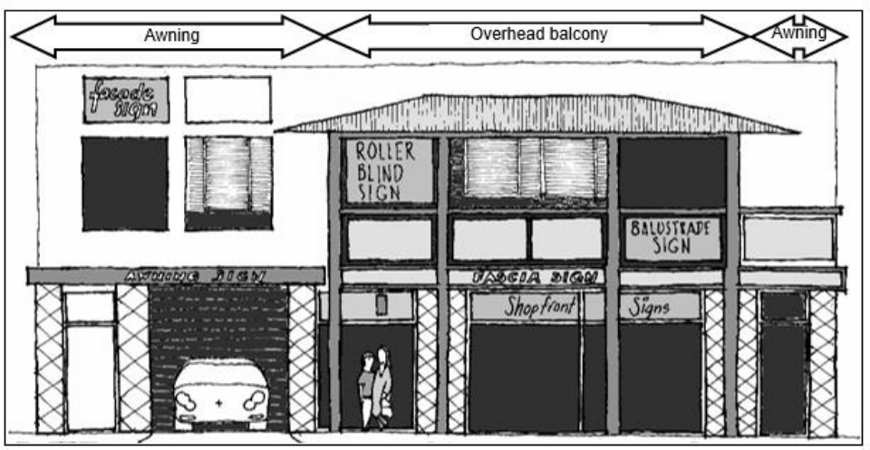

#### 4.2.10 ADVERTISING AND SIGNAGE

#### OBJECTIVES

▪ Ensure that signage and advertising enhances the visual quality of the streetscape.

▪ Ensure that signage and advertising are integrated with the building design by responding to scale, proportions and architectural detailing.

▪ Ensure that signage and advertising communicates effectively and contributes to the character of the public domain.

#### CONTROLS

a Commercial signage should be co-ordinated and limited in size and number to promote the identity of each centre rather than emphasising corporate sponsorship.

b Business signs for ground floor tenancies should be limited in number and location:

i Above roof or above-awning signs are not permitted,

ii Awning fascia signs should be limited to one per tenancy not taller than 0.3 metres,

iii Under-awning signs should be limited to one per tenancy, a maximum of 2 metres wide and 0.6 metres high, either painted murals or internally illuminated,

iv Shopfront signs should be limited to the upper panel of the shopfront window, and either painted onto the glass, a mural or collage, or internally illuminated,

v Generally, signs should not be applied to the lower panel of any shop-front window, with the exception of illuminated signs that are located inside the glass-line.

c Business signs for above-ground tenancies should be integrated with the architectural forms or features of each building, and should be limited in number:

i Above-awning signs and signs projecting from the face of buildings should not be permitted.

ii Wall or window signs should not exceed more than two per tenancy, each not more than 2 metres high by 1 metre wide, and either fitted within window openings or in locations that are compatible with the shape of the façade or with the pattern of window openings.

iii Awning fascia signs should be limited to one sign per tenancy not taller than 0.3 meters.

iv Under-awning signs should be limited to one per tenancy, a maximum of 2 metres wide and 0.6 metres high, either painted murals or internally illuminated.

d Within Ettalong Beach Village Centre external signage is to be in heritage colours. An example of heritage colours is the Heritage and Traditional Colours range by Pascol Paints Australia Pty Ltd.

> [Picture on page 40: a picture, saved as a picture (images/ch-04-02-peninsula-centres-page-40-24.gif, 150 dpi).]

#### Figure 4.2.28: Street facade with awnings, balconies and integrated signs
