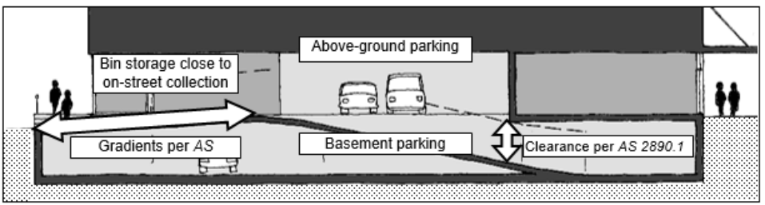

#### 4.2.11 VEHICLE ACCESS & CAR PARKING

#### OBJECTIVES

▪ Ensure that vehicle and service entrances are designed to facilitate active street frontages, pedestrian amenity and safety.

▪ Provide adequate and accessible service areas and loading facilities.

▪ Provide adequate car parking for the buildings users and visitors.

▪ Ensure that the location and design of car parking is integrated with the design of the site and building design.

#### CONTROLS

a Parking should be provided at the rates set out by the Transport and Parking Chapter of this DCP.

b On site parking should provide at least one space per dwelling, plus one space per retail or business tenancy.

c The balance of spaces required by the Transport and Parking Chapter of this DCP may be accommodated in Council’s public facility, subject to a monetary contribution set by Council’s adopted Contributions Plan.

d Parking areas, driveways and ramps must be designed according to the applicable Australian Strandard AS 2890.1:

i Ramps must not be steeper than 1:20 within 6 metres of a street or laneway boundary to protect pedestrian safety,

ii Ramps must not exceed specified maximum gradients and must incorporate transitional gradients to prevent vehicle damage,

iii Minimum headroom requirements must be satisfied along all ramps, driveways and bays,

iv Preferred ramp widths should conform with the requirements of the Active Street and Laneway Frontages section of this Chapter.

e Conceal off street parking behind shops or apartments.

f Provide unobtrusive vehicle entrances from laneways or secondary streets to minimise the disruption of shopfronts and pedestrian activity.

g Basement car parking shall not project above finished ground level along primary or active laneway frontages.

h On primary or active laneway frontages multi storey car parks must contain retail, commercial or other active uses.

i Grilles or other appropriate screening devices are required to the upper floors of multi-storey car park fronting the street, active laneway or adjoining residential to minimise visual and amenity impacts.

j In flood prone areas in Woy Woy, parking shall have a ramp threshold of RL 1.95 metres and parking areas shall be waterproofed and provided with arrangements protecting flood to the threshold level.

> [Picture on page 42: a picture, saved as a picture (images/ch-04-02-peninsula-centres-page-42-1.gif, 150 dpi).]

#### Figure 4.2.29: Cross-section illustrating vehicle and service access

k Developments that contain dwellings should provide for short-term parking of furniture removalists vehicles:

i Where on-street loading-zones are located in proximity to the site and with direct access to the proposed residential lobby: no off-street provision is required,

ii For sites facing main streets that have rear-lane access only: on-site space should be provided for a small delivery vehicle in a location that does not obstruct access to parking areas

l Developments that accommodate non-residential floorspace should provide delivery areas in proportion to the scale and intensity of retail and business uses:

i Where the area of each defined retail or business tenancy does not exceed 100m2: Deliveries may be made “across-the-kerb” from designated loading zones,

ii For sites facing the any proposed pedestrian mall deliveries may be permitted via the pedestrian mall within restricted hours that are defined by Council,

iii Where the area of any retail or business tenancy exceeds 100m2 one dedicated delivery space should be provided on-site, located and designed according to the Transport and Parking section of this DCP.
