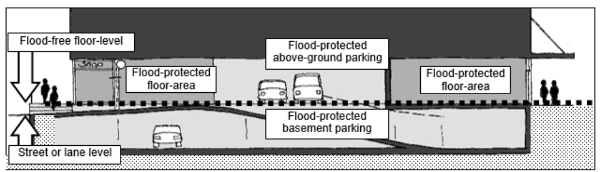

#### 4.2.12.2 Flood prone Properties and Stormwater Management

#### OBJECTIVES

▪ Address the requirements of State planning instruments together with Council’s controls and policies with regard to safety, conservation of natural resources plus the control and minimisation of waste.

▪ In areas that are subject to recognised environmental hazards, prevent development that is not planned or constructed appropriately.

▪ Prevent the discharge of contaminated stormwater from each property.

#### CONTROLS

a On properties that are defined as flood prone, development must be planned and constructed according to the State Government’s “Floodplain Development Manual” plus the Water Cycle Management chapter of this DCP.

i Council’s Section 10.7 Certificates indicate properties that have been identified as flood prone.

ii For flood prone properties within the Woy Woy town centre, Council has defined 1% AEP flood level.

iii On flood prone properties, new building works must be designed to protect structures, people and personal possessions from flood hazard and damage.

iv New building works and basements must not increase the level or the severity of flood impacts for any other property that is located within the surrounding drainage catchment.

b Building works on flood prone properties must be designed to prevent the entry of floodwaters:

i The lowest occupied floor must be elevated 0.5 metres above the 1% AEP flood level that has been defined by Council.

ii Parking areas must incorporate ramps that rise from the level of the street or laneway frontage to prevent the entry of flood-waters.

> [Picture on page 44: a picture, saved as a picture (images/ch-04-02-peninsula-centres-page-44-12.gif, 150 dpi).]

#### Figure 4.2.30: Cross-section illustrating flood protection measures

c Car parking and delivery areas should be fitted with interceptor traps to collect petroleum and metal wastes deposited by vehicles onto driveways and floors to prevent the discharge of contaminated water from a site.

d Stormwater collected during peak storm events should be detained on-site:

i Detention systems should be provided to protect the trunk drainage network from overloading,

ii Development applications should provide preliminary details of proposed detention systems, including their capacity to accommodate peak storm events, dimensions and location to facilitate gravity discharge to the trunk network,

iii Final details of the detention system, including maintenance requirements, should be provided with Construction Certificate applications.
