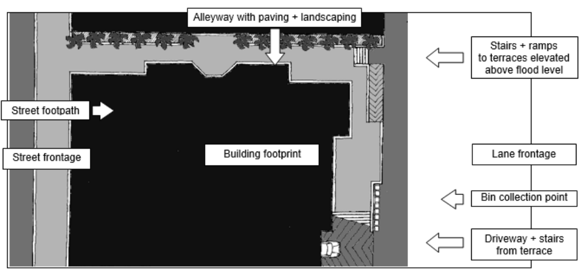

#### 4.2.13 CENTRE IMPROVEMENTS

#### OBJECTIVE

▪ Ensure that new development contributes to centre improvements that form part of Council's adopted Master Plan.

#### CONTROLS

a Street footpaths should be reconstructed along the full frontage of each development site according to Council's adopted Master Plan for street improvements.

b Footpath construction should incorporate the materials, construction techniques and specifications that form part of the adopted improvements program:

i Footpaths must be constructed of pavers laid over a structural base that incorporates service conduits, as specified by the adopted scope of works,

ii Along each building frontage and street kerb, footpaths must be finished to specified levels with select unit pavers that are surrounded by header courses,

iii Provision must be made for future installation by Council’s contractor of street furniture and lighting in the locations designated by the Master Plan.

c Publicly-accessible areas within development sites should employ materials and specifications that are identical to the adopted improvements Master Plan:

i Paved areas such as alleyways, courtyards and terraces should be surfaced with unit pavers and headers around all building facades and at any changes in level,

ii Kerb crossings and vehicle entrances up to the face of any security shutter should be surfaced with contrasting interlocking pavers,

iii Any changes in level or grade should be marked by tactile indicators.

d Lighting of publicly-accessible areas should meet Australian Standard and BCA requirements and the standard and design of light fittings should be compatible with the adopted improvements Master Plan.

e Canopy trees should be provided along alleyways, terraces facing laneways and in open courtyards:

i Trees should be provided at the rate of at least one per 10 lineal metres,

ii Species should be consistent with the adopted improvements Master Plan,

iii Planter boxes should be sized, water-proofed, drained, filled and irrigated according to requirements of the species accommodated and to any applicable standards.

f Utilities and utility cabinets should be integrated with the design of publicly-accessible area:

i Services should be located underground wherever possible,

ii Above-ground cabinets should be located away from the principal pedestrian pathways and designed to minimise their visual impact.

> [Picture on page 47: a picture, saved as a picture (images/ch-04-02-peninsula-centres-page-47-7.gif, 150 dpi).]

Figure 4.2.31: Site plan highlighting areas that should be landscaped Plan illustrates a typical property between Main Street and Lane
