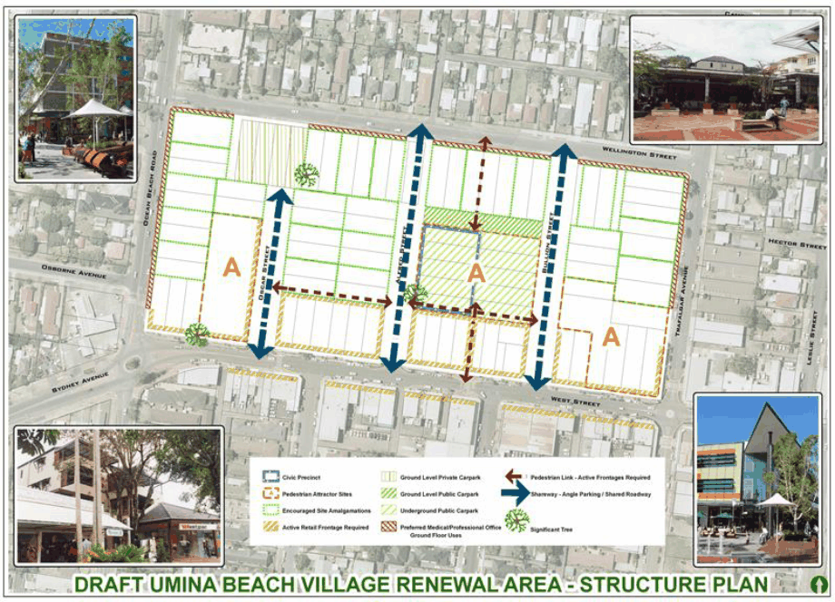

#### 4.2.14.1 Detailed Planning Provisions

Although there is flexibility in the application of the structure plan to development proposals, there are a number of detailed provisions that need to be incorporated into the DCP. These are outlined below;

#### OBJECTIVE

To ensure that the pedestrian links are provided in a location that offer the most direct and safest route between the activity nodes of supermarkets and possible Civic area.

#### CONTROL:

a The public and urban design benefit for either Lot 22 DP 8872 Oscar Street and Lot 33 DP 8872 Alfred Street Umina provided in return for the bonus height as contained in Clause 4.3A of the Central Coast LEP 2022 is to consist of a 3m wide alleyway. The location of the alleyway is shown on the structure plan. This alleyway is to be dedicated to Council as part of a development application for a building proposed in accordance with the Central Coast LEP 2022.

#### OBJECTIVE:

To ensure that an existing alleyway is maintained in its current location to provide direct access between possible Civic area and the pedestrian crossing opposite the alleyway in West Street.

#### CONTROL:

a The public and urban design benefit for either Lot 1 or Lot 2 DP 537967 West Street Umina provided in return for the bonus height as contained in Clause 4.3A of the Central Coast LEP 2022 is to consist of the existing alleyway located between the two properties. The location of the alleyway is shown on

the structure plan. This alleyway is to be dedicated to Council as part of a development application for a building proposed in accordance with the Central Coast LEP 2022.

> [Picture on page 51: a picture, saved as a picture (images/ch-04-02-peninsula-centres-page-51-3.gif, 150 dpi).]

#### Figure 4.2.32 - Umina Beach Extension Area Structure Plan
