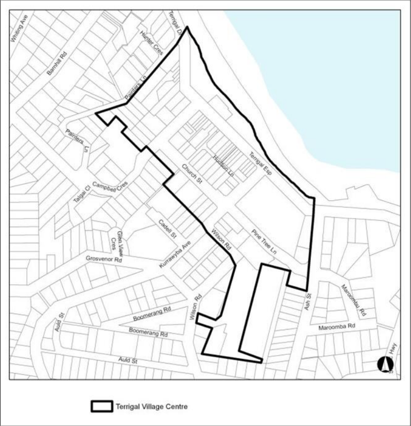
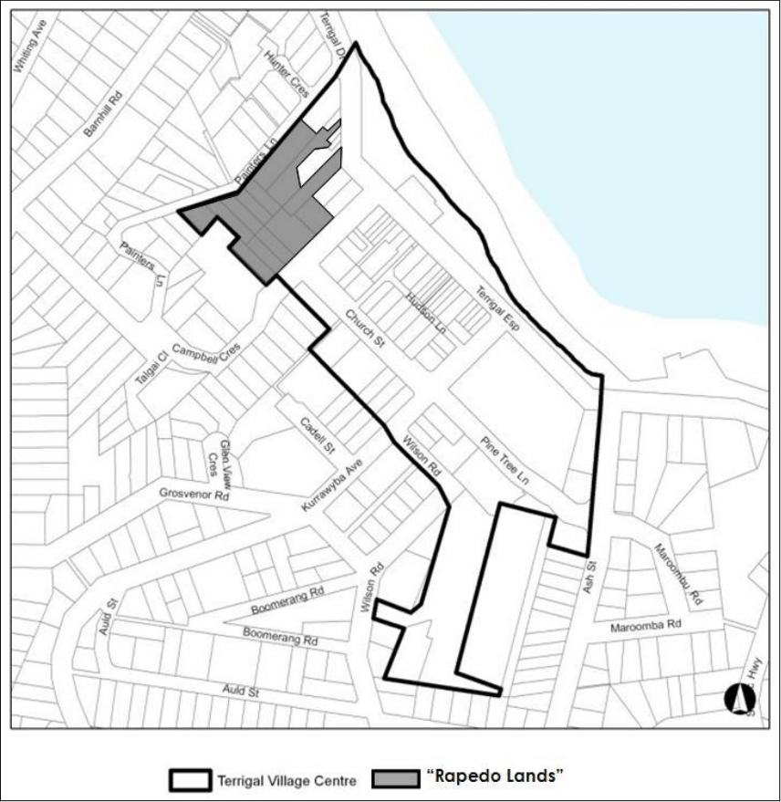

### 4.3 TERRIGAL VILLAGE CENTRE

#### 4.3.1 WHERE THIS CHAPTER APPLIES

This chapter applies to all development that requires consent, including alterations and additions to existing structures on properties within the Zones B2 & SP2 shown on the map below.

> [Picture on page 1: a picture, saved as a picture (images/ch-04-03-terrigal-village-centre-page-1-5.gif, 150 dpi).]

#### Figure 4.3.1 –Terrigal Village Centre

Clauses 4.3.5.2a-c, 4.3.6.2a & 4.3.6.4a do not apply to land within the Terrigal Village Centre known as the "Rapedo Lands" as outlined in Figure 4.3.2 (below) as this land is subject to separate height and FSR controls under Central Coast Local Environmental Plan (LEP) 2022 as a result of a site specific rezoning gazetted on the 4 July 2003.

> [Picture on page 2: a picture, saved as a picture (images/ch-04-03-terrigal-village-centre-page-2-1.gif, 150 dpi).]

#### Figure 4.3.2 – Terrigal Village Centre Map showing excluded Rapedo Lands
