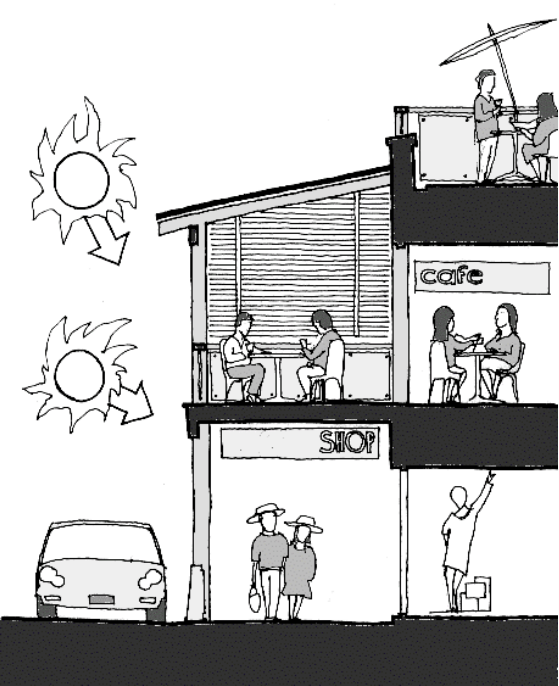
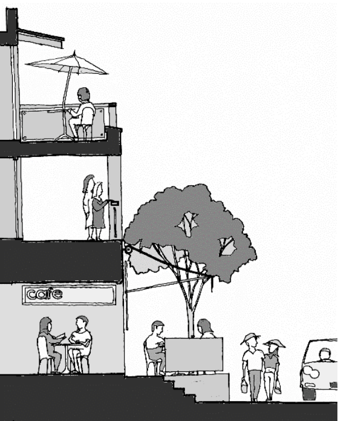
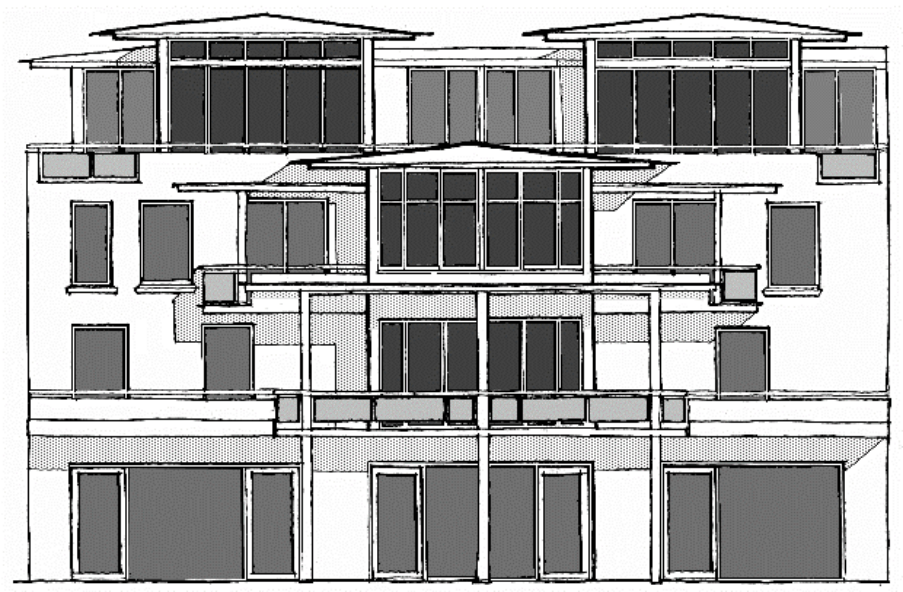

#### 4.3.4 DESIRED CHARACTER AND SCENIC QUALITY

#### 4.3.4.1 Objectives

▪ Define fundamental features of the desired design character and design quality for both public places and buildings

▪ Recognise the importance of relationships between land use, the levels of pedestrian and business activity, the size and the design of buildings

▪ Encourage modestly-scaled buildings that would not dominate the scenic qualities of a foreshore setting

▪ Promote architectural identity for this village centre that is regionally-distinctive

#### 4.3.4.2 Controls - Desired character of the public domain

a All streets and laneways should support high levels of pedestrian activity

i Visible retail activity should be maximised along all frontages, except Painters Lane (see 4.3.4.2e below)

ii Existing levels of sunlight during the middle of the day should be protected

iii The design of public pavements should be consistent with the Terrigal Foreshore Improvements Landscape Masterplan Report and Associated Documents that has been adopted by Council. Refer to Council's Construction Operations Department for details

iv The design of publicly-accessible areas on private properties should be consistent or compatible with the adopted Terrigal Foreshore Improvements Landscape Masterplan Report and Associated Documents

v The design of shop-fronts and business signs should be co-ordinated

b All streets should achieve the following role and design standards

i Remain the primary retail frontages and pedestrian routes

ii Incorporate awnings or balconies that provide continuous shelter and shade along all shopfronts

iii Provide the street improvements specified by the adopted Terrigal Foreshore Improvements Landscape Masterplan Report and Associated Documents

c Painters Lane should achieve the following role and design standards

i Remain residential in character with traditional residential street address

ii Retain existing informal leafy character whilst providing improved amenity and urban design

d Other public laneways should achieve the following roles and design standards

i Secondary retail frontages that expand the diversity and extent of existing shops and street-level businesses

ii A safe balance between service access to buildings and secondary pedestrian routes

iii Enhanced environmental amenity achieved by buildings that are setback behind pedestrian terraces

iv Pedestrian terraces incorporate landscaping that is consistent or compatible with street improvements specified by the adopted Terrigal Foreshore Improvements Landscape Masterplan Report and Associated Documents

> [Picture on page 5: a picture, saved as a picture (images/ch-04-03-terrigal-village-centre-page-5-1.gif, 150 dpi).]

Figure 4.3.3: Street frontage activity - The principal setting for a vibrant Village centre

> [Picture on page 5: a picture, saved as a picture (images/ch-04-03-terrigal-village-centre-page-5-3.gif, 150 dpi).]

#### Figure 4.3.4: Laneways - A secondary setting shared by pedestrians and cars

#### 4.3.4.3 Controls - Desired character of buildings

a Maximise benefits to the resident community as well as visitors to the Central Coast by encouraging redevelopment

i Accommodate a diverse range of shops, businesses and community activities at street level and first floor level

ii Locate residential flats above street level

b Provide a backdrop that is appropriate to the scenic quality of this coastal setting

i Limit overall height to maintain existing street-level amenity and to prevent unreasonable obstruction of coastal and ocean views that are available from surrounding residential hillsides

ii Vary the profile and silhouette of buildings within a framework set by height and building envelope controls

iii Design exterior walls and roofs in response to all-around visibility from foreshores, street-level and surrounding hillsides, incorporating well-articulated building forms that cast a variety of shadows

iv Enhance the current appearance of laneway frontages by establishing a new secondary retail frontage that stimulates pedestrian activity and conceals service areas plus on-site car parking

c Maintain positive aspects of the established village character

i Enhance the level and the diversity of existing retail activity at street-level

ii Promote the pedestrian-friendly scale that has been created by existing buildings with two storey “street walls” along each street

iii Protect existing levels of sunlight during the middle of the day along north- and west-facing footpaths

iv Promote an overall diversity of building designs along each street block, with forms varied to reflect the existing allotment pattern

d Disguise the scale and bulk of new buildings, and promote an architectural identity for this centre that is regionally-distinctive

i Exterior walls and roofs should be well articulated, creating faceted forms that cast a variety of strong shadows

ii As exterior walls rise above the two storey “street-wall”, they should be stepped back from their street or laneway frontage

iii The top-most storey should be constructed as a framed structure, setback from the face of lower storeys and capped by pitched roofs with wide eaves, surrounded by a mix of terraces and roofs, and

iv Exterior walls facing public places should be partially screened by framed balcony and verandah structures, wide roof overhangs and exterior sunscreens that reflect a light-weight character

e Provide an appropriate interface to the surrounding residential zone

i Buildings should be surrounded by landscaped gardens along common boundaries with residential properties

ii The height and scale of buildings should reflect the lower rise form of residential surroundings where traditional coastal cottages display a light-weight design character

f Ensure that vehicle access and building services are integrated with the desired village character

i Parking areas and delivery docks should not interrupt the continuity of primary retail frontages, and should be concealed substantially behind shopfront floor space

ii Services should be concealed within the exterior envelope of buildings or consistent with the standard of architectural detailing

> [Picture on page 7: a picture, saved as a picture (images/ch-04-03-terrigal-village-centre-page-7-8.gif, 150 dpi).]

Figure 4.3.5: Street elevation illustrating desired character of buildings Note: Any fifth storey or greater should be divided into pavilion structures that are separated by terraces or roofs
