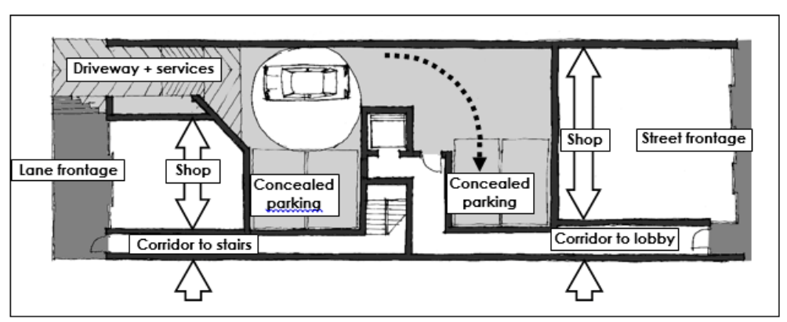

#### 4.3.5 STREET FRONTAGE

#### 4.3.5.1 Objectives

▪ Incorporate best-practice urban design by ensuring that street frontages are wide enough to conceal car parking and delivery areas behind street level shopfronts

▪ Ensure that street frontages are sufficient to accommodate building services and corridor access for above-ground storeys

▪ Ensure that street frontages are sufficient to accommodate residential floorplans which provide a reasonable level of amenity

▪ Encourage consolidation of existing properties that have narrow frontages in order to facilitate efficient use of land

#### 4.3.5.2 Controls - Wider frontages for development bonus

a Where street frontages are wider than the specified minimum, Central Coast LEP 2022 provides for bonus building height.

b For the purposes of Clauses 4.3, 4.3B, 4.4 and 4.4B in Central Coast LEP 2022 and this clause, "street frontage" refers to a street frontage nominated on the Height of Buildings and Floor Space Ratio Maps in Central Coast LEP 2022. Where more than one frontage is nominated on the map the applicant may select the frontage to which this clause applies.

c The minimum street frontage for bonus height has been fixed to accommodate active street frontages plus building services:

i Nearly-continuous bands of shopfronts along all streets

ii Shopfronts along at least half of any laneway frontage

iii Ramp access to basement parking and delivery areas

iv Corridors to lift lobbies and stairs

v Cupboards for building services and / or garbage stores

d Clause 4.3.5.2 a, b and c do not apply to land known as the "Rapedo Lands" outlined in Figure 4.3.2.

> [Picture on page 8: a picture, saved as a picture (images/ch-04-03-terrigal-village-centre-page-8-13.gif, 150 dpi).]

Figure 4.3.6: Site plan illustrating the minimum frontage allotment- A typical allotment fronting Terrigal Esplanade and Hudson Lane (layout subject to appropriate details and dimensions)
