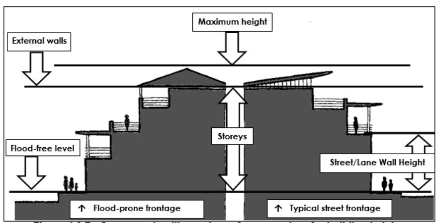
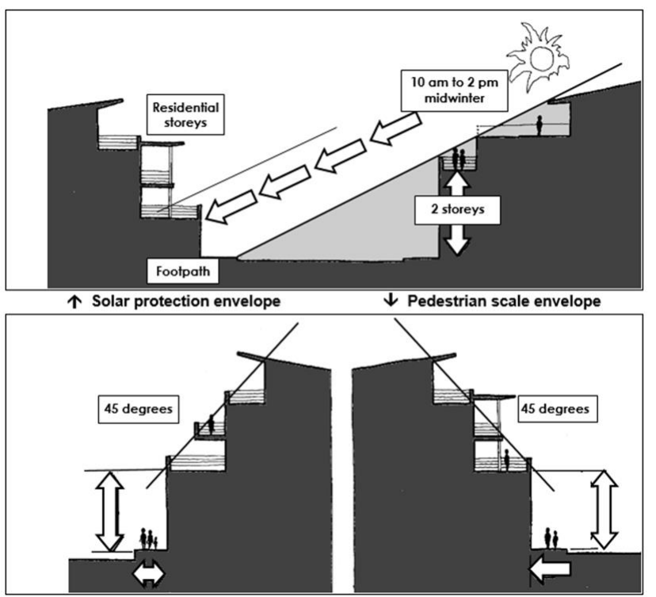
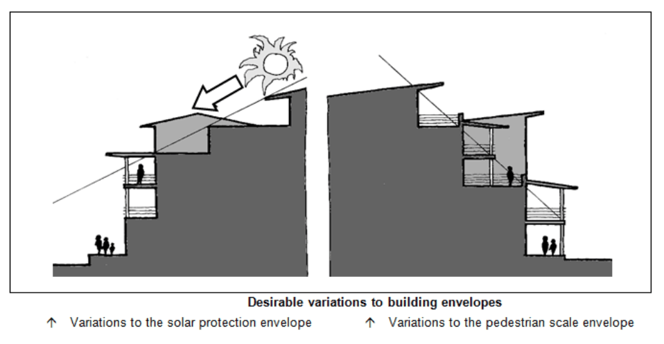

#### 4.3.6 HEIGHT FORM AND SCALE OF BUILDING

#### 4.3.6.1 Objectives

▪ Establish the primary controls to encourage financially-viable redevelopment that addresses scenic quality, character and residential amenity

▪ Limit both the visual impact of multi-storey buildings upon the scenic quality of this coastal setting, and the potential for obstruction of significant coastal and ocean views that are available from surrounding residential hillsides

▪ Vary the maximum building height for each development in proportion to the size and frontage of the development site.

▪ Maintain the established pedestrian-friendly scale of two storey facades facing all streets

▪ Promote a sunlit outdoor environment as the setting for a vibrant village centre, maintaining existing levels of sunlight along footpaths during the middle of the day

▪ Ensure that village centre dwellings will receive satisfactory levels of midwinter sunlight

▪ Encourage variations in building form that create a varied silhouette or profile, and that contribute to a regionally-distinctive architecture

#### 4.3.6.2 Controls - Maximum Heights

a New buildings and alterations or additions to existing buildings shall not exceed the maximum building height specified in Clause 4.3 and 4.3B of Central Coast LEP 2022.

b Where the maximum building height permitted under Central Coast LEP 2022  is indicated in Table 1, the additional provisions specified in the corresponding row in Table 1 apply:

| LEP Height control | Site frontage | Site Area | Max Height in Storeys | Max External Wall Height in 'm' | Max Street/Lane Wall Height in Storeys/m |
|---|---|---|---|---|---|
| Clause 4.3A | Less than 20m |  | 3 | 10 | 2 8.75m |
| RL on Height Map | 20m or greater | Less than 2000m2 | 4 | 12.75 | 2 8.75m |
| Clause 4.3A | 20m or greater | 2000m2 or greater | 5 | 15.5 | 2 8.75m |

#### Table 1

c Clause 4.3.6.2b and Table 1 above do not apply to land identified as "Rapedo Lands" on Figure 4.3.2.

d An 8.75m high and 2 storey façade will apply to all frontages of properties that have an interface with a street or laneway or common boundary with a residential zone.

e The measurement of maximum heights incorporate the following reference points:

i Maximum Height for the Building- Specified in Central Coast LEP 2022 refer to clause 4.3 and 4.3B;

ii External Wall - means walls that enclose a building, other than end walls above the pitching point of any inclined roof (such as a gable-end) or the sides to any attic's dormer window;

iii Storey - defined in Central Coast LEP 2022;

iv Street/Lane Wall Height - The vertical distance measured in metres or storeys at the centre of the street or laneway frontage from the average of the street/laneway levels at each end of the frontage to the parapet level of the frontage. The parapet level is the horizontal plane in which at least two thirds of the length of the top of the façade is situated.

v The highest point of any roof provides an absolute limit to the height of buildings, and is intended to encourage the use of gently-pitched roofs that contribute to desirable variations in the silhouette and the profile of each building, but not to accommodate an additional storey that is enclosed by taller walls or by steeply pitched roofs that would increase the desirable scale or bulk of a building.

> [Picture on page 10: a picture, saved as a picture (images/ch-04-03-terrigal-village-centre-page-10-13.gif, 150 dpi).]

#### Figure 4.3.7: Cross-section illustrating reference points for building heights

#### 4.3.6.3 Controls - Building envelopes

a Except as provided in Sections 4.3.6.3b  and  c, exterior walls and balconies should not extend beyond a building envelope that is projected from each street or laneway frontage as detailed the Precinct Controls section of this Chapter:

i Maintain the existing level of midwinter sunlight along public footpaths between at least the hours of 10am and 2pm by a building envelope that is projected at the appropriate solar altitude angle from the adjacent street kerb, and / or;

ii Provide satisfactory levels of midwinter sunlight for residential storeys (whether existing or future buildings on properties that have not yet been developed according to this Chapter) by a building envelope that is projected at the appropriate solar altitude angle from the first floor level of a facade facing Hudson Lane, and / or;

iii Maintain the pedestrian-friendly scale of existing low-rise buildings facing each street or laneway by a building envelope that is projected at 45 degrees from the façade at a point not higher than 7m above “street level”, or from the second storey floor, whichever is the lesser;

iv Note that awnings, eaves, balustrades and parapets may project beyond the pedestrian envelope, but generally should not project beyond the solar envelope unless glazed or substantially of transparent construction.

b Adjacent to any residential property, exterior walls should be stepped to maintain reasonable sunlight to the principal living area and private open space of each dwelling according to the requirements of BASIX.

c Minor variations of building envelopes are desirable in the following situations in order to avoid the appearance of continuous horizontal building forms:

i In general, variations are desirable at street corners where a vertical emphasis of landmark locations is appropriate, and to allow reasonable potential for the redevelopment of corner properties;

ii Also, variations are desirable on wide sites where vertical structures or balconies can provide effective contrasts to continuous horizontal forms with regular steps that might otherwise occur.

> [Picture on page 11: a picture, saved as a picture (images/ch-04-03-terrigal-village-centre-page-11-11.gif, 150 dpi).]

Figure 4.3.8: Building envelopes - Cross sections through street and laneway frontages

d The location and dimension of variations to the building envelopes should be limited:

i Any façade that penetrates a solar envelope should not be wider than 10m or taller than 4 storeys, and resulting shadows that are cast across a footpath or neighbouring façade should be relatively narrow and fast-moving;

ii Variations of a pedestrian envelope should not have a total width that is greater than 30% of any façade’s width, and no single variation should exceed a width of 10 metres or 4 storeys, except upon a corner property where variations will be assessed subject to conformity with objectives of Section 4.3.7.;

iii Variations may include enclosed floor space or roofed balconies that are constructed above public footpaths to accommodate outdoor dining.

> [Picture on page 12: a picture, saved as a picture (images/ch-04-03-terrigal-village-centre-page-12-3.gif, 150 dpi).]

#### Figure 4.3.9: Desirable variations to building envelopes

#### 4.3.6.4 Controls - Buildings Exceeding Four Storeys

a Maximum floor space for the fifth storey of any building in the Terrigal Village Centre is specified in clause 4.3B of Central Coast LEP 2022.

b Floors pace in any fifth storey or greater should be located behind the setbacks that are specified in this chapter in the sections Building Envelopes, Setbacks to side and rear boundaries, and Alleyways and Courtyards.

c Floor space in any fifth storey or greater should be distributed to disguise the scale and bulk of multi-storey buildings, as well as to minimise obstruction of significant coastal and ocean views that are available from surrounding residential hillsides:

i The maximum width of enclosed floor space should not exceed 50% of the primary street frontage to any site, and

ii Enclosed floor space should be distributed in separate pavilion structures that are not wider than 15 metres each, and are separated by not less than 10 metres from a neighbouring pavilion upon the same site.

d The form of any fifth storey or greater should be consistent with the “Architectural Character and Identity” section of this chapter.

e Clause 4.3.6.4a does not apply to lands known as the "Rapedo Lands" specified in Figure 4.3.2.

#### 4.3.6.5 Controls - Excavated storeys

a Excavations to accommodate residential or business floor space should only occur upon hillside sites

i Excavated floor space should only occur where it can be demonstrated that excavations would have no adverse flood-impacts either on-site or in the vicinity, and

ii No excavation may extend below “street level” except for plant rooms or basement parking, and

iii Excavated residential floor space may only occur where it can be demonstrated that proposed dwellings would receive satisfactory levels of daylight and outlook, sunlight, ventilation and privacy, according to Section 4.3.10 of this Chapter, and

iv Excavated residential floor space must not be more than one storey below existing ground level at any point

b On any site adjoining a residentially-zoned property, excavations should be designed to provide a landscaped buffer that is compatible with the desired garden character of hillside residential properties

i Facing a side or rear boundary, excavated garden courtyards should be suitable for the growth of medium-sized canopy trees

ii Garden courtyards should be at least 4 metres wide measured from the external wall of a building to the face of any retaining wall

iii Retaining walls should be terraced and should be landscaped to disguise their vertical scale together with the height of any associated boundary fence

#### 4.3.6.6 Related controls

a In order to determine siting and building forms that would be consistent with the objectives of this Chapter, Section 4.3.6 should be considered in conjunction with:

i Section 4.3.4: Desired character of buildings

ii Section 4.3.8: Architectural character and identity

iii Section 4.3.10: Residential amenity

iv Section 4.3.11.2: Flood-Prone Properties
