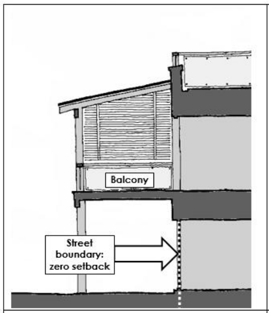
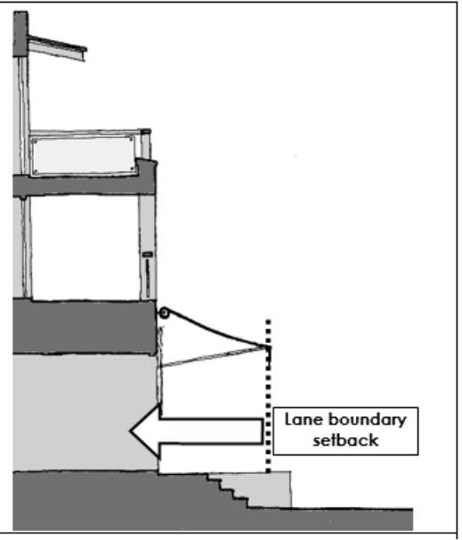
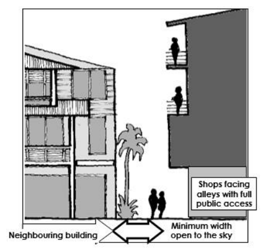
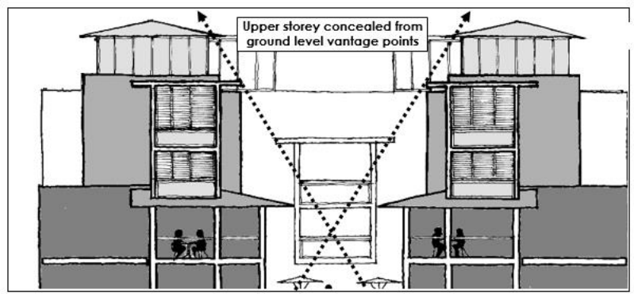

#### 4.3.7 SETBACKS SITING AND SCALE OF BUILDING

#### 4.3.7.1 Objectives

▪ Enhance existing levels of retail and pedestrian activity along street and laneway frontages

▪ Improve the amenity and the urban design quality of frontages to Hudson Lane

▪ Disguise the scale and bulk of new buildings

▪ Establish an appropriate interface with residential properties and Painters Lane that reflects the desired character of surrounding hillsides

▪ Achieve high standards of residential amenity

▪ To encourage shops along at least 50% of all frontages to Hudson Lane.

▪ To accommodate pedestrian forecourts or terraces facing Hudson Lane in association with all shopfronts that are suitable for outdoor dining.

#### 4.3.7.2 Controls - Street Setbacks

a The alignment of lower storeys should reinforce and enhance existing levels of retail and pedestrian activity

i Generally, facades should not be setback from the street frontage in order to maximise the visibility of shopfronts and to concentrate pedestrian activity along existing footpaths

ii In general, increased setbacks are only acceptable along street frontages that are subject to flooding, where ground level shopfronts may be setback up to 3m in order to accommodate flood-free pedestrian access along elevated terraces

iii Permissible encroachments include balconies constructed above public footpaths that are designed to accommodate outdoor dining

iv Permissible variations include café shopfronts at ground level only, setback from the street frontage to accommodate “outdoor” tables

#### 4.3.7.3 Controls - Laneway Setbacks

a Setbacks from Hudson Lane are as follows:

i Except in the cases of corner allotments facing either Kurrawyba Avenue or Church Street, the setback for any new building or addition to any existing building fronting Hudson Lane is to be at least 3m from the frontage to Hudson Lane.

ii Facades should be setback from the lane boundary to increase sunlight that is available at street level, improving environmental amenity, as well as stimulating pedestrian and retail activity

iii Setbacks should accommodate publicly-accessible spaces such as terraces or forecourts that are suitable for outdoor dining

> [Picture on page 14: a picture, saved as a picture (images/ch-04-03-terrigal-village-centre-page-14-19.gif, 150 dpi).]

Figure 4.3.10: Street front setback. Section illustrates lower storeys built to the boundary

> [Picture on page 15: a picture, saved as a picture (images/ch-04-03-terrigal-village-centre-page-15-1.gif, 150 dpi).]

#### Figure 4.3.11: Laneway setbacks. Section illustrates setback behind a terrace

b Setbacks to Painters Lane are as follows:

i Except for the case of the corner allotment facing The Esplanade the setback for any new building or addition to any existing building fronting Painters Lane is to transition from 3m at the boundary of Lot 3 DP 829025 and the land covered by SP 43573 to 6m at the boundary of Lot C DP 433631 and Lot B DP 433631 with an average of 4.5m.

#### 4.3.7.4 Controls - Setbacks to side and rear boundaries

a The alignment of lower storeys should maintain existing levels of retail and pedestrian activity:

i In order to maximise the length of shopfronts facing all streets and Hudson Lane, lower storeys generally should not be setback from the side boundary with any property that is zoned to permit business development

ii However, in order to provide publicly-accessible links such as alleyways or courtyards that are open to the sky above, lower storeys may be setback from side boundaries according to dimensions that are specified in Section 4.3.7.5

b Adjoining any residential building or a residential zone, new development should incorporate setbacks that are consistent with the desired residential character:

i Lower storeys should be setback at least 4 metres in order to provide a landscaped courtyard that is suitable for medium-sized trees

ii Subject to the location and orientation of any neighbouring dwelling, a wider setback may be necessary in order to achieve levels of residential amenity that are consistent with the Residential Amenity section of this Chapter

iii Upper-storeys should be stepped to maintain adequate sunlight to residential properties

iv Balconies may overhang the landscaped setbacks provided that the amenity of lower storey dwellings and neighbouring properties would not be affected, and provided also that balconies

would contribute to the desired urban design quality specified by Architectural Character and Identity section of this Chapter

#### 4.3.7.5 Controls - Alleyways and courtyards

a Alleyways or courtyards should be located and designed to provide strategic benefits:

i Existing levels of “main-street” retail and pedestrian activity must not be eroded, and

ii New public access should enhance the Village Centre’s existing pedestrian network, and

iii Settings for outdoor activity should demonstrate high levels of amenity that include reasonable levels of daylight and midwinter sunlight at street level, plus protection from cold winter winds, and

iv “Open spaces” should contribute to effective articulation of building forms, enhancing the overall level of variations that are displayed by structures along each street, and

v Above-ground open space contributes to high levels of residential amenity related to daylight, sunlight, ventilation and the outlook from each dwelling

b Alleyways generally should incorporate the following dimensions, locations and features:

i A minimum width of 3 metres, open to the sky above and sufficient for landscaped planters that are at least 1 metre wide with sufficient soil volume for canopy trees, and

ii Provide limited public access to residential lobbies, or

iii Alternatively, provide full public access between streets and lanes, with shopfronts along at least 30% of the overall length, and

iv Located immediately next to any existing alleyway or courtyard upon a neighbouring property, and

v Overlooked by windows and balconies that are designed to satisfy the Residential Amenity section of this Chapter

> [Picture on page 16: a picture, saved as a picture (images/ch-04-03-terrigal-village-centre-page-16-24.gif, 150 dpi).]

#### Figure 4.3.12: Accessible alleyways. Viewed from the street frontage

c Publicly Accessible Courtyards generally should incorporate the following dimensions, locations and features:

i Located only where they face a public street frontage that receives midday sunlight, and

ii Located no closer than 25 metres from an existing street corner where they would not erode either the role or the visual prominence of existing corner shop-fronts or building forms, and

iii Accommodating continuous shopfronts around a publicly-accessible space that is open to the sky above and is suitable for pavement dining, and

iv Minimising disruption to established shop-frontages as well as maximising both the visibility and the proximity of new shopfronts to existing public footpaths, with “street level” dimensions that generally should not exceed 8 metres to 10 metres (measured as site frontage and courtyard depth), and

v Overlooked by windows and balconies that are designed to satisfy the Residential Amenity section of this Chapter

d Around alleyways and courtyards that are publicly-accessible, walls should incorporate upper storey setbacks in order to enhance amenity at street-level:

i The third and fourth storeys should be setback at least 1m from the face of lower storey walls to avoid the appearance of sheer vertical walls

ii Any storey above the fourth storey should have an additional setback sufficient to conceal that storey from vantage points located within the alleyway or courtyard at “street level”

e Preferred locations for alleyways and courtyards are shown in the Precinct Control section of this Chapter

#### 4.3.7.6 Related controls

a In order to determine siting and building forms that would be consistent with the objectives of this Chapter, Section 4.3.7 should be considered in conjunction with:

i Section 4.3.4: Desired character

ii Section 4.3.8: Architectural character and identity

iii Section 4.3.10: Residential amenity

iv Section 4.3.11.2: Flood-prone properties

> [Picture on page 18: a picture, saved as a picture (images/ch-04-03-terrigal-village-centre-page-18-1.gif, 150 dpi).]

Figure 4.3.13: Street elevation of courtyard Highlighting desired dimensions at ground level and upper storey setbacks
