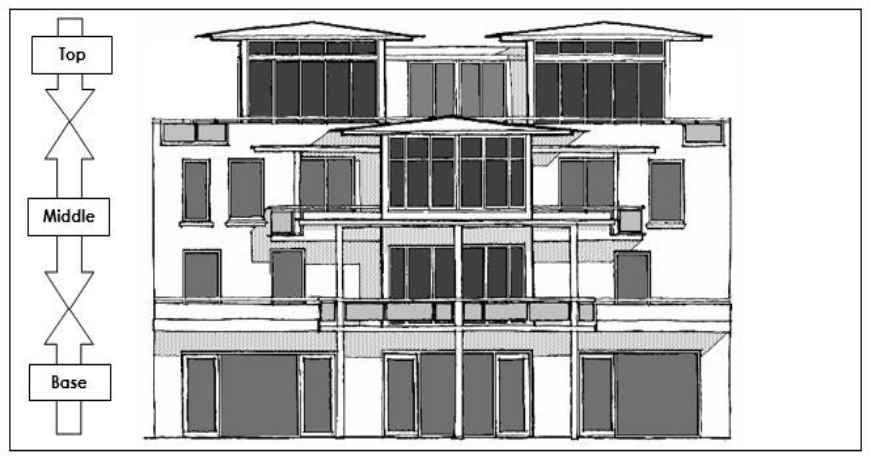
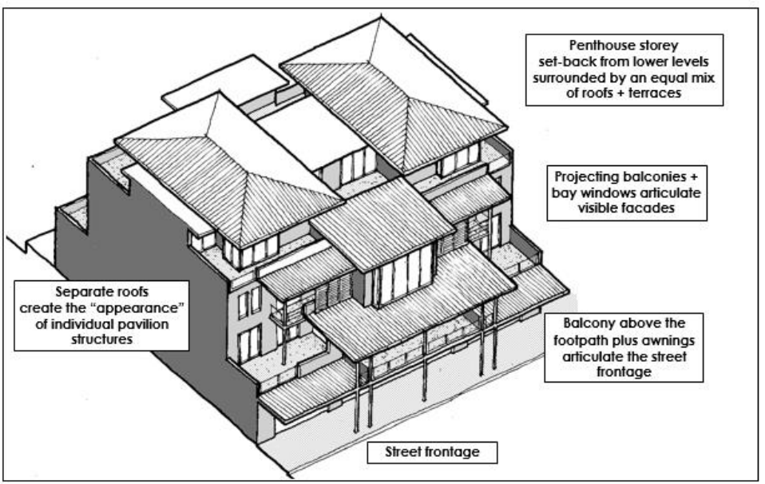
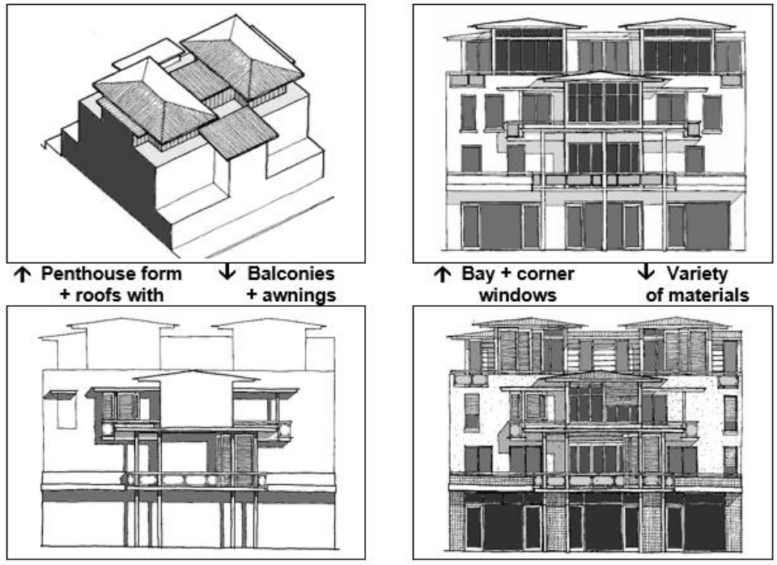

#### 4.3.8 ARCHITECTURAL CHARACTER AND IDENTITY

#### 4.3.8.1 Objectives

▪ Design all facades and roofs to address the all-around visibility of properties in this Village centre from street level as well as from surrounding residential hillsides

▪ Employ a variety of architectural design techniques that disguise the scale and the bulk of multi-storey buildings

▪ Promote the civic amenity and the regional identity of this village centre through high standards of architectural and urban design

#### 4.3.8.2 Controls - Building form

a The silhouette of each building should contribute to the overall diversity of form that is visible from nearby foreshores as well as from surrounding residential hillsides

i Within each façade, vary the level of roofs, external walls and parapets in order to avoid simple cubic forms and flat roofs that tend to accentuate scale and bulk

ii Each top storey should incorporate stepped floorplans or, for developments of five or more storeys, separate pavilion structures, capped by highly-articulated roof forms that contribute to the overall diversity of building silhouettes facing every street

b Facades facing each street or lane should be composed as three distinct layers that contribute to design diversity and disguise both the scale and bulk of multi-storey buildings:

i The “base” of each building includes the lowest storey, and may also include the first storey above street level

ii The “middle” of each building should accommodate at least one residential level, but not the upper-most storey

iii The “top” of each building should accommodate the “penthouse” residential storey

c Horizontal layering of buildings should be emphasised by setbacks and materials:

i The “base” should be set against street frontages or close to laneway frontages, and should display a solid appearance, for example “thick” masonry walls that are punctured by display windows

ii The “middle” should combine solid walls with a varied pattern of windows, partly screened behind balconies and generally set back from the face of the lower storeys

iii The “top” or penthouse level should have a very light appearance that is accentuated by walls that are setback from the storeys below, incorporating extensive window walls plus light cladding, and capped by framed roofs with wide eaves

> [Picture on page 19: a picture, saved as a picture (images/ch-04-03-terrigal-village-centre-page-19-10.gif, 150 dpi).]

Figure 4.3.14: Street elevation illustrating appropriate form of three and four storey buildings. Penthouse level on five storey or greater buildings should be broken into pavilion structures separated by roofs or terraces

d The form and design of facades that are visible from any street or lane should be articulated by distinct steps in plan and cross section:

i Facades should be divided into a series of vertical panels that vary in width from 2 metres to 6 metres, in order to reflect the design diversity of traditional village centres comprising rows of individually-designed narrow-fronted shop-dwellings

ii Vertical panels in each façade should be accentuated by stepped building forms and by projecting structures such as balconies or bay windows, casting a pattern of distinct shadows in order to disguise the scale and bulk of multi-storey buildings

iii Each vertical panel should also be highlighted by variations in materials and exterior finishes in order to prevent the appearance of monolithic or repetitive building forms

iv On wider sites, alleyways and courtyards should be used to divide buildings, creating the appearance of separate structures with a more-modest scale

e The form and design of roofs should address visibility from surrounding hillside properties:

i Roofs should be predominantly gently pitched and surrounded by wide eaves, rather than flat roofs set behind parapets that tend to accentuate the scale and bulk of multi storey buildings

ii Plant and mechanical services should be concealed or integrated with the design of roofs

iii Penthouse levels should be surrounded by an equal mix of roofs and terraces in order to disguise the scale and bulk of multi-storey buildings

#### 4.3.8.3 Architectural details and finishes

a All facades that are visible from surrounding streets or residential hillsides should display a consistent design standard

b Side and rear facades should match the design quality, degree of articulation and the standard of finishes that are desirable for front façades

> [Picture on page 20: a picture, saved as a picture (images/ch-04-03-terrigal-village-centre-page-20-8.gif, 150 dpi).]

Figure 4.3.15: The desired articulation of building forms illustrating steps in plan and cross-section

Diagram illustrates a three or four storey building. Any fifth storey or greater should be divided into separate pavilions.

#### 4.3.8.4 Light-weight features

a The architectural identity of this coastal village centre should be emphasised by light-weight design features that provide distinctive design contrasts with the underlying masonry form of each building

i Light-weight features should contribute to the design diversity of each visible facade, as well as screening and contrasting masonry building forms that tend to accentuate both the scale and bulk of multi-storey structures

ii Each building should incorporate a “penthouse” storey where framed pavilion-structures are setback from the face of lower storeys, capped by roofs that are gently-pitched with wide eaves contributing to the distinctive silhouette of each building, and

iii In general, exterior walls should be partly-screened by balconies, verandahs and pergolas that are framed of steel or timber to accentuate the degree of articulation that is necessary to avoid continuous cubic forms, as well as disguising the scale and bulk of multi-storey structures, and

iv Exterior walls should also incorporate wide bay or corner windows to disguise the scale of sheer vertical walls, particularly at any “outside” corners that would be visually-prominent from street-level, and

v A variety of moveable exterior screens and blinds should be fitted to windows and balconies to provide privacy and shade, as well as filtering the visibility of building forms and contributing to the diversity of design contrasts, and

vi Exterior materials and finishes should display an overall variety, including a proportion of sheet or board cladding plus painted finishes that accentuate the horizontal “layers” of each façade

vii Street-level facades may also incorporate open balconies that are set above the street footpath, designed to accommodate outdoor dining, and either cantilevered from the first storey or framed as a post-and-beam structure standing upon the footpath, providing design contrasts that are visually-prominent from street-level vantage points

> [Picture on page 21: a picture, saved as a picture (images/ch-04-03-terrigal-village-centre-page-21-10.gif, 150 dpi).]

Figure 4.3.16: Features that accentuate a “light-weight appearance." Diagrams illustrate three and four storey buildings – any fifth storey or greater should not extend across the full frontage
