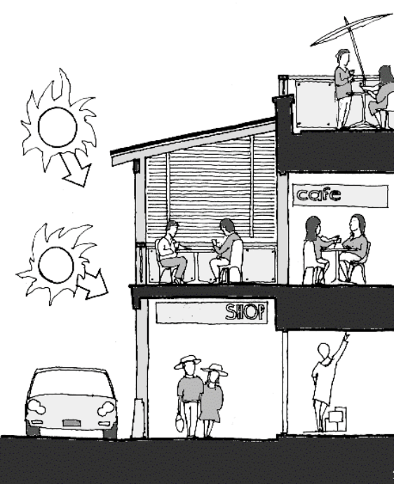
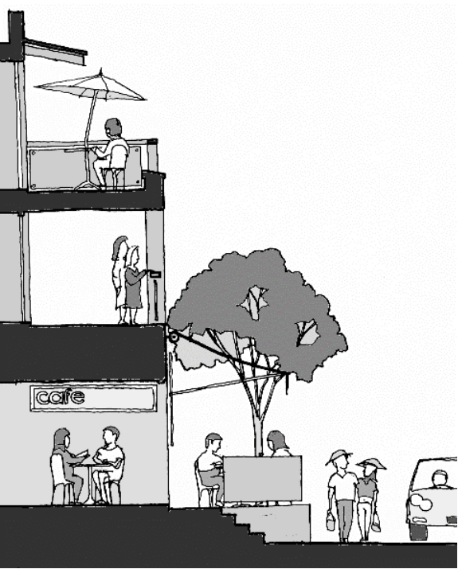
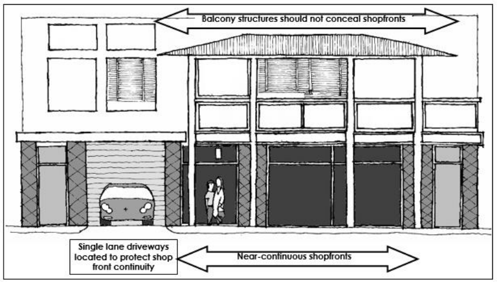
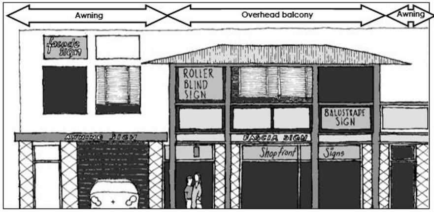
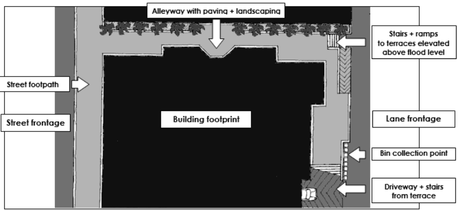

#### 4.3.9 STREET - LEVEL ACTIVITY AND CIVIC DESIGN

#### 4.3.9.1 Objectives

▪ Maintain and enhance the established “main street” retail environment, particularly by concentrating pedestrian activity along existing retail frontages

▪ Encourage a new secondary retail frontage along Hudson Lane in proportion to market demand for retail and business floor space

▪ Accommodate a mix of apartments plus businesses, including restaurants and community-related services, on the first floor above ground to maximise the range of services that are provided for residents and visitors

▪ Conceal on-site parking and services from street frontages

▪ Co-ordinate the design of shopfronts, business signs, and the landscaping of public areas according to “main street” principles

▪ Ensure that the landscaping and furnishing of public areas are consistent with Council’s adopted master plan for street improvements

#### 4.3.9.2 Controls - “Main Street” design principles

a “Main street” design principles that are appropriate to the scale of this village centre should be promoted to enhance existing levels of civic amenity and pedestrian activity, contributing to social and economic improvements:

i The outdoor environment and beachside location should be promoted as key features of this retail setting

ii A near-continuous ribbon of shopfront businesses should be maintained along all streets and extended along Hudson Lane

iii Pedestrian activity should be concentrated along existing footpaths

iv Areas that cater for lower intensity pedestrian activity should be located along the foreshore promenade, rather than as part of the established retail area

v New pedestrian spaces or links should only be created where they would enhance existing levels of retail and pedestrian activity

vi The design of shop-fronts and business signs should be co-ordinated

vii All outdoor pavements and street furniture should incorporate consistent designs and materials

#### 4.3.9.3 Controls - Street-level activity

a Along all street frontages, visible pedestrian and retail activity should be maximised:

i Facades should accommodate a near-continuous ribbon of shopfronts plus primary entrances to each building, and

ii Shopfronts and entrances should be protected by fixed awnings and weatherproof balconies that run for the full length of each street block, and

iii On-site car parking and service areas should not be visible from any street frontage, and should be located in basements or behind occupied floor space such as shops, and

iv Facades should not accommodate fire exits, service cupboards, vehicle or service entrances unless there are no feasible alternatives, for example where a property has a single street frontage

> [Picture on page 23: a picture, saved as a picture (images/ch-04-03-terrigal-village-centre-page-23-1.gif, 150 dpi).]

Figure 4.3.17: Activity along street frontages. A setting for concentrated retail and pedestrian activity b Along Hudson Lane, visible pedestrian and retail activity should be promoted at street level in conjunction with safe and efficient vehicle access:

i Facades should be set behind pedestrian forecourts that are open to the sky above, suitable for outdoor dining and separated from traffic, but should not be used for parking at-grade, and

ii Facades should accommodate new shopfronts along at least 50% of each site frontage, protected by retractable awnings or balconies, and

iii Facades also should accommodate building entrances, fire exits and service cupboards, plus vehicle and service entrances that are designed to maximise safety for pedestrians and motorists

c Above-ground facades also should contribute to the levels of visible activity:

i Footpaths may be overhung by first-floor balconies that are designed primarily to accommodate outdoor dining, and

ii Restaurants and other businesses at first floor level should have extensive windows that permit views to and from street level, and

iii Dwellings at first floor level or above should have a combination of balconies and extensive windows that permit views to and from the street, fitted with adjustable exterior screens to provide shade and privacy

> [Picture on page 24: a picture, saved as a picture (images/ch-04-03-terrigal-village-centre-page-24-1.gif, 150 dpi).]

Figure 4.3.18 Activity along Hudson Lane. A shared zone for pedestrian activity and vehicle access d Along Painters Lane facades should contribute to social interaction between residents and promote a safe residential environment by providing for surveillance in conjunction with safe and efficient vehicle access

i Provide sight lines from regularly occupied rooms and open spaces within each dwelling and the lane, and to semi public places within developments such as driveways and walkways

ii Facades should incorporate front doors, verandahs, balconies, terraces and courtyards and windows to regularly occupied rooms

#### 4.3.9.4 Controls - Publicly-accessible areas

a Publicly-accessible areas that erode the level of on-street activity are not compatible with “main-street” design principles, and should not be used in this village centre, for example:

i Indoor arcades or narrow dark alleyways that do not promote a high-amenity setting for outdoor pedestrian activity, or where shopfronts are concealed from the street restricting their commercial potential

ii Wide courtyards and piazzas, particularly at street-corner locations, that interrupt the continuity of existing shop-fronts along any street and disperse pedestrian activity away from existing footpaths

b Along Hudson Lane, publicly-accessible terraces or forecourts should be provided within the building setback:

i Paved areas should be suitable for outdoor dining, either elevated above the defined flood-contour to match indoor floor levels, or level with the laneway

c For properties that are defined as flood-prone, pedestrian access to shopfronts should be provided via arcades that are open to the street frontage:

i Facing streets, access may be either via open “arcades” that are set into the street façade and elevated above the flood level, or direct from street level to each shop and building entrance via individual stairs and ramps

ii Facing laneways, alleyways or courtyards, access may be via terraces that are open to the sky, either elevated above the flood level, or at street level with individual access to each shop and building entrance

iii All transitions from streets or laneways up to elevated indoor floors should incorporate barrier-free access that is suitable for people with impaired mobility, according to requirements of the Federal Disability Discrimination Act plus the relevant Australian Standard

iv Where elevated terraces or arcades are used, their finished level should be consistent with any existing structures upon neighbouring properties, and the location of stairs or ramps should provide direct access to all shop or business tenancies

v Vehicle entrances and ramps should be integrated with the level and alignment of forecourts, terraces or arcades to maximise pedestrian safety and avoid unsafe cross-falls or trip points

#### 4.3.9.5 Controls - Shopfronts and entrances

a The alignment and design of shopfronts should be co-ordinated according to “main street” principles that promote a commercially-unified appearance together with high levels of public amenity

i Shop-fronts should be aligned according to the setbacks that are specified by Section 4.3.7 of this Chapter, and

ii Each shopfront window should be divided into a lower panel that incorporates a display window extending approximately 2.7m above the finished interior floor level, and an upper panel that supports a continuous band of business signs beneath any overhead awning or balcony, and

iii Walls and any solid doors between shopfront windows should be finished in durable materials that facilitate routine cleaning and maintenance, as well as reflecting the design quality of Council’s adopted Master Plan for CBD pavement improvements

iv Shopfronts should not be concealed behind heavy colonnade structures that would restrict the visibility of any commercial tenant from the road, or limit natural daylight along footpaths

b Service and vehicle entrances should be integrated with the design quality and the commercial presentation of street-level facades

i Entrances should not disrupt the general continuity of shop-fronts or the commercial significance of corner locations, and should be at least 20 metres from a street corner or another entrance

ii Entrances should address road and pedestrian safety, particularly along footpaths and near crossings

iii The width of openings should be minimised, with driveways preferably limited to one-way passages not wider than 3.5 metres, supported where necessary by directional warning lights that are visible from cars approaching along the street, plus queuing space to enable vehicles to pass safely, and

iv Security shutters should be set at least 6 metres from a street or laneway frontage, and shutters, doors, plus wall and ceiling finishes within that setback should match the design standard of shopfronts and street facades, and

v Between any garage shutter and the street or laneway frontage, pipework and service ducts should be concealed behind walls and above ceilings

> [Picture on page 26: a picture, saved as a picture (images/ch-04-03-terrigal-village-centre-page-26-6.gif, 150 dpi).]

#### Figure 4.3.19: Configuration and design of lower storey street facades

#### 4.3.9.6 Controls - Awnings and balconies

a All street footpaths should have continuous weather protection provided by awnings or overhead balconies

i Awnings should maximise protection from summer sunlight, and should be of opaque materials rather than glazed in order to minimise the need for intensive maintenance

ii The underside of any awning or balcony should be generally consistent with the level of awnings on both neighbouring properties, between 3.3 metres and 3.5 metres above the finished interior floor level, and

iii Awnings and balconies should have vertical fascias that are at least 0.3 metres deep in order to support a continuous band of business signs

iv The face of awnings and balconies should be setback from the kerb-line of any roadway by at least 0.5 metres to prevent vehicle impact damage

b Balconies above footpaths are subject to Council’s license plus design requirements

i Balconies may be erected above public footpaths subject to the terms and conditions of Council’s leasehold

ii Balconies must be consistent with the maximum dimensions and design provisions that are specified by Sections 4.3.6 and 4.3.8 of this Chapter

iii Balconies may be roofed but should not be enclosed by permanent walls or windows, and should be designed primarily for dining

iv Balconies may be cantilevered structures or post-and-beam structures that rest on the footpath with adequate protection from vehicle impact damage

#### 4.3.9.7 Controls - Business signs

a Business signs for ground floor tenancies should be limited in number and location

i Above-awning signs should not be permitted

ii Awning fascia signs should be limited to one per tenancy not taller than 0.3 meters

iii Under-awning signs should be limited to one per tenancy, a maximum of 2 metres wide and 0.6 metres high, either painted murals or internally illuminated

iv Shopfront signs should be limited to the upper panel of the shopfront window, and either painted onto the glass, a mural or collage, or internally illuminated

v Generally, signs should not be applied to the lower panel of any shop-front window, with the exception of illuminated signs that are located inside the glass-line

b Business signs for above-ground tenancies should be integrated with the architectural forms or features of each building, and should be limited in number

i Above-awning signs and signs projecting from the face of buildings should not be permitted

ii Wall or window signs should not exceed more than two per tenancy, each not more than 2 metres high by 1 metre wide, and either fitted within window openings or in locations that are compatible with the shape of the façade or with the pattern of window openings

iii Awning fascia signs should be limited to one sign per tenancy not taller than 0.3 meters

iv Under-awning signs should be limited to one per tenancy, a maximum of 2 metres wide and 0.6 metres high, either painted murals or internally illuminated

> [Picture on page 28: a picture, saved as a picture (images/ch-04-03-terrigal-village-centre-page-28-1.gif, 150 dpi).]

#### Figure 4.3.20: Street facade with awnings, balconies and integrated signs

#### 4.3.9.8 Controls - Landscaping and street furniture

a Street footpaths adjacent to each development site should be reconstructed by each development according to Council’s adopted Master Plan for street improvements:

i Footpaths must be constructed of pavers laid over a structural base that incorporates service conduits, as specified by the adopted scope of works

ii Along each building frontage and street kerb, footpaths must be finished to specified levels with select unit pavers that are surrounded by header courses

iii Provision must be made for future installation by Council’s contractor of street furniture and lighting in the locations designated by the Terrigal Foreshore Improvements Landscape Masterplan Report and Associated Documents

b Publicly-accessible areas within development sites should employ materials and specifications that are identical to the adopted CBD improvements Master Plan:

i Paved areas such as alleyways, courtyards and terraces should be surfaced with unit pavers and headers around all building facades and at any changes in level

ii Kerb crossings and vehicle entrances up to the face of any security shutter should be surfaced with contrasting interlocking pavers

iii Stairs and ramps should be poured in-situ concrete according to the Master Plan’s Type 2 specification, with dimensions and grades per the applicable Australian Standard

iv Any changes in level or grade should be marked by tactile indicators

c Lighting of publicly-accessible areas should meet Australian Standard and Building Code of Australia (BCA) requirements:

i The standard and design of light fittings should be compatible with the adopted improvements Master Plan

d Canopy trees should be provided along alleyways, terraces facing Hudson Lane and in open courtyards:

i Trees should be provided at the rate of at least one per 10 lineal metres

ii Species should be consistent with the adopted improvements Master Plan

iii Planter boxes should be sized, water-proofed, drained, filled and irrigated according to requirements of the species accommodated and to any applicable standards

e Utilities and utility cabinets should be integrated with the design of publicly-accessible areas:

i Services should be located underground wherever possible

ii Above-ground cabinets should be located away from the principal pedestrian pathways and designed to minimise their visual impact

> [Picture on page 29: a picture, saved as a picture (images/ch-04-03-terrigal-village-centre-page-29-8.gif, 150 dpi).]

Figure 4.3.21: Site plan highlighting areas that should be landscaped Plan illustrates a typical property between Terrigal Esplanade and Hudson Lane
