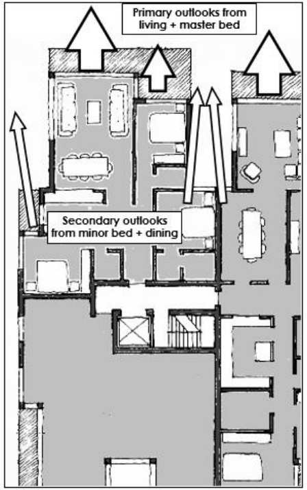
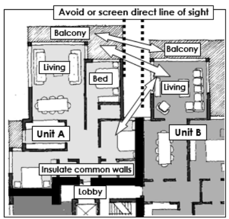
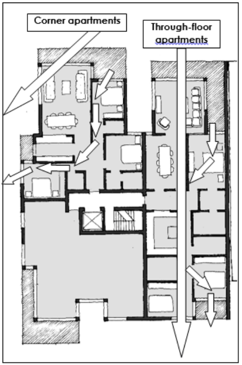

#### 4.3.10 RESIDENTIAL AMENITY

#### 4.3.10.1 Objectives

▪ Provide high levels of residential amenity that are appropriate for multi-unit development in a village centre setting

▪ Maintain and enhance the existing levels of amenity that are enjoyed by residential areas on the surrounding hillsides

▪ Contribute to high quality architectural and urban design by employing exterior screens as significant elements of all buildings

▪ Contribute to energy-efficient construction by appropriate solar orientation and effective application of exterior sunshades

#### 4.3.10.2 Controls - Minimum dimensions

a Floor-to-ceiling dimensions should promote effective daylighting and ventilation for all habitable rooms:

i The minimum ceiling height for habitable rooms should be 2.7 metres

b The size and configuration of each habitable room should be appropriate to their proposed use:

i Dimensions plus the location of windows and doors should accommodate the furniture typically associated with the use of each room

ii All development proposals should illustrate a furniture layout for each typical apartment

c Common lobbies and hallways should define residential territory and be wide enough to accommodate the passage of people and furniture:

i Each stair or lift lobby should service not more than eight apartments per floor

ii The width of lobbies and hallways should be increased beside lifts or stair landings, and opposite the entry to each apartment to facilitate removal of furniture and the two-way passage of residents

iii Common hallways should not be less than 1.2 metres wide at any point

#### 4.3.10.3 Controls – Views

a Buildings must not exceed the maxima specified by Central Coast LEP 2022

b The top storey of each building should be shaped to minimise obstruction of significant coastal and ocean views that are enjoyed from dwellings on the surrounding hillsides:

i Significant views include the ocean horizon, landmarks such as Crackneck, The Skillion and Wamberal dunes, inshore waters such as The Haven and the Wamberal beachfront.

ii Upper-storey roofs should have gentle pitches that generally are not steeper than 10 to 15 degrees in order to minimise obstruction of existing views.

iii On sites larger than 2000m2 or wider than 20 metres, the top storey should be divided into pavilion structures separated by “view corridors” that are wide enough to allow filtered views from hillside properties

#### 4.3.10.4 Controls - Private open space

a Private open space should be provided for each dwelling to accommodate outdoor recreation in proportion to the dwelling size:

i Private open space for each dwelling may be provided as one or more balconies or roof terraces

ii The primary private open space for each dwelling should be located immediately beside living or dining rooms

iii The area and dimensions of each private open space should be sufficient to accommodate typical outdoor activities such as dining, sitting and reclining

iv No private open space should have dimensions less than 2 metres wide and 4 metres long

b Private open spaces should be designed to maximise the amenity of each dwelling within a development:

i Balconies and terraces should incorporate adjustable sunshades to screen hot summer sun and prevent indoor overheating

ii Balconies and terraces should incorporate privacy screens constructed to prevent direct cross-viewing and transfer of noise between adjoining dwellings

c Private open spaces should contribute to the desired form and character of buildings that are specified by the Architectural Character and Identity section of this Chapter:

i Balconies and terraces should be used to articulate desired building forms

ii The shape, dimensions and location of balconies or terraces should be varied across each façade

iii Balconies should be designed in short lengths, and should not create the appearance of monolithic building forms by extending continuously along the length of any façade

#### 4.3.10.5 Controls - Outlook and daylight

a All habitable rooms should have a reasonable outlook:

i The floorplan of each dwelling should be shaped and oriented to provide an attractive outlook, preferably towards activities or natural backdrops that are located beyond the development site

ii Where the outlook from a dwelling would be blocked by surrounding buildings, private balconies or landscaped courtyards should be designed to provide an appropriate outlook

b Each dwelling should receive high levels of natural daylight:

i The principal windows to all habitable rooms should be located and / or oriented to provide at least 6 metres from any wall or obstruction, measured perpendicular to the plane of glazing

ii Where balconies overhang the windows to a habitable room below, the depth of the overhang should not be more than 2 metres

> [Picture on page 31: a picture, saved as a picture (images/ch-04-03-terrigal-village-centre-page-31-15.gif, 150 dpi).]

Figure 4.3.22: Floorplans provide attractive outlooks. Indicative floorplan facing Terrigal Esplanade

#### 4.3.10.6 Controls - Acoustic Privacy

a The specification of acceptable noise levels in a residential environment is a complex task:

i Acceptable noise levels have been established with regard to intrusive noise such as road traffic, but there is often limited guidance available for domestic noise sources

ii In the first instance, developments should be planned to satisfy “rule-of-thumb” controls that are listed below

iii Where “rule-of-thumb” controls are not satisfied, or in other situations and circumstances that might be determined by Council, applications may require a technical report prepared by a qualified acoustic consultant

b All structures and walls between dwellings should be acoustically-rated according to the applicable standards

c “Rule-of-thumb” planning and construction techniques should prevent the transfer of noise into any dwelling:

i Firstly, noise sources should be separated or otherwise insulated from neighbouring dwellings

ii Secondly, windows and private open spaces should be oriented to prevent direct line transfer of noise, either from existing or from likely noise sources

iii Thirdly, windows and private open spaces should be shielded to prevent direct line transfer of noise, for example by exterior screening of balconies and by acoustic insulation of balcony ceilings

iv As a last resort, windows may be acoustically-insulated to prevent direct line transfer of noise, with mechanical ventilation provided for habitable rooms

d Site planning and design should prevent direct line transfer between the following areas in particular:

i The windows of habitable rooms and / or private open spaces within neighbouring dwellings

ii Common access balconies and the habitable rooms or private open spaces of any adjacent dwelling

iii Bedroom windows and vehicle entrances or garbage collection areas

iv Bedrooms and lift shafts or common access corridors or living rooms in neighbouring dwellings

v Note that direct line transfer may be blocked externally by acoustically-impervious screens such as masonry walls or acoustically-rated glazing

vi For noise sources that are located above any dwelling, high-level windows are not adequate to block direct line transfer

e Mechanical plant should be located and designed to minimise nuisance noise:

i Plant should be located well away from habitable rooms unless acoustically-insulated according to the applicable standards

#### 4.3.10.7 Controls - Visual Privacy

a Neighbouring buildings and/or dwellings should have an appropriate orientation and an adequate separation in order to prevent unreasonable direct views into any dwelling:

i Windows and private open spaces should not face the windows or private open spaces of any neighbouring dwelling

ii Windows of habitable rooms in adjoining dwellings should be separated by at least 12 metres

iii Any window of a habitable room should be separated from a neighbouring private open space or common access balcony by at least 9 metres

b Where the desired orientation and separation cannot be achieved, exterior screening should be used:

i Fixed screens should be installed on windows, for example fixed louvres that admit light but prevent directional overlooking

ii Balconies and terraces should be fitted with screens that may be fixed or adjustable according to the proximity of vantage points and the significance of potential cross-views

iii Where elevated vantage points allow cross-viewing, high-level windows might not provide effective screening

> [Picture on page 33: a picture, saved as a picture (images/ch-04-03-terrigal-village-centre-page-33-8.gif, 150 dpi).]

#### Figure 4.3.22: Privacy considerations for neighbouring dwellings

#### 4.3.10.8 Controls - Climate control

a Site planning and design of facades should protect all dwellings from overheating during summer:

i Windows facing east, north or west should be shaded by eaves, balcony overhangs or exterior sun-shades that prevent the entry of sunlight from the equinoxes through to mid-summer

ii Shading devices for windows should be designed to admit sunlight from the equinoxes until mid-winter, for example adjustable screens and blinds, louvered screens, or by suitably-dimensioned balcony overhangs or eaves

b Dwelling floorplans should facilitate natural cross-ventilation during summer months:

i Easterly winds should have an unobstructed path through the majority of dwellings within each development

ii Dwellings should be planned with windows in two external walls to facilitate cross-ventilation, for example “corner” apartments and “through-floor” apartments

> [Picture on page 34: a picture, saved as a picture (images/ch-04-03-terrigal-village-centre-page-34-1.gif, 150 dpi).]

#### Figure 4.3.24: Apartment floorplans that encourage natural ventilation

#### 4.3.10.9 Controls - Safety and Security

a Developments should be planned and designed to promote neighbourhood security:

i Site planning should distinguish a range of “territory”, from areas with full public access such as alleyways and forecourts, to semi-public areas such as apartment lobbies and corridors

ii Lines of sight should be provided from each dwelling to publicly-accessible streets and laneways below as a “passive security” measure that enhances the level of personal safety in public areas

iii Floorplans should limit the opportunities for concealment of intruders in semi-public areas, with courtyards, lobbies, corridors and parking areas that avoid recesses or blind corners, and cupboards or service rooms that are lockable

iv Publicly-accessible areas should have at least two travel paths to facilitate escape

v “Passive” security planning should be supported by “hard” security measures such as lockable car-park shutters and entrance doors to common lobbies
