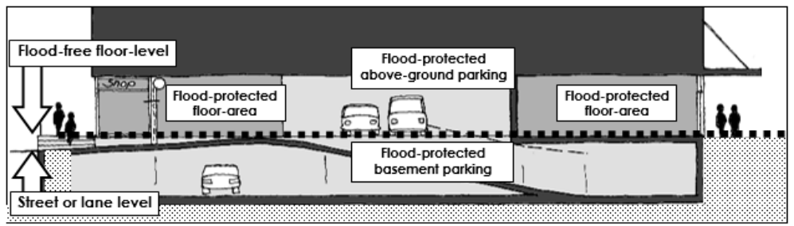

#### 4.3.11 NATURAL HAZARDS AND ENVIRONMENTAL PLANNING

#### 4.3.11.1 Objectives

▪ Address the requirements of State planning instruments together with Council’s controls and policies with regard to safety, conservation of natural resources plus the control and minimisation of waste

▪ In areas that are subject to recognised environmental hazards, prevent development that is not planned or constructed appropriately

▪ Promote the efficient use of natural resources

▪ Prevent the discharge of contaminated stormwater from each property

#### 4.3.11.2 Controls - Flood prone properties

a On properties that are defined as flood prone, development must be planned and constructed according to the State Government’s “Floodplain Development Manual” plus the Water Cycle Management Chapter of this DCP:

i Council’s Section 10.7 Planning Certificates (Environmental Planning and Assessment Act 1979) indicate properties that have been identified as flood prone

ii For flood prone properties within the Terrigal village centre, Council has defined 1% AEP flood level.

iii On flood prone properties, new building works must be designed to protect structures, people and personal possessions from flood hazard and damage

iv New building works and basements must not increase the level or the severity of flood impacts for any other property that is located within the surrounding drainage catchment

b Building works on flood prone properties must be designed to prevent the entry of floodwaters:

i The lowest occupied floor must be elevated 0.5 metres above the 1% AEP flood level that has been defined by Council

ii Parking areas must incorporate ramps that rise from the level of the street or laneway frontage to prevent the entry of flood-waters

> [Picture on page 35: a picture, saved as a picture (images/ch-04-03-terrigal-village-centre-page-35-26.gif, 150 dpi).]

Figure 4.3.25: Cross-section illustrating flood protection measures. Indicative property between

#### Terrigal Esplanade and Hudson Lane

#### 4.3.11.3 Controls - Energy efficiency

a New dwellings should be planned, designed and constructed according to provisions of State Environmental Planning Policy (SEPP) BASIX (2004):

i Applications should include a completed energy performance statement, and

ii Site planning, interior layout and design of facades should incorporate an effective range of passive solar principles

iii All windows facing east, north or west should be protected by eaves, structural overhangs, or exterior sunshades

iv At least two thirds of all dwellings within each development should have a northerly orientation for living room windows

b Construction Certificate applications should include additional information:

i Insulation should be incorporated within all framed exterior walls and roofs in accordance with the applicable Australian Standard

ii Water heaters that achieve at least a four star greenhouse rating should be installed

#### 4.3.11.4 Controls - Stormwater Management

a The discharge of contaminated waters from each site should be prevented:

i Car parking and delivery areas should be fitted with interceptor traps to collect petroleum and metal wastes deposited by vehicles onto driveways and floors

b Stormwater collected during peak storm events should be detained on-site:

i Detention systems should be provided to protect the trunk drainage network from overloading

ii Development applications should provide preliminary details of proposed detention systems, including their capacity to accommodate peak storm events, dimensions and location to facilitate gravity discharge to the trunk network

iii Final details of the detention system, including maintenance requirements, should be provided with Construction Certificate applications

#### 4.3.11.5 Controls - Water conservation

a The collection of stormwater for re-use on site is encouraged for new developments:

i Re-use may include irrigation of planted areas, car washing within dedicated basement areas, or toilet flushing

ii Storage systems should be fitted with first-flush interceptors, sediment traps and outlet filters, and non-potable waters should be distributed via pipes that are separated from the potable system

iii Details of storage systems, including technical operation and maintenance, should be provided with Construction Certificate applications
