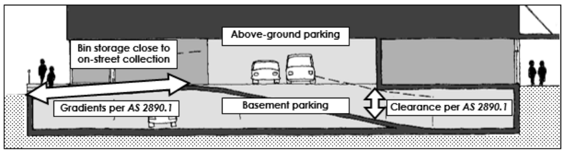

#### 4.3.12 VILLAGE CENTRE IMPROVEMENTS SERVICING OF DEVELOPMENT

#### 4.3.12.1 Objectives

▪ New development should contribute to village centre improvements that form part of Council’s adopted Master Plan:

o Street footpaths should be reconstructed along the full frontage of each development site

o Footpath construction should incorporate the materials, construction techniques and specifications that form part of the adopted improvements program

o Monetary contribution for works may be levied according to a Contributions Plan that has been adopted by Council for this Village centre

#### 4.3.12.2 Controls – Car parking

a Each development should provide car parking at the rates set by the Car parking Chapter of this DCP:

i All of the car parking required for the residential component of the development is to be provided on site.

ii No less than two thirds of the car parking calculated for the retail and commercial component of the development is to be provided on site, the balance may be provided by way of s94 contribution.

b Parking areas, driveways and ramps must be designed according to the applicable Australian Standard AS 2890.1:

i Ramps must not be steeper than 1:20 within 6 metres of a street or laneway boundary to protect pedestrian safety

ii Ramps must not exceed specified maximum gradients and must incorporate transitional gradients to prevent vehicle damage

iii Minimum headroom requirements must be satisfied along all ramps, driveways and bays

iv Preferred ramp widths should conform to Section 4.3.9.5 of this Chapter.

#### 4.3.12.3 Controls – Deliveries

a Developments that contain dwellings should provide for short-term parking of furniture removalists vehicles:

i Where on-street loading-zones are located in proximity to the site and with direct access to the proposed residential lobby: no off-street provision is required

ii For sites facing The Esplanade that have rear-lane access only: on-site space should be provided for a small delivery vehicle in a location that does not obstruct access to parking areas

b Developments that accommodate non-residential floor space should provide delivery areas in proportion to the scale and intensity of retail and business uses:

i Where the area of each defined retail or business tenancy does not exceed 100m2: Deliveries may be made “across-the-kerb” from designated loading zones

ii For sites facing the proposed pedestrian mall in The Esplanade, deliveries may be permitted via the pedestrian mall within restricted hours that are defined by Council

iii Where the area of any retail or business tenancy exceeds 100m2: one dedicated delivery space should be provided on-site, located and designed according to Sections 4.3.8 and 4.3.9 of this Chapter

> [Picture on page 38: a picture, saved as a picture (images/ch-04-03-terrigal-village-centre-page-38-6.gif, 150 dpi).]

Figure 4.3.26: Cross-section illustrating vehicle and service access Indicative property between Terrigal

#### Esplanade and Hudson Lane

#### 4.3.12.4 Controls - Garbage storage and collection

a Garbage storage should be provided in accordance with the Waste Management Chapter of this DCP together with the urban design and amenity provisions of this Chapter:

i Storage areas should accommodate the number of bins specified by the Waste Management Chapter.

ii Storage areas should be located according to the urban design and amenity provisions that are listed in Sections 4.3.8, 4.3.9 and 4.3.10 of this Chapter, close to a street or laneway frontage in order to facilitate collection by Council’s contractors

b Unloading of bins should not require Council’s contractors to enter a private property:

i Properties with rear lane access should provide a level area within each property immediately adjacent to the lane and suitable for the short-term storage of bins prior to collection

ii For properties without rear lane access, development applications must include a management plan that confirms the responsibility of the proposed building’s owners and/or managers for movement of bins to a kerbside collection position plus their removal to an indoor storage area immediately after collection by Council’s contractor

#### 4.3.12.5 Controls - Clothes Drying

a Natural drying facilities are encouraged for new developments:

i Each dwelling should be provided with outdoor space for clothes-drying, fitted with a retractable clothes line and located as part of a private balcony or terrace that is surrounded by fixed screens to conceal washing from street-level vantage points

#### 4.3.12.6 Controls - Plant and Piped Services

a Plant and equipment should be concealed within the fabric of each building in order to promote high standards of urban design and amenity:

i Plant, equipment and ductwork should not be surface-mounted on roofs, terraces, or exterior walls

ii Services, pipes and ductwork should not be visible from any public frontage

iii Services, pipes or ductwork should be concealed in the entrances to parking or delivery areas that face a street or laneway

iv Plant and equipment should be designed and located to prevent exposure of nearby dwellings to unreasonable odours or noise

b Control valves and meters for piped services should not intrude upon the continuity of shopfronts or design of facades facing any street:

i Valves and meters should be accessed via secondary street or laneway frontages, and where possible, located in secured cabinets that are associated with carpark entrances rather than intruding upon street facades

ii Where cabinets must be located along a street frontage, their width should be minimised and they should be integrated with the design of shopfronts

#### 4.3.12.7 Controls – Antennas

a The number, design and location of television and radio antennas should be limited:

b There should be one common mast per building

c Satellite dishes should not be installed on roof-tops, and should be restricted to small units located on private balconies or terraces to conceal their appearance from street level vantage points

d Mobile phone facilities are not appropriate to the desired urban design quality or the population density of this village centre

e Arrays of transmitters have an uncoordinated appearance that would detract from the desired urban design quality

f Expressions of concern for public health suggest that the location of transmitters in a village centre would not be appropriate given the intensity of pedestrian activity or the density of residential accommodation.
