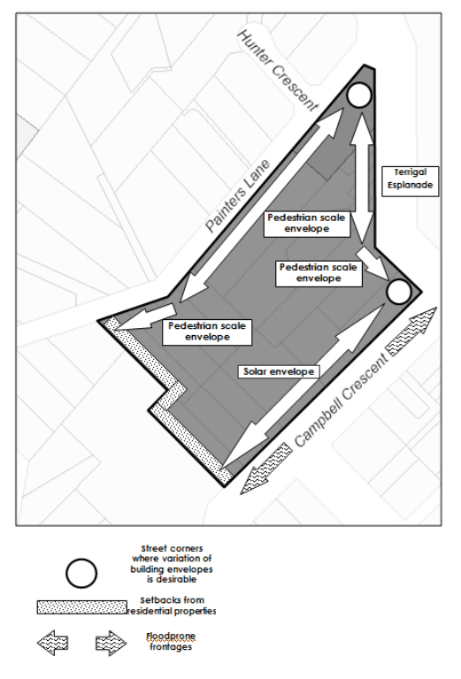
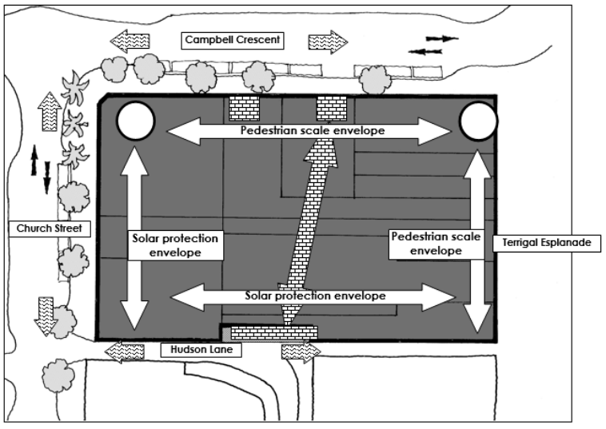
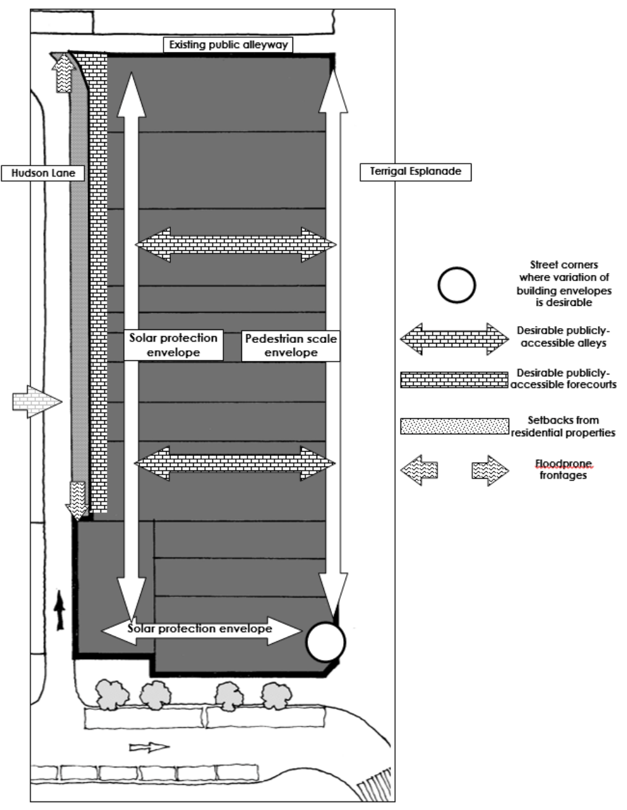
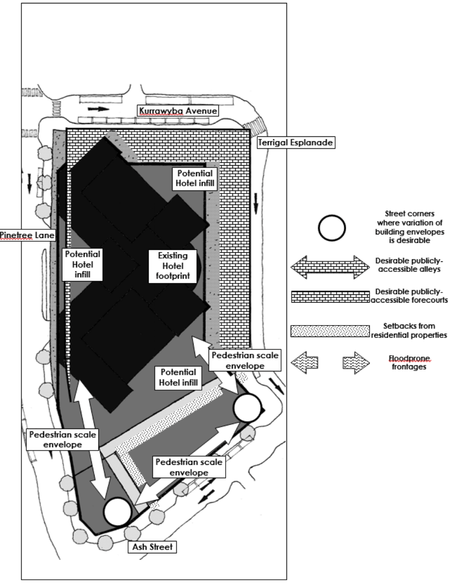
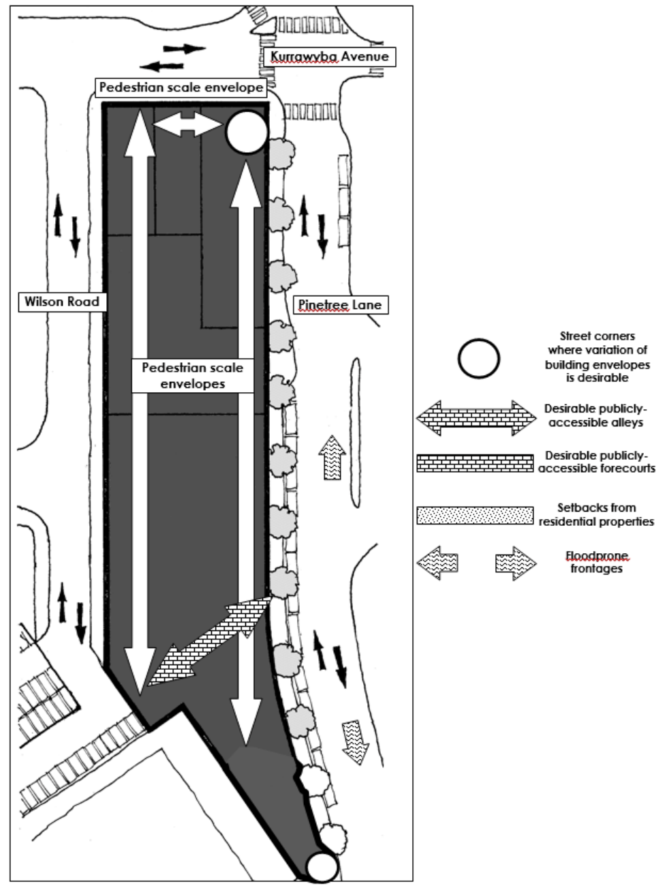
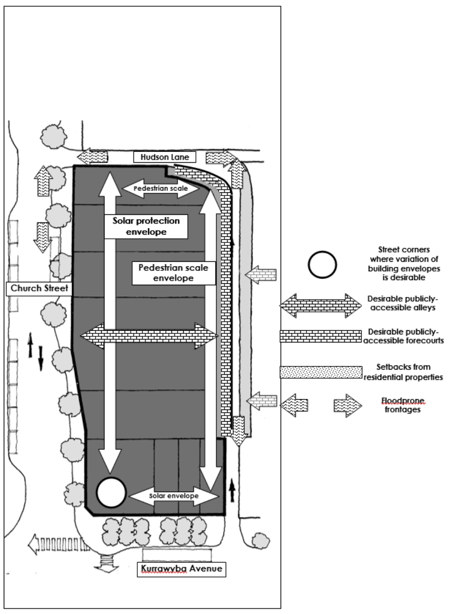
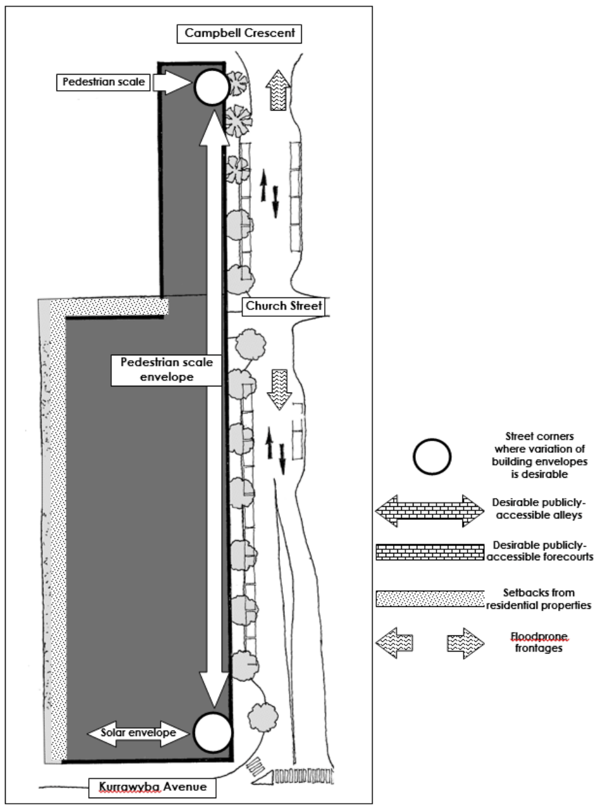

#### 4.3.13 PRECINCT CONTROLS

#### 4.3.13.1 Purpose

a This Chapter identifies the appropriate location or general application of specific controls in the General Control section of this Chapter:

i Solar protection envelope: Section 4.3.6.3

ii Pedestrian scale envelope: Section 4.3.6.3

iii Desirable street corner variations to the building envelope: Section 4.3.6.3

iv Setbacks to residential properties: Section 4.3.7.4

v Desirable publicly-accessible alleyways and courtyards: Section 4.3.7.5

vi Flood prone frontages: Section 4.3.11.2

b The Precinct Control section of this Chapter incorporates a series of street block maps:

i Incorporating property boundaries that were current at August 2003

ii Illustrating general features of Council’s Master Plan for CBD Improvements, as adopted at August 2003

c Street block maps provide diagrammatic indications regarding particular features:

i The number and/or the general location of publicly accessible alleyways and courtyards that are desirable within any street block

ii Frontages that are deemed flood prone

iii Note that the precise location of desirable alleyways or courtyards upon any development site must be selected according to provisions of Section 4.3.7.5

iv Note also that the precise extent of flood prone frontages should be checked with Council

d Maps in the Precinct Control section of this Chapter cover the following street blocks:

Block 1 Terrigal Esplanade: north of Campbell Crescent

Block 2 Terrigal Esplanade: north of Hudson Lane to Campbell Street

Block 3 Terrigal Esplanade: north of Kurrawyba Avenue

Block 4 Terrigal Esplanade: south of Kurrawyba Avenue

Block 5 Pinetree Lane: south of Kurrawyba Avenue

Block 6 Church Street: east side

Block 7 Church Street: west side

#### Block 1 Terrigal Esplanade: north of Campbell Crescent

> [Picture on page 41: a picture, saved as a picture (images/ch-04-03-terrigal-village-centre-page-41-2.gif, 150 dpi).]

#### Block 2 Terrigal Esplanade: north of Hudson Lane to Campbell Street

> [Picture on page 41: a picture, saved as a picture (images/ch-04-03-terrigal-village-centre-page-41-4.gif, 150 dpi).]

#### Block 3 Terrigal Esplanade: north of Kurrawyba Avenue

> [Picture on page 42: a picture, saved as a picture (images/ch-04-03-terrigal-village-centre-page-42-2.gif, 150 dpi).]

#### Block 4 Terrigal Esplanade: south of Kurrawyba Avenue

> [Picture on page 43: a picture, saved as a picture (images/ch-04-03-terrigal-village-centre-page-43-2.gif, 150 dpi).]

#### Block 5 Pinetree Lane south of Kurrawyba Avenue

> [Picture on page 44: a picture, saved as a picture (images/ch-04-03-terrigal-village-centre-page-44-2.gif, 150 dpi).]

#### Block 6 Church Street east side

> [Picture on page 45: a picture, saved as a picture (images/ch-04-03-terrigal-village-centre-page-45-2.gif, 150 dpi).]

#### Block 7 Church Street west side

> [Picture on page 46: a picture, saved as a picture (images/ch-04-03-terrigal-village-centre-page-46-2.gif, 150 dpi).]
