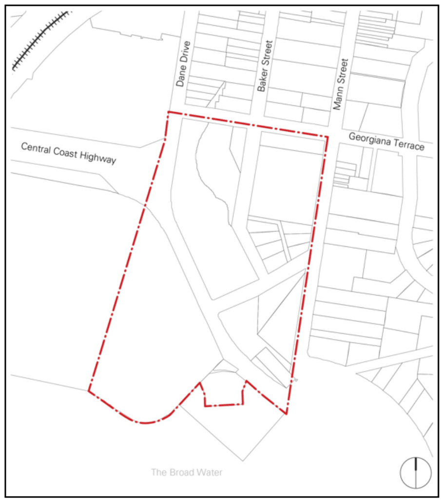

### 4.4 GOSFORD WATERFRONT

#### 4.4.1 INTRODUCTION

Gosford City Centre has been identified by the NSW Government as the Central Coast's regional city and accordingly will play a vital role in the shaping the future of Central Coast. The Central Coast Regional Strategy, which sets the strategic framework for growth over the next 25 years, identifies that Gosford will need to accommodate 10,000 new residents and 6,000 new jobs within that period.

Development of the Gosford City Centre in line with the Central Coast Regional Strategy is therefore critical to ensuring sustainable growth, providing a focal point for local development and a significant contribution to local employment capacity. In this context, the former Department of Planning and the former Gosford City Council implemented a suite of planning tools in 2007 comprising a vision, local environmental plan, development control plan and civic improvement plan.

In 2007 the former Gosford City Council, in collaboration with NSW Government and the local community, initiated the "Gosford Challenge" to explore further specific opportunities to revitalise the City Centre. That process culminated in the issue of a new blueprint for the Gosford City Centre entitled “Our City, Our Destiny

– Gosford City Centre Master Plan" (2010).

The Master Plan recognised the existing spatial framework and identified the following five key precincts of activity within the framework in recognition of their capacity to evolve and contribute to growth and revitalisation of the City:

▪ The Waterfront;

▪ The Arts & Entertainment Precinct;

▪ The City Core;

▪ The Railway Precinct, and;

▪ The Hospital Precinct.

The Master Plan identifies The Waterfront (herein referred to as "the Gosford Waterfront) as "the jewel in Gosford's crown..." and promotes "...a vibrant and active urban waterfront with shops, restaurants and new development".

In recognition of the Master Plan's findings, a new land use framework for the Gosford Waterfront has been established through an amendment to Gosford’s Local Environmental Plan. The new framework rezoned parts of the Gosford Waterfront, and introduced new development standards (floor space and height) and other controls to promote the orderly, economical and sustainable revitalisation of the Gosford Waterfront.

The new land use framework provides an opportunity to expand the previously identified extent of the Gosford Waterfront by incorporating part of the Arts & Entertainment Precinct. In addition, the new framework underpins and strengthens two existing key streets - Mann Street, and a newly extended Baker Street - and provide high quality connections to a series of new and reconfigured development zones on and adjacent to the Gosford Waterfront.

This Chapter builds upon the Gosford Waterfront’s new land use framework and provides detailed controls against which to assess future development applications. The Chapter is based, wherever possible, on existing controls. It outlines the more detailed planning provisions for the built form such as pedestrian amenity, access and environmental management for future development in the Gosford Waterfront. It establishes controls for building setbacks and building separations to ensure high amenity. Enhanced pedestrian connectivity and high-quality public domain are key features of the Chapter.

#### 4.4.1.1 Land to which this Chapter Applies

This Chapter applies to all land shown within the dotted line in Figure 1 and applies to all categories of development, as defined within the Environmental Planning and Assessment Act, 1979 addressed within the Chapters of this Plan.

> [Picture on page 2: a picture, saved as a picture (images/ch-04-04-gosford-waterfront-page-2-5.gif, 150 dpi).]

#### Figure 1 – Land to which this Part Applies

#### 4.4.1.2 Relationship to other Plans

The Chapter supplements the provisions of Central Coast Local Environmental Plan (LEP) 2022. The provisions of the Central Coast LEP 2022 prevail over the Chapter.

The Chapter supersedes all previous DCP Controls applying to the Gosford Waterfront.

The relevant sections of the Central Coast Development Control Plan 2022 and adopted Council policies, guidelines and codes of Central Coast Council also apply to the Gosford Waterfront. This Chapter should be read in conjunction with Central Coast DCP 2022, notably:

▪ Part 2 –Development Controls

▪ Part 3 – Environmental Controls

Where it conflicts with other requirements of the Central Coast Development Control Plan 2022, this Chapter prevails.

State Environmental Planning Policies may apply to the land to which this Chapter applies.

#### 4.4.1.3 Application of the Chapter

Where a development application is lodged which relates to land to which this plan applies, Council shall take the provisions of this chapter into consideration in determining that application. The provisions of this chapter are not statutory requirements and any development application will be considered on its merits. The consent authority is to be flexible in applying the controls and allow reasonable alternative solutions that achieve the objectives of the controls. Where, in the opinion of Council, an application satisfies the objectives set out in this plan, Council may grant consent to the application notwithstanding that one or more of the controls are not complied with.

Development applications should aim to demonstrate consistency with the objectives of this Chapter, including:

▪ The overall aims and objectives of this Chapter,

▪ The overall vision (Section 4.4.2.1) and outcomes (Section 4.4.2.2) for the Gosford Waterfront, and

▪ Detailed objectives of each relevant section in this Plan.

#### 4.4.1.4 Purpose, Aims and Objectives

The purpose of the Chapter is to provide guidance on and to facilitate the future development of the site consistent with the aims and objectives of Central Coast LEP 2022. The specific aims and objectives of this Chapter are:

▪ To identify Council's expectations and requirements for development within Central Coast local government area and build upon the Central Coast LEP 2022 and the Master Plan for Gosford entitled Our City (&) Destiny – Gosford City Centre Master Plan in 2010 by providing detailed objectives and controls for development;

▪ To ensure that all development is consistent with the desired character of the Gosford Waterfront area;

▪ To identify approaches and techniques which promote quality urban design and architectural outcomes in Gosford local government area; and

▪ To promote best practice and quality environmental outcomes.

#### 4.4.1.5 Structure of the Chapter

This Chapter includes 8 sections:
