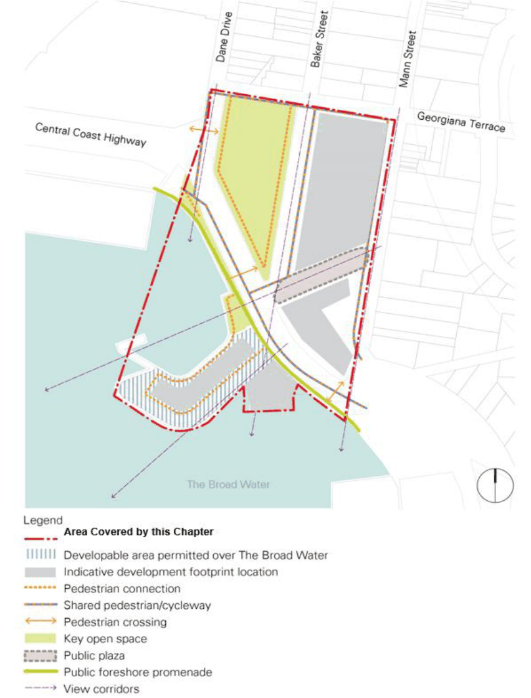

#### 4.4.2 VISION, LAND USE AND URBAN STRUCTURE

#### 4.4.2.1 Vision

The vision for the Gosford Waterfront is to promote sustainable growth in a manner which will provide a catalyst for the wider revitalisation of the City Centre.

The Gosford Waterfront will be a vibrant and active mixed-use precinct that will connect the Gosford City Centre to the Brisbane Water foreshore. New residential development will contribute to the State Government's regional housing targets for the Central Coast and will take advantage of Gosford's unique water-based setting. The Gosford Waterfront will also be a vibrant centre for jobs and offer regional office opportunities for large business and corporations near a locally based skilled workforce. New jobs will focus on high growth industries that build the Gosford City Centre's strengths in business services, health, education, retail, tourism and cultural activities. Key regional services, cultural activity, entertainment, recreational and tourism uses will complement and support residential and employment uses.

The range of available public amenities and services will attract people of all ages to live in the Gosford Waterfront and Gosford City Centre. Street life and activity will increase, providing a greater mix of uses to serve residents, workers and tourists. A greater diversity of housing and employment will encourage residents to work and live in the City Centre. The Performing Arts Centre, Civic Place and City Park will

become the key public spaces for the city residents, workers and tourists in Gosford - destinations for recreation, leisure and entertainment.

The Broadwater is a local and regionally significant asset. The foreshore edge will be activated and celebrated with upgraded open space and key public spaces, pedestrian walkways and cycle ways. New and existing marina and boating facilities will be provided to attract both water-borne tourists and boat owners to Gosford to live and recreate in its waterways. Boating is a key attractor and aspect of the new character for the Gosford Waterfront and to differentiate it from other Central Coast towns.

The Gosford Waterfront will link the City Centre to the Broadwater through a public environment that will be well designed, and creates attractive, legible and unique places. Contemporary treatments, lighting and street furniture will provide an attractive environment for walking and public life. New development will be of high quality. Public transport and non-private car usage will be promoted. Attractive pedestrian and cycle routes will link into the regional Point Clare cycleway along the edge of the railway causeway.

Ecological sustainability will be a key requirement for all development. Buildings and public spaces will embrace water and energy efficiency strategies and best practice. All development will need to demonstrate compliance with the relevant statutory and measuring tools such as Greenstar, NatHERs, etc to preserve Gosford Waterfront's unique environmental character. The built environment and public spaces will minimise the consumption of energy and water and promote social interaction and activity.

The development controls under this Chapter aim to develop and reinforce the vision established for the Gosford Waterfront through the Gosford Challenge process.

#### 4.4.2.2 Outcomes

The following are the envisaged outcomes for the Gosford Waterfront and are to be considered in the preparation and assessment of development applications.

#### Overall

▪ A new mixed-use precinct of the Gosford CBD, connecting the CBD with the Broadwater.

▪ Vibrant, liveable, healthy and sustainable community.

▪ An attraction for visitors, residents and workers of the Gosford Waterfront to enjoy the natural beauty of the Brisbane Water.

#### Urban Design

▪ A mixed-use precinct with residential, commercial office, retail, entertainment, visitor accommodation, recreation and cultural attractions.

▪ High quality architecturally designed buildings providing a clear distinction between public and private domains.

▪ Active street frontages along key pedestrian routes to improve safety and amenity for pedestrian and visitors to the precinct.

▪ A series of new public spaces catering for both active and passive recreation, linked by pedestrian and cycle friendly walkways.

▪ Establishment of view corridors from the adjacent spaces to the Broadwater.

#### Residential

▪ High density residential components with high amenity and water views, proximity to employment, services and recreational facilities.

#### Employment

▪ New commercial development to support the regional employment role of Gosford CBD.

▪ New commercial office developments providing high quality, sustainable floor plates suited to a range of businesses.

▪ New opportunities for convenience retail that complements the central retail zone of the Gosford CBD.

▪ A new restaurant zone based along the existing breakwater.

#### Public Spaces and Facilities

▪ Improved, continuous public access to the Brisbane Water foreshore.

▪ Improved and formalised public spaces including parks and plazas.

▪ High quality landscape features and embellishments attracting visitors and improving the recreational opportunities for residents and workers of the Gosford Waterfront and surrounds.

▪ A revitalised City Park with formalised recreation spaces.

▪ Improved links between Central Coast Stadium, the Clubs and Gosford CBD.

#### Transport and Accessibility

• A network of roads, plazas, public spaces, links and waterside pathways.

• New residents, visitors and workers will rely on public transport and non-private vehicles with parking for residential, commercial and community developments.

• Multi use car park to serve the commercial development and recreational activities.

• Investigate opportunities to provide a new public ferry wharf on the Gosford Breakwater.

#### Environmental

▪ New development built to modern environmental standards.

▪ Development sympathetic to any significant tree standings and ecologically sensitive environments.

#### Recreational and Cultural Facilities

▪ Potential for a new Regional Performing Arts and Conference Centre.

▪ A range of built form and open space recreational and cultural facilities.

▪ Potential for new improved boating facilities for a variety boating of activities including public and private moorings.

▪ Improved and rationalised open space and recreational facilities for new and existing residents, employees and visitors.

#### Heritage

▪ Recognise the heritage values of the site, whilst ensuring that future development has due regard to the significance of the item.

#### 4.4.2.3 Land Use

#### OBJECTIVES

▪ To provide a mix of land uses including residential, commercial office, retail, visitor accommodation, recreational and cultural uses.

▪ To provide for significant employment opportunities to build on the employment role of the Gosford CBD and provide supportive retail services that will draw visitors towards the Broad Water.

#### CONTROLS

a Commercial office development should generally be provided as an extension or continuation of the existing Gosford CBD.

b Retail development should be provided along key pedestrian routes and active precincts within the Gosford Waterfront.

c Cultural and recreational facilities should be provided in accessible locations.

#### 4.4.2.4 Urban Structure

#### OBJECTIVES

▪ To provide building envelopes that reinforce key existing view lines and provide a legible and permeable development pattern

▪ To provide pedestrian connectivity and improved facilities for pedestrians and cyclists

▪ To provide a series of well-located public spaces connected by pedestrian and cyclist facilities and providing range of facilities for residents, workers and visitors

▪ To provide for new developable areas to facilitate a range of residential, employment and community uses

▪ To provide for the reconfiguration upgrading and revitalisation of the Gosford Breakwater

▪ To ensure new development optimises the existing road hierarchy

#### CONTROLS

a The Gosford Waterfront should generally retain the existing road network, with some minor additions or changes to improve site access and pedestrian connectivity.

b Baker Street is to be extended and formalised as a key pedestrian and vehicular connection within the precinct.

c Building envelopes and development of the foreshore is to generally be located in accordance with Figure 2. Any development application that proposes to vary the location of the building envelopes is to demonstrate an improved urban design outcome and maintain key public spaces as indicated on Figure 2.

d Key public spaces and public plazas are to be provided such as illustrated in Figure 2.

e Create a new civic space and provide a pedestrian connection to replace Vaughan Avenue between Mann and Baker Street.

f A major pedestrian crossing of the Central Coast Highway is to be provided in a central well-designed location in the vicinity of Baker Street and public plaza.

g Any new development along the Brisbane Water foreshore should maintain continuous public access to the foreshore.

h New development is to include or facilitate public pedestrian/cycle connections in accordance with Figure 2. Detail of public access and connections to public access are to be provided at development application stage.

> [Picture on page 8: a picture, saved as a picture (images/ch-04-04-gosford-waterfront-page-8-10.gif, 150 dpi).]

#### Figure 2 - Urban Structure
