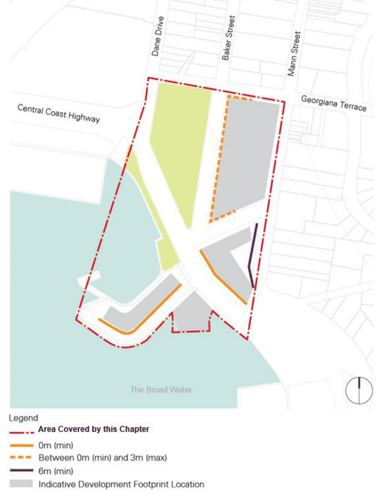
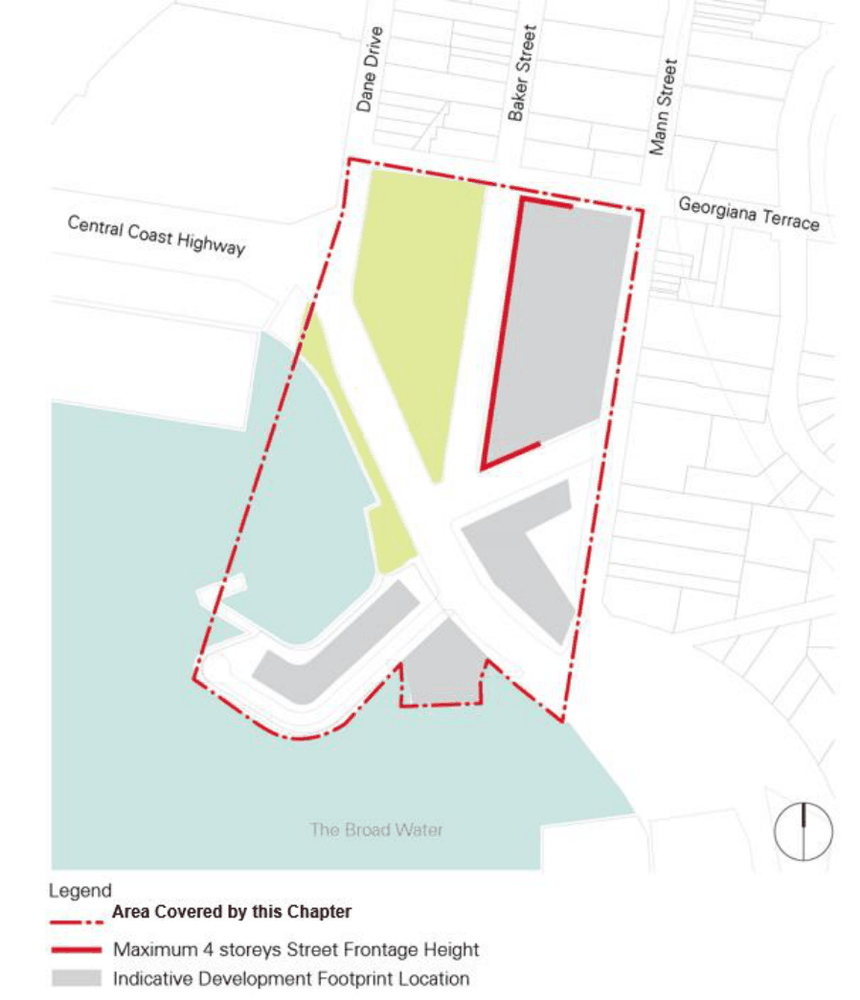
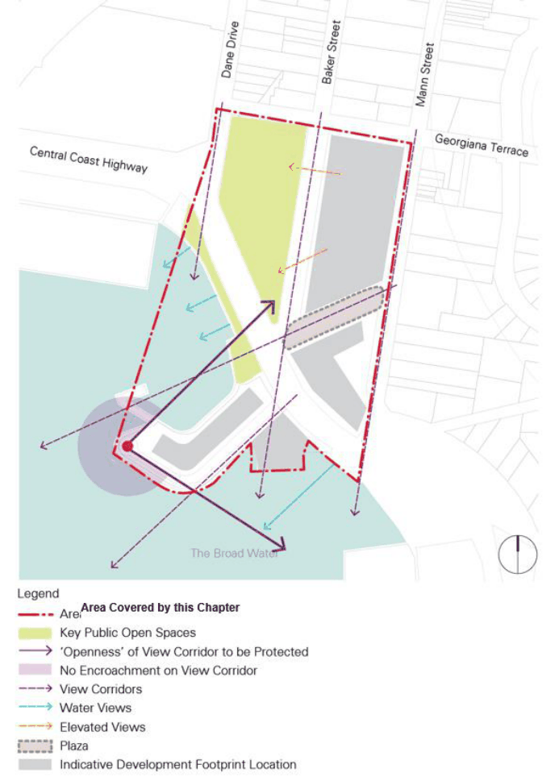

#### 4.4.3 BUILDING FORM

Building form and character refers to the individual elements of building design that collectively contribute to the character and appearance of the built environment. Central Coast LEP 2022 includes provisions for land use, building heights and gross floor area.

The development provisions in this section are intended to encourage high quality design for new buildings, balancing the character of the Gosford Waterfront with innovation and creativity. The resulting built form and character of new development should contribute to an attractive public domain in the Gosford Waterfront and produce a desirable setting for its intended uses.

The controls in this section aim to:

▪ Facilitate economic growth of Gosford City Centre by utilising available lands for built form that will attract new commercial office tenants to Gosford.

▪ Establish the scale, dimensions, form and separation of buildings appropriate for the Gosford Waterfront setting.

▪ Provide for the minor reconfiguration of parts of the Brisbane Water foreshore to improve the public foreshore areas and the efficiency and orientation of development parcels.

▪ Achieve an attractive and sustainable form within the Gosford Waterfront context.

▪ Achieve active frontages with good physical and visual connections between buildings, streets and the public domain.

▪ Provide for pedestrian comfort and protection from weather conditions.

▪ Define the public street to provide spaces that are clear in terms of public accessibility and safety and are easy to maintain.

▪ Ensure building depth and bulk is appropriate to the environmental setting and landform by providing for view sharing and good internal building amenity.

▪ Ensure building separation is adequate to protect amenity, daylight penetration and privacy between adjoining developments.

▪ Encourage mixed use development with residential components that achieve active street fronts and maintain good residential amenity.

▪ Achieve an articulation and finish of building exteriors that contribute to a high quality of design excellence.

▪ Provide for high quality landscape to contribute to the amenity of the city centre and a sustainable urban environment.

#### 4.4.3.1 Building Alignments and Setbacks

Building setbacks and alignments establish the front building line. They help to create the proportions of the building from the public domain and can contribute to the public domain by enhancing streetscape character and the continuity of facades.

Building setbacks can also be used to enhance the setting and address for the building. They provide for landscape areas, access arrangements, and entries to ground floor apartments. However, along key pedestrian routes and public domain areas, it may be more appropriate to provide buildings up to the street/public domain alignments to frame the public domain, reinforce the urban character, and improve pedestrian amenity and activity at street level.

Front, side and rear setbacks, where provided, allow ventilation, daylight access and view sharing, increase privacy, and reduce adverse wind effects. In residential buildings and serviced apartments, separation between windows on side and rear facades and other buildings is particularly important for privacy, acoustic amenity and view sharing.

For commercial buildings, separation distances are smaller due to reduced requirement for privacy, noise and daylight access. Separation for mixed use buildings containing residential and commercial uses is to be in accordance with specified distances for each component use.

#### OBJECTIVES

▪ To establish the desired spatial proportions, and define the edge, of streets and the public domain

▪ To provide a range of front setbacks appropriate to building function and character

▪ To create a transition between public and private space

▪ To locate active uses, such as shopfronts, closer to pedestrian activity areas

▪ To allow an outlook to, and surveillance of, the street and public domain

▪ To allow for street landscape character, where appropriate

▪ To maintain sun access to the public domain

▪ To ensure an appropriate level of amenity for building occupants in terms of daylight, outlook, view sharing, ventilation, wind mitigation, and privacy

▪ To achieve usable and pleasant streets and public domain areas in terms of wind mitigation and daylight access.

#### CONTROLS

a Street building alignment and street setbacks are to comply with Figure 3.

b The following projections and activities are permitted within front building alignments and setbacks (where not projecting beyond the property boundary):

i landscaping;

ii access arrangements and driveways;

iii balconies up to a maximum 600 mm depth; and

iv minor projections into front building lines and setbacks for sun shading devices, entry awnings and cornices.

c If the specified setback distances cannot be achieved when an existing building is being refurbished or converted to another use, appropriate visual privacy levels are to be achieved through other means, for example, the construction of screens. These will be assessed on merit by the consent authority.

> [Picture on page 11: a picture, saved as a picture (images/ch-04-04-gosford-waterfront-page-11-1.gif, 150 dpi).]

#### Figure 3 – Street Alignment and Setbacks

#### 4.4.3.2 Building Frontage Heights

Frontage heights (to streets or the public domain) ensure a sense of enclosure and scale that is appropriate to the Gosford Waterfront, and the function and character of different parts of the site. Well framed streets and public domain areas enhance the pedestrian environment.

Frontage heights refer to the height of the building that directly addresses the street or public domain from the ground level up to the first (if any) setback.

#### OBJECTIVES

▪ To achieve comfortable environments for pedestrians in terms of daylight, scale, sense of enclosure and wind mitigation as well as a healthy environment for street trees

▪ To protect solar access to key streets and public spaces

▪ To encourage a strong architectural expression of the "building wall" up to frontage height

#### CONTROLS

a Consistent street or public domain frontage heights are to be provided in accordance with Figure 4.

b Development above the maximum street frontage height is to be setback a minimum of 8m from the Baker Street boundary.

c The street and public domain frontage height of buildings must demonstrate a sense of street enclosure and high pedestrian amenity.

d No upper level setbacks are required, if proposed building frontage heights demonstrate sufficient sunlight access to Mann Street, and other public places such as Civic Plaza and City Park.

e Notwithstanding the above, the frontage height of any new building is to be consistent with the controls in Section 4.4.3.5 Sun Access and View Corridors.

> [Picture on page 13: a picture, saved as a picture (images/ch-04-04-gosford-waterfront-page-13-1.gif, 150 dpi).]

#### Figure 4 – Street Frontage / Public Domain Heights

#### 4.4.3.3 Building Depth and Bulk

Building depth and bulk controls will enable a balance to be found between mitigating the potential adverse effects that tall and bulky buildings may have on the public domain, allowing for good internal amenity access to natural light and ventilation, and meeting the market requirements for larger format buildings (particularly for commercial uses).

#### OBJECTIVES

▪ To promote the design and development of sustainable buildings

▪ To achieve the development of living and working environments with good internal amenity and minimise the need for artificial heating, cooling and lighting

▪ To provide viable and useable commercial office floor space that meets market requirements

▪ To achieve useable and pleasant streets and public domain at ground level by controlling the size of building floor plates

▪ To allow for view sharing and view corridors

▪ To reduce the apparent bulk and scale of buildings by breaking up expanses of building wall with modulation of form and articulation of facades

#### CONTROLS

a The maximum floor plate size for commercial buildings is 2,200m2.

b The maximum floor plate depth (excluding balconies) for residential buildings is 20m.

c In addition to the above, buildings are to:

d promote continuous, and wherever possible, direct lines of public foreshore access;

e achieve the relevant access and connections requirements identified in Section 4.4.5.1 Connections and Access;

f be articulated and modulated using a range of architectural treatments; and

g be orientated to optimise daylight and minimise lighting requirements.

#### 4.4.3.4 Mixed Use Buildings

Mixed use developments provide for a variety of uses and activities, encouraging use of Gosford Waterfront outside the working day, adding vibrancy and life to the city streets. Different uses within the same building are best located to a pattern and layout suitable to the mix of uses, with retail and business activity at ground level to assist street activation, and residential uses, requiring privacy and noise mitigation, located above the street / public level.

a Mixed use development within the Gosford Waterfront are preferred in areas where pedestrian activity will be encouraged and activity is ideal. These areas are located to the south of the existing Gosford CBD and along key pedestrian routes, to attract visitors south towards Brisbane Water and provide activity and surveillance throughout all times of the day.

#### OBJECTIVES

▪ To encourage a variety of mixed-use developments in the Gosford Waterfront

▪ To create lively streets and public spaces

▪ To increase the diversity and range of shopping and recreational activities for workers, residents and visitors

▪ To enhance public safety by increasing activity in the public domain on weeknights and on weekends

▪ To minimise potential conflicts and achieve compatibility between different uses

▪ To ensure that the design of mixed-use buildings addresses residential amenity

▪ To create separate, legible and safe access and circulation in mixed use buildings

▪ To ensure that mixed use buildings address the public domain and the street

▪ To ensure mixed use buildings adequately address all requirements for waste storage and waste collection

#### CONTROLS

a Minimum floor to ceiling heights are 3.3 metres for commercial office, 3.5 metres for active public uses, such as retail and restaurants, and 2.7 metres for residential.

b Separate commercial service requirements, such as loading docks, from residential access, servicing needs and primary outlook.

c Locate clearly demarcated residential entries directly from the public street.

d Clearly separate and distinguish commercial and residential entries.

e Provide security access controls to all entrances into private areas, including carparks and internal courtyards.

f Provide safe pedestrian routes through the site, where required.

g Front buildings onto major streets with active uses where possible.

h Avoid the use of blank building walls at the ground level where reasonably possible.

#### 4.4.3.5 Sun Access and View Corridors

Good solar access is a key contributor to the amenity of public spaces, particularly during winter. Protecting solar access to the key public spaces such as the City Park, the Civic Plaza and the Broad Water foreshore.

Views contribute to the character and amenity of a site, enhancing its sense of place and identity. The physical setting of the Gosford Waterfront on Brisbane Water provides for special views through, to and from the site.

It is important that the development of the Gosford Waterfront allows key view lines to Brisbane Water. The location and massing of buildings is important in maintaining the key view corridors to the waterfront.

#### OBJECTIVES

▪ To allow sunlight access to new and existing significant public spaces

▪ To ensure a high level of amenity to significant public spaces

▪ To maintain and enhance significant view corridors from public spaces to Brisbane Water

#### CONTROLS

a Key public spaces to be provided as illustrated at Figure 5.

b Any new public spaces are to be designed so that at least 50% of the open space provided has a minimum of 3 hours of sunlight between 9am and 3pm on 21st June (Winter Solstice).

c Significant views to be protected are illustrated in Figure 5.

d Align tall building elements to maximise view corridors between buildings.

> [Picture on page 16: a picture, saved as a picture (images/ch-04-04-gosford-waterfront-page-16-7.gif, 150 dpi).]

#### Figure 5 – View Corridors and Key Public Spaces

#### 4.4.3.6 Building Exteriors

The pedestrian environment is to be characterised by excellence of design, high quality materials and a standard of finish appropriate to a regional city centre. The maintenance and improvement of the public domain is dependent on a consistent approach to the design of new development including the articulation and finish of building exteriors.

#### OBJECTIVES

To ensure that new buildings in Gosford Waterfront:

▪ contribute positively to the streetscape and public domain by means of high-quality architecture and robust selection of materials and finishes,

▪ provide richness of detail and architectural interest especially at visually prominent parts of buildings such as lower levels and roof tops,

▪ present appropriate design responses to nearby development that complement the streetscape,

▪ clearly define the adjoining streets, street corners and public spaces and avoid ambiguous external spaces with poor pedestrian amenity and security,

▪ maintain a pedestrian scale in the articulation and detailing of the lower levels of the building, and

▪ contribute to a visually interesting skyline.

#### CONTROLS

a Adjoining buildings (particularly heritage buildings) are to be considered in the design of new buildings in terms of:

i appropriate alignment and street frontage heights,

ii setbacks above street frontage heights,

iii appropriate materials and finishes selection,

iv facade proportions including horizontal or vertical emphasis, and

v the provision of enclosed corners at street intersections.

b Balconies and terraces are encouraged, particularly where buildings overlook parks and on low rise parts of buildings.

c Articulate façades so that they address the street and add visual interest.

d External walls should be constructed of high quality and durable materials and finishes with ‘self-cleaning’ attributes, such as face brickwork, rendered brickwork, stone, concrete and glass.

e Finishes with high maintenance costs, those susceptible to degradation or corrosion from a coastal environment or finishes that result in unacceptable amenity impacts, such as reflective glass, are to be avoided.

f Maximise glazing for retail uses but break glazing into sections to avoid large expanses of glass.

g A materials sample board and schedule is required to be submitted with applications for development over $1 million or for that part of any development built to the street edge.

h Minor projections up to 450mm from building walls in accordance with those permitted by the Building Code of Australia may extend into the public space providing it does not fall within the definition of gross floor area and there is a public benefit, such as:

i expressed cornice lines that assist in enhancing the streetscape,

ii projections such as entry canopies that add visual interest and amenity,

iii projections to enhance light penetration into floor space, and

iv provided that the projections do not detract from significant views and vistas (refer to Figure 5).

i Finishes and materials should be chosen to reduce glare and reflection to the Broad Water.
