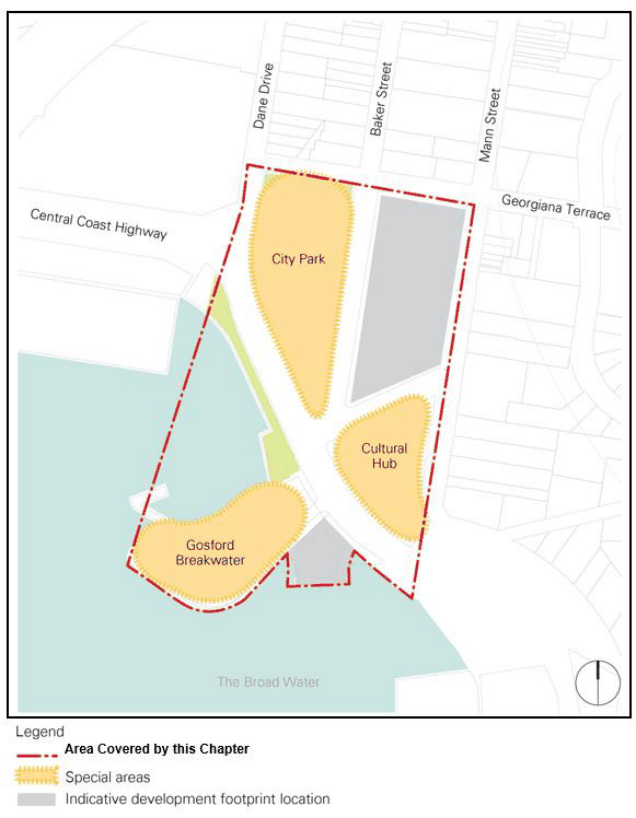

#### 4.4.4 CONTROLS FOR SPECIAL AREAS AND USES

Throughout the Gosford Waterfront, a number of “special areas and uses” have been identified in recognition of their location, attributes, size and development potential.

This Chapter has identified three ‘Special Areas and Uses’ (see Figure 6), each of which has its own set of objectives linked to the relevant development controls. These controls must be considered in addition to the general controls addressed previously in this Chapter.

> [Picture on page 18: a picture, saved as a picture (images/ch-04-04-gosford-waterfront-page-18-12.gif, 150 dpi).]

#### Figure 6 – Special Areas and Uses

#### 4.4.4.1 Cultural Hub

The cultural hub, as identified at Figure 6, is a key attractor within the Gosford Waterfront, drawing visitors and locals to the Broad Water and the Gosford CBD.

#### OBJECTIVES

▪ To promote the development of a high-quality architectural landmark building in the Gosford Waterfront Precinct

▪ To provide large performing arts and cultural exhibition space that will provide high grade regional facilities for the Central Coast

▪ To maintain the cultural significance of the site through its continual use as the cultural hub of the Gosford Waterfront

▪ To maintain and enhance public space and a pedestrian connections between Mann Street, Baker Street and the Gosford Highway

#### CONTROLS

a Any development of the site identified on Figure 6, should adopt the following principles:

b Include a Regional Performing Arts Centre;

c Include a public plaza along Mann Street, maintaining the existing significant vegetation;

d Maintain key view lines and pedestrian connections as identified at Figures 5 and 7;

e Include active frontages where buildings front the Civic Plaza.

f Maintain public access to all outdoor areas at all times.

#### 4.4.4.2 Gosford City Park

The Gosford City Park is currently a vacant grassed site with some vegetation along the street frontages. The redevelopment of the Gosford City Park will provide new public outdoor passive and recreational spaces for existing and future residents and workers within the Gosford CBD. The new public recreational facilities will provide an attraction within the Gosford CBD, further drawing visitors and Gosford locals towards the Gosford Waterfront and increasing opportunities for interaction between the Broad Water and the CBD.

#### OBJECTIVES

▪ To enhance the existing public space

▪ To provide new and formalised passive recreational spaces

▪ To increase the function and attraction of Gosford City Park

▪ To improve links to, and interface with, the Central Coast Stadium

#### CONTROLS

a The development of the Gosford City Park, as identified at Figure 6, should adopt the following principles:

i Provide a variety of publicly accessible outdoor recreational spaces.

ii Provide new pedestrian and cycle links between Baker Street, Gosford City Highway, Dane Drive and Georgiana Terrace.

iii Include a new indoor recreational facility providing new facilities for the existing and future population.

iv Part of the eastern and northern bounds of the site may be required for public on-street parking along Georgiana Terrace and Baker Street. No other part of the site is to be used for at-grade parking.

#### 4.4.4.2 Gosford City Park

The Gosford City Park is currently a vacant grassed site with some vegetation along the street frontages. The redevelopment of the Gosford City Park will provide new public outdoor passive and recreational spaces for existing and future residents and workers within the Gosford CBD. The new public recreational facilities will provide an attraction within the Gosford CBD, further drawing visitors and Gosford locals towards the Gosford Waterfront and increasing opportunities for interaction between the Broad Water and the CBD.

#### OBJECTIVES

▪ To enhance the existing public space.

▪ To provide new and formalised passive recreational spaces.

▪ To increase the function and attraction of Gosford City Park.

▪ To improve links to, and interface with, the Central Coast Stadium.

#### CONTROLS

a The development of the Gosford City Park, as identified at Figure 6, should adopt the following principles:

i Provide a variety of publicly accessible outdoor recreational spaces.

ii Provide new pedestrian and cycle links between Baker Street, Gosford City Highway, Dane Drive and Georgiana Terrace.

iii Include a new indoor recreational facility providing new facilities for the existing and future population.

iv Part of the eastern and northern bounds of the site may be required for public on-street parking along Georgiana Terrace and Baker Street. No other part of the site is to be used for at-grade parking.

#### 4.4.4.3 Gosford Breakwater

The Gosford Breakwater is an existing sea wall constructed within the Broad Water currently providing boat mooring facilities and is part of the existing public access network along the foreshore. The Breakwater will be a key attraction in the Gosford Waterfront, enhancing public access and retail services in the precinct. The Breakwater will provide opportunities for a commercial office, restaurant and retail precinct in the Gosford Waterfront, provided by an extension of the foreshore to provide new developable land.

▪ To provide new commercial, retail and restaurant services and visitor accommodation in the Gosford Waterfront Precinct.

▪ To maximise public access to the Breakwater.

▪ To provide opportunities for a ferry wharf.

▪ To minimise environmental impacts.

#### CONTROLS

a The development of the Gosford Breakwater, as identified at Figure 6, should adopt the following principles:

i The reconfiguration of the Breakwater is to facilitate a development parcel that can accommodate commercial development, a small retail and restaurant strip and new public landscaped areas.

ii The reconfiguration of the Breakwater is to minimise environmental impacts and any fill material should be sourced from material validated suitable for the purpose. The reconfiguration of the Breakwater should also minimise disturbance of the adjacent seabed.

iii Provide new retail and restaurant services providing activation and the attraction Breakwater.

iv Maintain continuous pedestrian connections around the foreshore.

v A new access road constructed off the Central Coast Highway generally along the alignment of the existing Breakwater.

vi Any development should not preclude the development of a ferry wharf at the end of the Breakwater.

#### 4.4.4.4 Marinas

#### OBJECTIVES

▪ To facilitate the development of marina facilities adjacent to the Gosford Breakwater.

▪ To locate marina facilities in locations that will minimise impact on views, environment and public access.

▪ To provide facilities to accommodate the growing boating community in Gosford associated with the existing boating infrastructure.

▪ To provide sufficient car parking to accommodate the demand for boating facilities within the Gosford Waterfront.

▪ To attract increased boating-based visitors to Gosford by providing facilities for short term moorings and shore facilities.

#### Location

a Marina developments are to be located where there is adequate water depth to accommodate the largest boat or where minimal dredging of soft material will achieve an adequate water depth.

#### Design and Layout

b Marinas shall not preclude or restrict public access to the foreshore.

c The extent of development over water including waterside structures, berths, fairways and access channels is to be minimised and result in minimal alienation of the waterway.

d Marinas are to be in the form of a series of interlinked pontoons which shall be restrained and held in position by a minimum number of piles or mooring lines to anchor points in the seabed.

e Design of marina restraints shall take into account the flexibility and performance of the pontoon systems under environmental loads.

f The depth and width of berths and fairways of marinas shall accommodate either a yacht or motor vessel. Restricted berths are to be nominated only where this will lead to an optimal environmental outcome.

g Commercial marinas are to provide a point of access to boats for disabled people where possible.

h Marinas are to be designed to minimise the impact of vessels when in use on the environment including on air and water quality, marine habitat and bank stability.

i Marina layouts are to be designed in accordance with the following publications:

i Department of Environment and Conservation (NSW) "Environmental Information for Marinas, Boatsheds and Slipways" (November 1998).

ii NSW Maritime Authority "Engineering Standards and Guidelines for Maritime Structures"

iii NSW Fisheries Department’s "Aquatic Habitat Management and Fish Conservation—Policy and Guidelines", 1998

iv NSW Department of Primary Industries – Fisheries "Policy and Guidelines – Aquatic Management and Fish Conservation (1999)".

v NSW Department of Primary Industries – Fisheries "Habitat Protection Plan No. 2: Seagrasses"; and

vi NSW Department of Primary Industries – Fisheries "Habitat Protection Plan No. 1: General".

#### Facilities and Services

j Marinas are to provide boating service facilities such as fuel, water, toilet facilities or sewage pumpout.

k Marinas are to provide an appropriate mix and choice of boat storage facilities based on established demand as well as a range of marine services to the boating public.

l Vessels at the marina are not to be used as a permanent residence. A covenant shall be included on the lease to enforce this requirement.

#### Visual Impact

m Any development application for a marina must be accompanied by a visual impact assessment that considers the following:

i the visual contrast between the marina and the planned future character of its setting;

ii the visual impact of the marina on people in the visual catchment (to ensure there remains clear view corridors to the water enhanced by the visual interest of the boats and moorings); and

iii the impact of the largest motor vessel capable of being berthed at the marina.

n The largest vessels (motorised or otherwise) to be berthed at the marina are to be located as far from shore as possible.

o Foreshore structures are to be minimised.

p Impact on key view lines from the public foreshore area are to be minimised.

q The visual impact of car parking from Brisbane Water is to be minimised.

#### Safety and Security

r Any future development application for a marina should demonstrate the safety and security measures to be incorporated into the design of the marina including addressing projected sea level rise risks.

#### Environmental Management

s Pollution and waste:

i potential pollutant sources from the site must be controlled and meet established performance standards;

ii appropriate controls are to be in place and managed to prevent any pollutants entering the environment;

iii marinas for nine or more vessels are to provide adequate and readily accessible facilities for the collection and disposal of wastes from vessels;

iv facilities for pumping out sewage holding tanks are to be provided onshore; and

v any waste that cannot be recycled is to be disposed of at an appropriate facility.

t Adequate car and trailer parking (based on the number and type of berths, associated activities and number of employees) is to be available on-site. Off-site parking is acceptable only where it will not reduce community amenity or generate adverse traffic impacts.

u The adverse impacts of traffic and parking generated by boat storage facilities in terms of congestion, safety, air quality and noise are to be minimised.

v The adverse impacts of noise (considering hours of operation, existing background noise, expected departure/arrival times for vessels, noise level of marina patrons, noise level from repair and testing of vessels and motors) are to be minimised through appropriate design and management measures.

w The adverse impacts of lighting on night navigation and neighbours are to be minimised through appropriate design and management measures.

#### Marina Buildings

x Marina buildings are to be designed so that their dimensions are not excessive and can reasonably meet the functional requirements of the proposed uses.

y The colours, appearance and form of any associated buildings shall be compatible with the surrounding environment.

z Shiny or reflective materials are not to be used.
