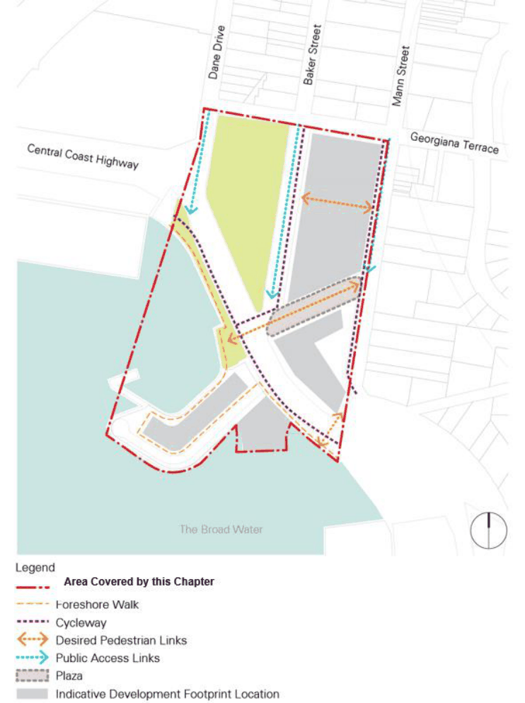
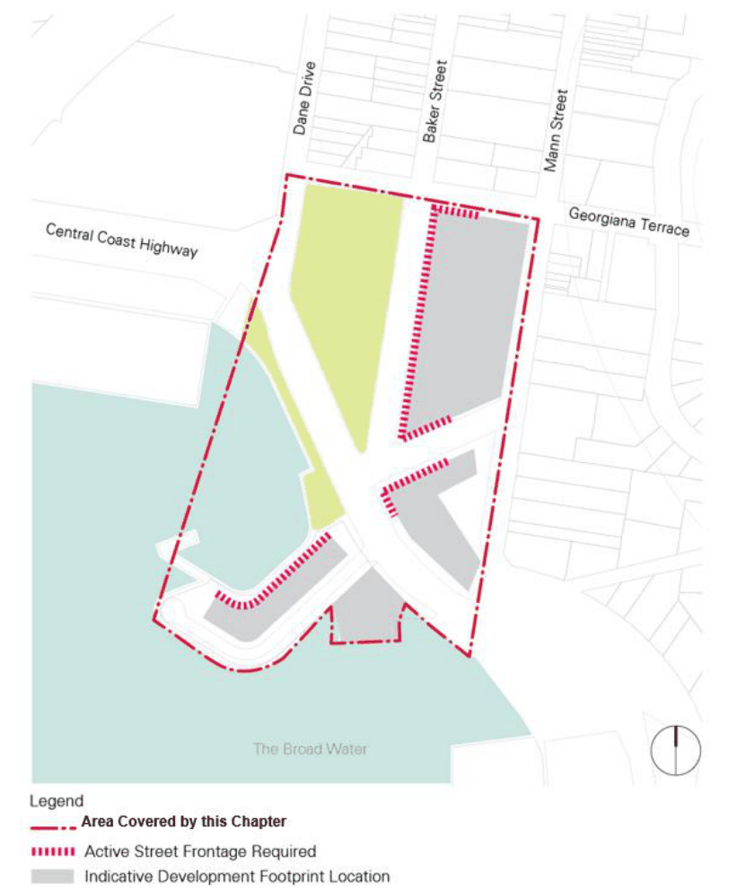
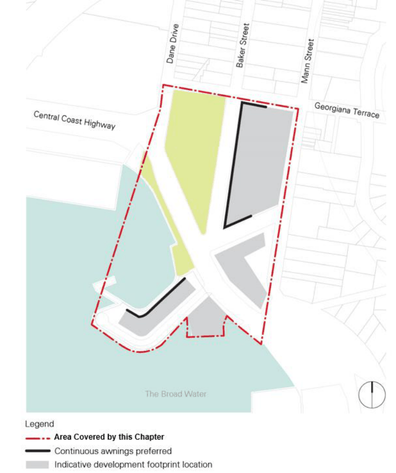

#### 4.4.5 PEDESTRIAN AMENITY

Pedestrian amenity incorporates all those elements of individual developments that directly affect the quality and character of the public domain. The pedestrian amenity provisions are intended to achieve a high quality of urban design and pedestrian comfort in the public spaces of the Gosford Waterfront. The pedestrian environment provides people with their primary experience of and interface with the site. This environment needs to be safe, functional and accessible to all. It should provide a wide variety of opportunities for social and cultural activities. The city’s lanes, arcades and through site links should form an integrated pedestrian network providing choice of routes at ground level for pedestrians.

The controls in this section aim to increase the vitality, safety, security and amenity of the public domain by:

▪ Encouraging future through site links at ground level.

▪ Ensuring active frontages and positive building address to the street and public domain.

▪ Ensuring provision of awnings along the key pedestrian and commercial frontages and other retail and tourist areas.

▪ Mitigating adverse impacts on the street arising from driveway access crossings, advertising signage and selection of building finishes and materials.

▪ Protecting significant views and vistas along streets.

#### 4.4.5.1 Connections and Access

#### OBJECTIVES

▪ To maintain and improve public access through the Gosford Waterfront to the Broad Water foreshore.

▪ To provide for pedestrian amenity and safety.

#### CONTROLS

a Pedestrian connections are to be provided in accordance with Figure 7.

b Public access along the Broad Water foreshore is to be provided at all times in accordance with Figure 7.

c New through-site links for pedestrians, cyclists and vehicles are to be provided in accordance with Figure 7.

d Laneways or slip lanes are to:

i be clear and direct throughways for pedestrians with paving finishes, lighting etc. that are appropriate for a pedestrian route.

ii provide public access at all times, have a minimum width of 6m clear of all obstructions, and

iii have signage indicating public accessibility and the street to which the lane connects.

e Where lanes are primarily used for building access and servicing, ‘safer by design’ principles must be demonstrated.

> [Picture on page 26: a picture, saved as a picture (images/ch-04-04-gosford-waterfront-page-26-1.gif, 150 dpi).]

#### Figure 7 – Pedestrian Connections and Public Access

#### 4.4.5.2 Active Frontages

Active street frontages promote an interesting and safe pedestrian environment. Busy pedestrian areas and non-residential uses such as shops, studios, offices, cafes, recreation and promenade opportunities promote the most active street fronts. Residential buildings contribute positively to the street by providing a clear street address, direct access from the street and direct outlook over the street.

#### OBJECTIVES

▪ To promote pedestrian activity and safety in the public domain.

▪ To maximise active frontages along key pedestrian links in the Gosford Waterfront.

▪ To define areas where active streets are required or are desirable.

▪ To encourage an address to the public domain outside of areas where active street frontages are required.

#### Active Frontages

a Active frontages are required at the ground level as identified in Figure 8.

b Active frontages are defined as one or a combination of the following:

i entrance to retail,

ii shop front,

iii glazed entries to commercial and residential lobbies,

iv café or restaurant if accompanied by an entry from the street,

v active office uses, such as reception, if visible from the street, and

vi public building if accompanied by an entry.

c Entry to active ground floor uses is to be generally at the same level as the footpath.

d In other locations where active frontages are required, restaurants, cafes and the like are to consider providing operable shop fronts and outdoor seating. Where active frontages are not required, buildings should provide an attractive relationship to the street, including measures like:

i avoiding blank walls,

ii providing building entries and lobbies,

iii landscaped plazas between the street and the building frontage, and

iv orientate the building to provide passive surveillance.

> [Picture on page 28: a picture, saved as a picture (images/ch-04-04-gosford-waterfront-page-28-1.gif, 150 dpi).]

#### Figure 8 – Active Frontages and Public Domain Address

#### 4.4.5.3 Safety and Security

The design of buildings and public spaces has an impact on perceptions of safety and security, as well as actual opportunities for crime. A safe and secure environment encourages activity, vitality and viability, enabling a greater level of security.

#### OBJECTIVES

▪ To ensure developments are safe and secure for pedestrians.

▪ Reduce opportunities for crime through environmental design.

▪ To contribute to the safety of the public domain.

▪ Encourage a sense of ownership over public and communal open spaces.

a Address ‘Safer-by-Design’ principles to the design of public and private domain, and in all developments (including the NSW Police ‘Safer by Design’ crime prevention though environmental design (CPTED) principles).

b Ensure that the building design allows for passive surveillance of public and communal spaces, access ways, entries and driveways.

c Avoid creating blind corners and dark alcoves that provide concealment opportunities in pathways, stairwells, hallways and car parks.

d Where residential development is proposed on the ground level, maximise the number of residential ‘front door’ entries at ground level.

e Provide entrances which are in visually prominent positions and which are easily identifiable, with visible numbering.

f Clearly define the development boundary to strengthen the transition between public, semi-private and private space. This can be actual or symbolic and can include landscaping, fences, change in paving material, etc. Provide adequate lighting of all pedestrian access ways, parking areas and building entries.

g Provide clear lines of sight and well-lit routes throughout the development and along public foreshore areas.

h Where a pedestrian pathway is provided from the street, allow for casual surveillance of the pathway.

#### 4.4.5.4 Pedestrian Protection

Awnings/colonnades increase the useability and amenity of public footpaths by protecting pedestrians from sun and rain. They encourage pedestrian activity along streets and, in conjunction with active edges such as retail frontages, support and enhance the vitality of the local area. Awnings/colonnades, like building entries, provide a public presence and interface within the public domain and contribute to the identity of a development.

#### OBJECTIVES

▪ To provide shelter for public streets and key routes where most pedestrian activity occurs.

▪ To address the streetscape by providing a consistent frontage in the Gosford Waterfront.

#### CONTROLS

a Street frontage awnings or colonnades are to be provided for all new developments as indicated in Figure 9.

b Awning/colonnade dimensions should generally be:

i horizontal in form,

ii minimum 2.4 metres deep (dependant on footpath width),

iii minimum soffit height of 3 metres and maximum of 5 metres,

iv steps for design articulation or to accommodate sloping streets are to be integral with the building design and should not exceed 700mm,

v low profile, with slim vertical fascias or eaves (generally not to exceed 300mm height), and

vi setback from kerb to allow for clearance of street furniture, trees, etc. (typically 1.2m).

c Awning/colonnade design must match building facades, be complementary to those of adjoining buildings and maintain continuity.

d Wrap awnings/colonnades around corners for a minimum 6m from where a building is sited on a street corner.

e Provide under awning/colonnade lighting to facilitate night use and to improve public safety recessed into the soffit of the awning/colonnade or wall mounted onto the building.

> [Picture on page 30: a picture, saved as a picture (images/ch-04-04-gosford-waterfront-page-30-9.gif, 150 dpi).]

#### Figure 9 – Required Awnings/Colonnades
