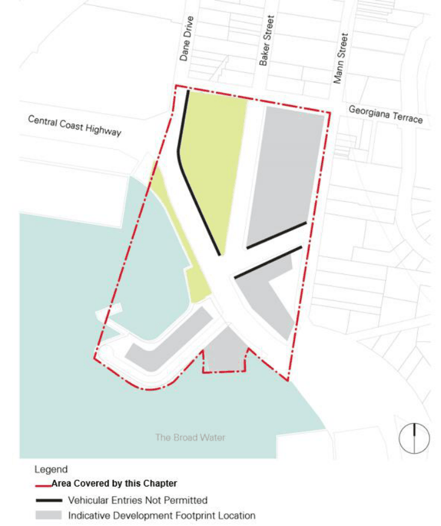

#### 4.4.6 ACCESS, PARKING AND SERVICING

#### 4.4.6.1 Traffic Management

The Gosford Waterfront is located along a major regional road within the Central Coast LGA. The redevelopment of the Gosford Waterfront should aim to mitigate the impacts on the local and regional traffic network and encourage greater use of alternative transport modes.

#### OBJECTIVES

▪ To ensure the traffic impacts of the Gosford Waterfront are appropriately mitigated and assessed.

#### CONTROLS

a Prior to the approval of the first development application for additional floor space within the Gosford Waterfront precinct, a comprehensive traffic and transport study shall be undertaken in accordance with the RMS Guide to Traffic Generating Developments. The study is to investigate the total impacts of the Gosford Waterfront precinct on the surrounding road network. The study must include the consideration of the following, as a minimum:

i Identify the constraints in the existing road network.

ii Demonstrate the capacity and functionality of the road network in catering for the expected future traffic volumes in the area.

iii Detail the impacts upon the regional and state road network at the various stages of development.

iv Consider any other major land use changes that will increase demand on the future road network.

v Provide an indicative road hierarchy and property access strategy for the road network.

vi Identify the necessary road and transport infrastructure improvements/upgrades required as a direct result of the future development of the site.

vii The provision of alternative transport modes and the infrastructure required to support these modes (public transport, pedestrians, cyclists, etc.).

b Consideration of and/or updates to the comprehensive traffic and transport study is required for each development application increasing floor space or amending land use mix within the Gosford Waterfront.

c Any capacity upgrades required on the classified State road network, as a result of the proposed rezoning/development, must be funded by the proponent including the intersection upgrades or mid-block traffic signal installations.

#### 4.4.6.2 Vehicle Access

The design of vehicle access to buildings influences the quality of the public domain. Overly wide and high vehicle access points detract from the streetscape and the active use of street frontages. The design and location of vehicle access to developments should minimise both conflicts between pedestrians and vehicles on footpaths, particularly along pedestrian priority places, and visual intrusion and disruption of streetscape continuity.

▪ To make vehicle access to buildings more compatible with pedestrian movements

▪ Reduce the impact of vehicular access on the public domain

#### CONTROLS Location of Vehicular Access

a Vehicle entries are to avoid those areas shown at Figure 10.

b In all other areas, one vehicle access point only to each proposed building (including the access for service vehicles and parking for non-residential uses) will be generally permitted. Where development is undertaken in stages, access should be consolidated or amalgamated where possible.

c Where practicable, adjoining buildings are to share or amalgamate vehicle access points. Internal on-site signal equipment is to be used to allow shared access. Where appropriate, new buildings should provide vehicle access points so that they are capable of shared access at a later date.

#### Design of Vehicular Access

d Wherever practicable, vehicle access is to be a single lane crossing with a maximum width of 2.7 metres over the footpath, and perpendicular to the kerb alignment. Where a double lane crossing is necessary due to the size of the car park, a maximum width of 6.5 metres may be permitted for safety reasons.

e Vehicle access ramps parallel to the street frontage will not be permitted.

f Ensure vehicle entry points are integrated into building design.

g Doors to vehicle access points are to be roller shutters, or tilting doors fitted behind the building facade and the like.

> [Picture on page 33: a picture, saved as a picture (images/ch-04-04-gosford-waterfront-page-33-1.gif, 150 dpi).]

#### Figure 10 – Restricted Vehicle Entrances

#### 4.4.6.3 Pedestrian Access and Mobility

Any new development must be designed to ensure that safe and equitable access is provided to all, including people with a mobility problems and disabilities.

#### OBJECTIVES

▪ To provide safe and easy access to buildings to enable better use and enjoyment by people regardless of age and physical condition, whilst also contributing to the vitality and vibrancy of the public domain

▪ To ensure buildings and places are accessible to people with a disability

▪ To provide a safe and accessible public domain

a Main building entry points should be clearly visible from primary frontages and enhanced as appropriate with awnings, building signage or high-quality architectural features that improve clarity of building address and contribute to visitor and occupant amenity.

b The design of facilities (including car parking requirements) for disabled persons must comply with the relevant Australian Standard (AS 1428 Pt 1 and 2, or as amended) and the Disability Discrimination Act 1992 (as amended).

c Barrier free access is to be provided to not less than 20% of dwellings in each development and associated common areas.

d The development must provide at least one main pedestrian entrance with convenient barrier free access in all developments to at least the ground floor.

e Pedestrian access ways, entry paths and lobbies must use durable materials commensurate with the standard of the adjoining public domain with appropriate slip resistant materials, tactile surfaces and contrasting colours.

#### 4.4.6.4 Vehicular Driveways and Manoeuvring Areas

#### OBJECTIVES

▪ To minimise the impact of vehicle access points on the quality of the public domain.

▪ To minimise impact of driveway crossovers on pedestrian safety and streetscape amenity.

▪ Minimise stormwater runoff from uncovered driveways and parking areas.

#### CONTROLS

a Driveways should be:

i located taking into account any services within the road reserve, such as power poles, drainage inlet pits and existing street trees, and

ii located a minimum of 6 metres from the perpendicular of any intersection of any two roads.

b Vehicle access is to be integrated into the building design so as to be visually recessive.

c All vehicles must be able to enter and leave the site in a forward direction without the need to make more than a three-point turn.

d Design of driveway crossings must be in accordance with Council’s standard Vehicle Entrance Designs, with any works within the footpath and road reserve subject to a Section 138 Roads Act approval.

e Driveway widths must comply with the relevant Australian Standards.

f Car space dimensions must comply with the relevant Australian Standards.

g Driveway grades, vehicular ramp width/ grades and passing bays must be in accordance with the relevant Australian Standard, (AS 2890.1).

h Vehicular ramps less than 20m long within developments and parking stations must have a maximum grade of 1 in 8. Ramp widths must be in accordance with AS 2890.2.

i Access ways to underground parking should be sited to minimise noise impacts on adjacent habitable rooms, particularly bedrooms.

#### 4.4.6.5 On-Site Parking

On-site parking includes underground (basement), surface (at-grade) and above ground parking, including parking stations.

There are particular constraints in certain areas of Gosford Waterfront on the provision of car parking in underground structures. Due to the high-water table, excavation on certain sites may become difficult beyond one level of basement parking. This may necessitate site design which locates the parking above ground. In these cases, minimising the impacts of above ground parking on the public domain is important.

#### OBJECTIVES

▪ To facilitate an appropriate level of on-site parking provision in the city centre to cater for a mix of development types

▪ To minimise the visual impact of on-site parking

▪ To facilitate the development of a casual paid car park within the Gosford Waterfront

▪ To provide adequate space for parking and manoeuvring of vehicles (including service vehicles and bicycles)

▪ To enable the conversion of above ground parking to other future uses

▪ To recognise the complementary use and benefit of public transport and non-motorised modes of transport such as bicycles and walking

#### CONTROLS General (all development)

a On-site vehicle and bicycle parking is to be provided in accordance with Table 1.

b Car parking and associated internal manoeuvring areas provided over and beyond that required by this chapter and the Central Coast LEP 2022 is to be calculated towards gross floor area.

c On-site parking is to be accommodated underground, or otherwise fully integrated into the design of the building.

d On-site parking must meet the relevant Australian Standard (AS 2890.1 2004 – Parking facilities, or as amended).

e Bicycle parking is to be provided insecure internal and accessible external locations.

f Natural ventilation should be provided to underground parking areas where possible, with ventilation grilles and structures:

i integrated into the overall façade and landscape design of the development,

ii not located on the primary street façade, and

iii oriented away from windows of habitable rooms and private open spaces areas.

g For commercial and retail development providing employment for 20 persons or more, provide adequate change and shower facilities for cyclists. Facilities should be conveniently located close to bike storage areas.

#### Required Parking Rates

h Residential

| Land Use | Parking Requirements |  |
|---|---|---|
| i Shop Top Housing | 1 car space/dwelling |  |
| ii Residential Flat Building | • | 1 car space |
| - Residential parking - 1 |  |  |
| bedroom dwelling |  |  |
| iii Residential Flat Building | • | 1.2 car spaces |
| - Residential parking - 2 |  |  |
| bedroom dwelling |  |  |
| iv Residential Flat Building | • | 1.5 car spaces |
| - Residential parking – |  |  |
| 3+ bedroom dwelling |  |  |
| v Residential Flat Building | • | 1 space / 800m2 residential |
| - Visitor Parking |  | GFA (maximum rate) |
| vi Residential Flat Building -Motorcycle parking | • | 1 space/15 dwellings (or part thereof) |
| vii Residential Flat Building | • | resident’s space/3 dwellings, |
| -Bicycle parking |  | and |
|  | • | 1 visitor’s space/12 dwellings |
|  |  | (or part thereof) |
| viii Housing for Seniors or | As per SEPP (Housing) 2021 |  |
| persons with disability |  |  |
| ix Aged Care Hostels, | • | Not less than 1 car space/10 |
| Nursing Homes, |  | beds |
| Convalescent Homes - Car Parking | • • | Not less than 1 car space/2 employees Not less than 1 parking space |
| x Aged Care Hostels, |  | suitable for an ambulance |
| Nursing Homes, | • | 1 motorcycle space/25 car |
| Convalescent Homes - |  | spaces (or part thereof) |
| Motorcycle Parking |  |  |

i Tourism

#### Land Use

#### Parking Requirements

i Hotel Accommodation, Motel Units, Tourist Units (including serviced apartments that are not strata titled) –  Car

#### Parking

• 1 space/3 accommodation unit, plus

• 1 space/for every 2 persons employed in connection with the development and on duty at any one time.

• Restaurants, function rooms, etc. associated with the development and open to the general public require additional parking at the rate for that use.

• 1 space/25 car spaces (or part thereof)

ii Hotel Accommodation, Motel Units, Tourist Units (including serviced apartments that are not strata titled) -

#### Motorcycle parking iii Boarding House – Car Parking

• 1 space/2 bedrooms (or part thereof), plus

• 1 space/residential manager, plus

• 1 space/2 employees

iv Boarding House –

#### Motorcycle Parking

• 1 space/25 car spaces (or part thereof)

v Youth Hostel,

#### Backpacker Hostel – Car Parking

• 1 space/5 occupants/lodgers, plus

• 1 space/residential manager, plus

• 1 space/2 employees

vi Youth Hostel,

#### Backpacker Hostel – Motorcycle Parking

• 1 space/25 car spaces (or part thereof)

Applies to uses where the accommodation is directed to travellers, a majority of whom

do not use private motor vehicles)

j Recreation

| Land Use | Parking Requirements |  |
|---|---|---|
| i Licensed Hotel, | • | space/133m2 GFA |
| Tavern/Club – Car |  | (maximum rate) |
| Parking |  |  |
| ii Youth Hostel, |  |  |
| Backpacker Hostel – Car | • | 1 space/25 car spaces |
| Parking – Motorcycle |  | (or part thereof) |
| Parking |  |  |
| iii Recreational Facility – | • | 1 space/25m2 GFA |
| Car Parking |  |  |
| iv Recreational Facility – Motorcycle Parking | • | 1 space/25 car spaces (or part thereof) |
| v Recreational Facility – | • | 1 space/200m2 GFA |
| Bicycle Parking |  |  |

k Commercial and Retail

| Land Use | Parking Requirement |  |
|---|---|---|
| i Commercial Premises | • | 1 space/80m2 GFA |
| (Office) – Car Parking |  | (maximum rate) |
| ii Commercial Premises |  |  |
| (Office) – Motorcycle Parking | • | 1 space/25 car spaces (or part thereof) |
| iii Commercial Premises | • | 1 space/200m2 GFA for |
| (Office) – Bicycle Parking | • | employees 1 space/750m2 GFA for visitors |
| iv Professional Consulting | • | 3 spaces/surgery or |
| Rooms, Medical |  | consulting rooms, plus |
| Practices – Car Parking | • | 1 space/professional practitioner and other staff present at any one time |
| v Professional Consulting Rooms, Medical Practices – Motorcycle | • | 1 space/25 car spaces (or part thereof) |
| Parking |  |  |

| Part 4 Major Centres |  |
|---|---|
| Chapter 4.4 Gosford Waterfront |  |
| vi Professional Consulting • | 1 space/4 consulting |
| Rooms, Medical | rooms |
| Practices – Bicycle |  |
| Parking |  |
| vii Service Stations • | Minimum 4 car spaces, plus |
| • | 6 spaces/service bay |
| (Convenience stores and |  |
| restaurants attached to a service |  |
| station require additional |  |
| parking calculated at the |  |
| respective rated designated for |  |
| those uses.) |  |
| viii Motor Showrooms – Car • | 1.5 spaces/200m2 site, |
| Parking | plus |
| • | 6 spaces/service bay or 1 space/2persons employed in connection with the use |
| ix Motor Showrooms – • | 1 space/25 car spaces |
| Motorcycle Parking | (or part thereof) |
| x Drive-in Liquor Outlet – • | 2 spaces, plus |
| Car Parking • | 1 space/person employed in connection with the use and on duty at any one time |
| (These spaces to be exclusive of |  |
| the driveway area used for |  |
| queuing and service to |  |
| customers in their vehicle) |  |
| xi Furniture and Building • Materials Showroom – | 1 space/45m2 GFA |
| Car Parking |  |
| xii Shops – Car Parking • | 1 space/50m2 GFA (maximum rate) |
| xiii Shops – Motorcycle • | 1 space/25 car spaces |
| Parking | (or part thereof) |
| xiv Shops – Bicycle Parking • | 1 space/200m2 GFA for employees |

|  |  | • | 1 space/750m2 GFA for |
|---|---|---|---|
|  |  |  | visitors |
| xv | Restaurants - Car Parking | • | 1 space/30m2 GFA (maximum rate) |
| xvi | Restaurants - |  |  |
|  | Motorcycle Parking | • | 1 space/25 car spaces (or part thereof) |
| xvii | Restaurants – Bicycle Parking | • | 1 space/200m2 GFA (staff and patrons) |
| xviii | Retail Markets – Car Parking | • | 1 space/18m2 |
| xix | Retail Markets – |  |  |
|  | Motorcycle Parking | • | 1 space/25 car spaces |
| xx | Retail Markets – Bicycle Parking | • • | (or part thereof) 1 space/750m2 GFA for employees 1 space/1000m2 for shoppers |

(This provision does not apply to approved markets operated by a community organisation for charitable purposes.)

l Community Facilities

| Land Use | Parking Requirement |  |
|---|---|---|
| i Place of Worship and | • | 1 space/27m2 GFA |
| Place of Assembly – Car |  | (maximum rate) |
| Parking |  |  |
| ii Place of Worship and |  |  |
| Place of Assembly – | • | 1 space/25 car spaces |
| Motorcycle Parking |  | (or part thereof) |
| iii Place of Worship and Place of Assembly – | • | 1 space/50 seats |
| Bicycle Parking |  |  |
| iv Child Care, Child | • | 1 space per person |
| Minding Centre, |  | employed in connection |
| Kindergarten, Pre- School - Car Parking | • | with the use, plus A temporary stand area at the rate of 1 space/6 children (a minimum of |

| v | Child Care, Child Minding Centre, Kindergarten, Pre- School - Motorcycle |  | 5 temporary stand areas) |
|---|---|---|---|
|  | Parking | • | 1 space/25 car spaces |
|  |  |  | (or part thereof) |
|  |  | (The temporary standing area |  |
|  |  | is to be designed so that |  |
|  |  | vehicles can enter or leave the |  |
|  |  | site moving in a forward |  |
|  |  | direction and without |  |
|  |  | conflicting with other |  |
|  |  | traffic/parking movements.) |  |
| vi | Hospital – Car Parking | • | 1 space/35m2 GFA |
| vii | Hospital – Motorcycle |  | (maximum rate) |
|  | Parking | • | 1 space/25 car spaces |
|  |  |  | (or part thereof) |
| viii | Schools, Educational Establishments – Car Parking | • | 1 space/1111m2 GFA (maximum rate) |
| ix | Schools, Educational Establishments – Motorcycle Parking | • | 1 space/25 car spaces (or part thereof) |
| x | Schools, Educational Establishments – Bicycle Parking | • | 1 space/5 students above Grade 4 |

m Other Uses

| Land Use | Parking Requirement Where not specified, the RMS guidelines will be applied to developments of a minor nature including extensions, etc. However for a major proposal the application is to |
|---|---|

be supported by a Traffic Impact Statement with recommendation as to the appropriate provision for on-site car, motorcycle and bicycle parking.

#### Variations and Compliance

a On-site parking will be required in accordance with the standards of this plan except where good cause can be shown as to why strict compliance is unnecessary.

b Requests for variation must be supported by information and data to substantiate that an alternative standard is appropriate. Except for minor variations, this information should take the form of a Traffic Impact Statement and/or Parking Needs Survey carried out by suitably qualified consultants.

c For developments incorporating different categories of uses, a separate calculation will be made for each component. Parking needs will be calculated on peak time. However, where peak demands for each land use component of the development are staggered, and this can be demonstrated to the satisfaction of the Council, a reduction in the total number of spaces required may be accepted.

#### Existing Development

d Where an existing building is to be replaced by a new building which has a floor area not exceeding the floor area of the existing building and no change of use is proposed, no additional parking is required to be provided. Any existing parking on the site, up to the number of spaces required under this plan for the existing development, or any requirement of the consent for the existing development, must be maintained on the site.

e Where an existing building is to be replaced by a new building,

i having a floor area greater than the existing building, and/or

ii which will have a different use and/or

iii where renovations, alterations or additions create potential to generate additional visitor and customer demand;

iv car parking is to be provided as calculated for the new building area and use.

#### Change of Use

f Nothing in this plan shall be applied to require that additional parking is required for the conversion of existing commercial floor space to either retail or restaurant land use in the Gosford Waterfront.

#### Car parking for Persons with Disability

Provision is to be made for persons with disability in the provision of car parking facilities, and in accordance with Australian Standard AS 2890.1 - 1993.

g Where car parking is provided in excess of five (5) spaces, provision shall be made for parking for persons with a disability at the rate of one (1) space per one hundred (100) or part thereof of car spaces provided. A higher proportion of such spaces may be required for uses which are likely to generate a higher demand for such facilities.

h The location of spaces designated for persons with disability should be close to an entrance to a building or facility with access from the car space by ramps and/or lifts in accordance with Australian Standard AS 1428.1 and Part D3 of the Building Code of Australia.

i Car spaces provided under this provision shall be kept or made available for use by persons with disability as required.

j In any residential development, consideration should be given to providing garages in accordance with the dimensions for class 4 spaces under AS 2890.1 - 1993. This would provide flexibility in making such facilities available for occupants with disability, or if not so used, provide domestic storage space.

#### 4.4.6.6 Site Facilities and Services

#### OBJECTIVES

▪ To ensure that site facilities (such as clothes drying areas, mail boxes, recycling and garbage disposal units/areas, screens, lighting, storage areas, air conditioning units and communication structures) are effectively integrated into the development and are unobtrusive

▪ To ensure that site services and facilities are adequate for the nature and quantum of development

▪ To establish appropriate access and location requirements for servicing

▪ To ensure service requirements do not have adverse amenity impacts

#### CONTROLS Mailboxes

a Provide mail boxes for residential building and/or commercial tenancies in one accessible location adjacent to the main entrance to the development.

b They should be integrated into a wall where possible and be constructed of materials consistent with the appearance of the building.

c Mail boxes shall be secure and large enough to accommodate articles such as newspapers.

#### Communication structures, air conditioners and service vents

d Locate satellite dish and telecommunication antennae, air conditioning units, ventilation stacks and any ancillary structures:

i away from the street frontage,

ii integrated into the roof-scape design and in a position where such facilities will not become a skyline feature at the top of any building, and

iii adequately setback from the perimeter wall or roof edge of buildings.

#### Waste (garbage) storage and collection (all development)

e All development is to preferably accommodate waste handling and storage on-site. The size, location and handling procedures for all waste, including recyclables, is to be determined in accordance with Council waste contract and advice from Council’s Waste and Emergency Services staff.

f Access for waste collection and storage is preferred from rear lanes, side streets or rights of ways.

g Waste storage areas are to be designed to:

i ensure adequate driveway access and manoeuvrability for any required service vehicles,

ii be located so as not to create any adverse noise impacts on the existing developments or sensitive noise receptors such as habitable rooms of residential developments, and

iii be screened from the public way and adjacent development that may overlook the area.

h The storage facility must be well lit, easily accessible and on level grade for movement of bins, free of obstructions that may restrict movement and servicing of bins or containers and designed to minimise noise impacts.

#### Location requirements for waste storage areas and access

i Where waste volumes require a common collection, storage and handling area, this is to be located:

i for residential fly at buildings, enclosed within a basement or enclosed carpark,

ii for multi-unit housing, at ground behind the main building setback and façade, or within a basement or enclosed carpark, and

iii for commercial, retail and other development, on-site in basements or at ground level within discrete service areas not visible from main frontages.

j Where above ground garbage collection is prohibitive or impractical due to limited street frontage, or would create an unsafe environment, an on-site basement storage area must be provided.

k Where a waste vehicle is required to enter the site, access and circulation areas shall be designed to accommodate Council’s current waste contractor vehicles. Designs should conform to Council’s current technical standards, any access route for waste collection vehicles and operators is subject to a Section 88B Instrument under the Conveyancing Act for right of access being provided prior to an occupational certificate being issued.

#### Service Docks and loading/unloading areas

l Provide adequate space within any new development for the loading and unloading of service/delivery vehicles.

m Preferably locate service access off rear lanes, side streets or rights of way.

n Screen all service doors and loading docks from street frontages and from active overlooking from existing developments.

o Design circulation and access in accordance with AS 2890.1.

p Fire service and emergency vehicles

q For developments where a fire brigade vehicle is required to enter the site, vehicular access, egress and manoeuvring must be provided to, from and on the site in accordance with the NSW Fire Brigades Code of Practice - Building Construction - NSWFB Vehicle Requirements.

r Generally, provision must be made for NSW Fire Brigade vehicles to enter and leave the site in a forward direction where:

s NSW Fire Brigade cannot park their vehicles within the road reserve due to the distance of hydrants from the building or restricted vehicular access to hydrants, or

t otherwise required by the NSW Fire Brigades Code of Practice – Building Construction NSWFB Vehicle Requirements.
