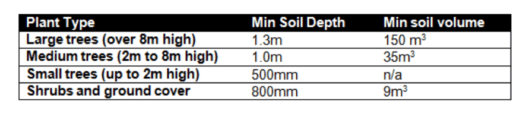

#### 4.4.7 LANDSCAPING

#### 4.4.7.1 Landscape Design

Landscape design includes the planning, design, construction and maintenance of all utility, open space and garden areas. Good landscaping provides breathing space, passive and active recreational opportunities and enhances air quality. It is fundamental to the amenity and quality of outside space for residential areas.

#### OBJECTIVES

▪ To ensure that the use of potable water for landscaping irrigation is minimised

▪ To ensure landscaping is integrated into the design of development

▪ To add value and quality of life for residents and occupants within a development in terms of privacy, outlook, views and recreational opportunities

▪ To improve stormwater quality and control run-off

▪ To improve the microclimate and solar performance within the development

▪ To improve urban air quality and contribute to biodiversity

#### CONTROLS

a Landscaped areas are to be irrigated with recycled water, where available.

b Remnant vegetation must be maintained throughout the site wherever practicable.

c A long-term landscape concept plan must be provided for all landscaped areas, in particular the deep soil landscape zone.

#### 4.4.7.2 Planting on Structures

The following controls apply to planting on roof tops or over car park structures, particularly for communal open space required as a component of mixed use or residential development, and in non-residential developments where the landscaping proposed is not on natural ground.

Constraints on the location of car parking structures due to water table conditions may mean that open spaces and courtyards might need to be provided over parking structures. The plants in these areas are grown in total containment with artificial soils, drainage and irrigation and are subject to a range of environmental stresses that affect their health, and ultimately their survival. Quality landscape design and open space amenity relies in part on the quality and health of plants.

#### OBJECTIVES

▪ To contribute to the quality and amenity of open space on roof tops and internal courtyards

▪ To encourage the establishment and healthy growth of trees in urban areas

▪ To minimise the use of potable water for irrigating planting on structures

▪ To improve the microclimate of the development site

#### CONTROLS

a Areas with planting on structures are to be irrigated with recycled water, where available.

b Design for optimum conditions for plant growth by:

i providing soil depth, soil volume and soil area appropriate to the size of the plants to be established,

ii providing appropriate soil conditions and irrigation methods, and

iii providing appropriate drainage.

c Design planters to support the appropriate soil depth and plant selection by:

i ensuring planter proportions accommodate the largest volume of soil possible and soil depths to ensure tree growth, and

ii providing square or rectangular planting areas rather than narrow linear areas.

d Increase minimum soil depths in accordance with:

i the mix of plants in a planter for example where trees are planted in association with shrubs, groundcovers and grass,

ii the level of landscape management, particularly the frequency of irrigation,

iii anchorage requirements of large and medium trees, and

iv soil type and quality

e Provide sufficient soil depth and area to allow for plant establishment and growth. The following minimum standards are recommended:

> [Picture on page 47: a picture, saved as a picture (images/ch-04-04-gosford-waterfront-page-47-18.gif, 150 dpi).]
