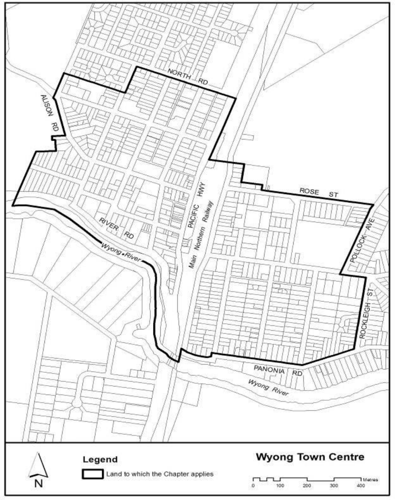

#### 4.5.1.3 Relationship to other Chapters and Policies

This Chapter should be read in conjunction with other relevant Chapters of this Development Control Plan and other Policy Documents of Council, including but not limited to:

▪ Chapter 2.1: Dwelling Houses, Secondary Dwellings and Ancillary Development

▪ Chapter 2.2: Dual Occupancies and Multi-Dwelling Housing

▪ Chapter 2.3: Residential Flat Buildings and Shop-Top Housing

▪ Chapter 2.13: Transport and Parking

▪ Chapter 5.48: Northern Areas -Public Art

▪ Chapter 3.6: Heritage Conservation

> [Picture on page 2: a picture, saved as a picture (images/ch-04-05-wyong-town-centre-page-2-1.gif, 150 dpi).]

#### Figure 1 Wyong Town Centre Area
