#### 4.5.2.2 Heritage Theme

One of the main visions for the Wyong Town Centre is to become the cultural and heritage focus area and a culturally-based tourist destination for people visiting and living on the Central Coast. There is a relatively large concentration of heritage items in the Wyong Town Centre compared to other towns on the Central Coast Accordingly, a heritage theme has been adopted for the Wyong Town Centre to preserve and reinforce its historic character.

This section describes the significance of the Wyong Town Centre and identifies the general Heritage Character Areas for the purposes of providing a context for development in the Wyong Town Centre.

#### 4.5.2.2.1 Aboriginal Heritage in the Wyong Town Centre

Council has adopted a Thematic History which provides some information on the Aboriginal heritage of the Wyong Town Centre. A copy of this history can be obtained by contacting Council. This history talks about Aboriginal Territories that may have been near the Wyong Town Centre, which include the Lower Wyong River and Jilliby Creek Valleys. Due to the Wyong Town Centre’s proximity to the river, it can be expected that Aboriginal archaeological sites might appear in the Wyong Town Centre area. For these reasons reference to heritage in the Wyong Town Centre should include Aboriginal heritage as well.

#### OBJECTIVES

▪ To acknowledge Aboriginal people as the traditional custodians of the Central Coast

▪ To provide a reference to the Aboriginal heritage of Wyong in public art

▪ To preserve existing sites of significance to Aboriginal people in the Wyong Town Centre

#### REQUIREMENTS

a Public signage at Gateway locations is to provide appropriate reference to local Aboriginal heritage.

b Development that is required to have Public Art shall incorporate the work of a local Aboriginal artist to a value of at least 20% of the total budget for Public Art.

c If a Section 10.7 Certificate describes a site as having archaeological significance, an assessment of the site must be carried out in accordance with Chapter 3.4: Heritage (European and Aboriginal)

#### 4.5.2.2.2 Built Heritage

Council has adopted a Thematic History which provides information on the built heritage of the Wyong Town Centre. A copy of this history can be obtained by contacting Council. The most significant drivers of development in the Wyong Town Centre were the Great Northern Railway (c. 1887) and the accompanying timber, farming and dairy industries. A photo of railway sleepers being loaded at Wyong Station is shown in Figure 2 below.

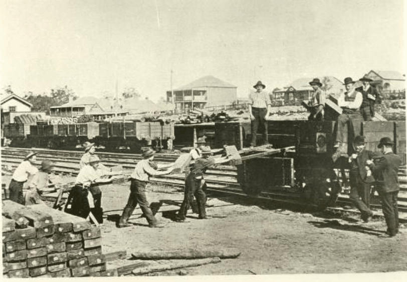

> [Picture on page 5: a picture, saved as a picture (images/ch-04-05-wyong-town-centre-page-5-1.gif, 150 dpi).]

Figure 2 Photograph of Railway Sleepers being loaded at the Wyong Railway Yard c.1904

(Source: Stinson c1909)

In the 20th Century roads and transport changed the character to that of a service town. Some of the historic buildings typical of the period remain today, such as the Chapman stores, which are shown in Figure 3 below.

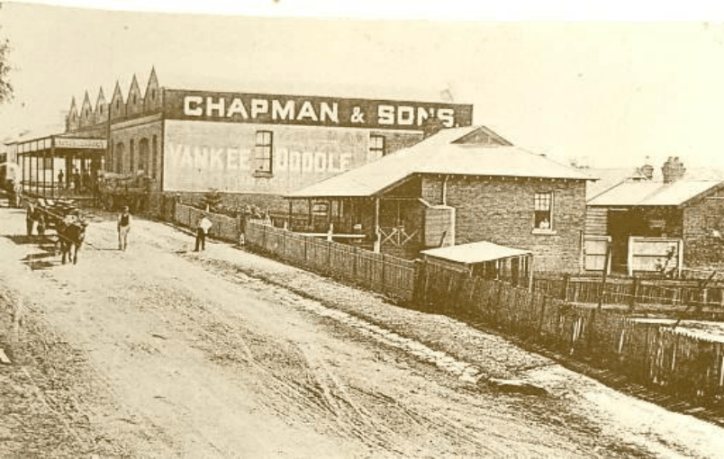

> [Picture on page 5: a picture, saved as a picture (images/ch-04-05-wyong-town-centre-page-5-6.gif, 150 dpi).]

#### Figure 3 Photograph of the Chapman Stores c.1901

#### 4.5.2.2.3 Heritage Items and Heritage Conservation Area

Heritage Items and the Heritage Conservation Area in the Wyong Town Centre are identified in the Central Coast LEP 2022. Photos of a selection of these heritage items are shown at Figure 5. For the current listing of heritage items refer to the Central Coast LEP 2022.

In the 2011 Wyong Shire-wide Heritage Review, a statement of significance was prepared about the heritage value of the Wyong Town Centre conservation area which is provided below:

“The Wyong Town Centre is a fine representative example of a town centre that retains good examples of civic, commercial and residential development constructed up until c. 1945 of high integrity. It remains largely intact in terms of retaining its historical subdivision pattern, its natural features located above the River, its built fabric and landscaping and the prominence of the Railway. Collectively, the built environment, transport links and natural features of the town centre contributes to it being a unique precinct that captures the historical development of an important town centre that retains its historical setting and character.

The town centre retains examples of its historic development across a broad range of historic themes including Aboriginal heritage, European heritage, other cultural and social heritage, natural heritage, and themes such as transport, agriculture, commerce, education, health, government and law and order. The conservation area is of historic, aesthetic, technical and cultural significance. Given its level of intactness and integrity, it is of high local heritage significance.”

#### OBJECTIVE

▪ To reinforce and preserve the existing heritage character of the Wyong Town Centre

#### REQUIREMENT

A Heritage Impact Statement will be required for new work to Heritage Items or new work on sites adjacent to Heritage items. In the example at Figure 4 below, a new development is proposed next to the Turton Heritage Building. The new development is adjacent to a heritage item, so will require a Heritage Impact Statement and need to adhere to the development provisions in Chapter 3.6: Heritage Conservation.

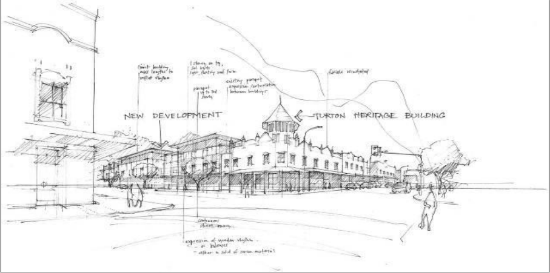

> [Picture on page 6: a picture, saved as a picture (images/ch-04-05-wyong-town-centre-page-6-25.gif, 150 dpi).]

#### Figure 4 Example of new development requiring a Heritage Impact Statement

Police Station and Quarters

Former Court House

Dwelling

Alison Road

Alison Road

Alison Road

Former Public School

Retail Store

St Cecilia’s Catholic Church Group, Byron Street

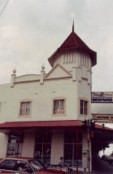

> [Picture on page 7: a picture, saved as a picture (images/ch-04-05-wyong-town-centre-page-7-11.gif, 150 dpi).]

Church Street

Alison Road

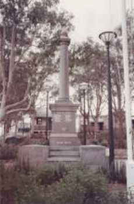

> [Picture on page 7: a picture, saved as a picture (images/ch-04-05-wyong-town-centre-page-7-14.gif, 150 dpi).]

Dwelling

Hope Street

World War I and II

Shops

Monument, Church Street

Dwelling

Corner Church Street and Pacific Highway

Hope Street

Dwelling

Former Rural Bank

Brisbane Water Ambulance Station, Pacific Highway

Hope Street

Pacific Highway

Shopping Complex

Wyong Railway Station

Former Methodist Church

Pacific Highway

Pacific Highway

Rankens Court

(recently burnt down)

Commercial Office

Council Building,

Building, Rankens Court

Corner Hely Street and Anzac Avenue

#### Figure 5 Photos of selected Wyong Town Centre heritage items

#### 4.5.2.2.4 Heritage Character Areas

Within the Wyong Town Centre area there are six main building precincts of generally consistent architectural style and character:

1 Wyong Hill Community Area 2 Railway Station Area 3 Pacific Highway and Alison Road 4 Administration Area 5 West Wyong Residential 6 East Wyong Residential

These Heritage Character Areas have been identified on the map below at Figure 6.

#### OBJECTIVE

▪ To enable new development that respects the existing character that has been established and integrates successfully with existing development within the Heritage Character Area

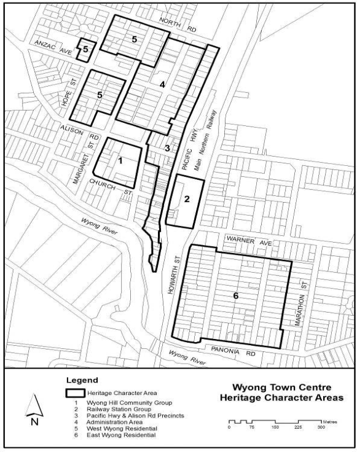

> [Picture on page 9: a picture, saved as a picture (images/ch-04-05-wyong-town-centre-page-9-14.gif, 150 dpi).]

#### Figure 6 Heritage character areas in the Wyong Town Centre

#### Precinct 1 – Wyong Hill Community Area

The Wyong Hill Community Area is centred on Wyong Town Park. Within its area are significant public structures including the former Wyong Public School (the oldest surviving building in Wyong Town Centre), the former Court House, and the WW1 and WW2 Memorial. The area is of social, historical and aesthetic significance.

#### REQUIREMENTS

a Maintain the ‘hill top’ effect. Any development within the vicinity of Wyong Hill Community Area must consider the impact of building bulk and scale in relation to Wyong Hill to ensure that Wyong Hill retains its prominence as a high point in the Wyong Town Centre.

b Provide opportunities for viewing aspects of the Wyong Town Centre and maintain visual links to Alison Road and Rankens Court.

c Development must make provision for accessibility in order to ensure that the area becomes a focal point for open-air activities in the Wyong Town Centre.

#### Precinct 2 – Railway Station Area

The Railway Station Area includes late-Victorian style railway buildings (now much altered) and the 1920s Railway Square shops constructed by A.H. Warner in an inter-War Gothic Style. The buildings are of historic, social and architectural significance because of their roles in the growth of the Wyong Town Centre.

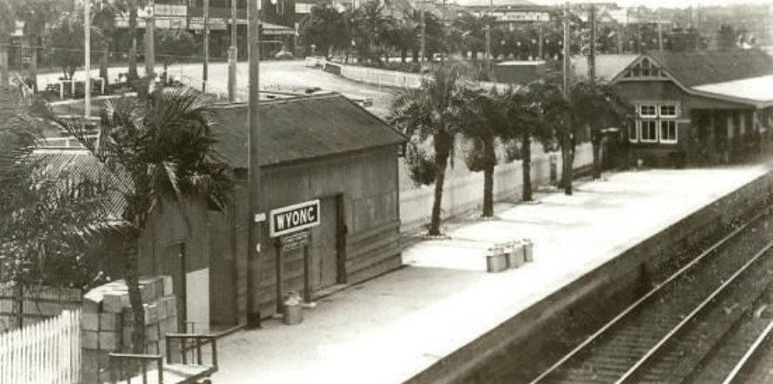

> [Picture on page 10: a picture, saved as a picture (images/ch-04-05-wyong-town-centre-page-10-18.gif, 150 dpi).]

#### Figure 7 Historic photo of Wyong Railway Station built in 1887

(Source: Rod Howard Heritage Conservation, 1994)

#### REQUIREMENTS

a Development must retain heritage items located within the railway station area.

b New buildings must respect the existing heritage structures, and be sympathetic in form and visual relationship.

#### Precinct 3 – Pacific Highway and Alison Road

The Pacific Highway and Alison Road area incorporates buildings in a strip along the western edge of the Pacific Highway and up Alison Road to the Wyong Town Park Hill. It includes a range of commercial buildings such as hotels, cafes and shops. The architectural style of the area is dominated by a low-budget Modernist approach, often exemplified by the successive modernisations of street facades undertaken in the decades after World War 2.

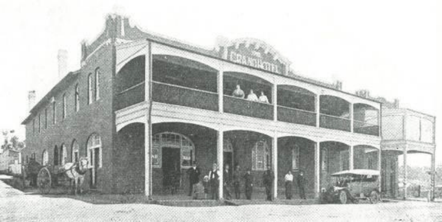

> [Picture on page 11: a picture, saved as a picture (images/ch-04-05-wyong-town-centre-page-11-7.gif, 150 dpi).]

#### Figure 8 Historic photo of the Grand Hotel on the Pacific Highway

(Source: Stinson)

#### REQUIREMENTS

a New development should respect boundary setbacks of existing buildings.

b Ensure future development addresses the Wyong River on those sites with frontage to River Road.

c Ensure uses above ground level that complement existing uses at ground floor level.

d Ensure that new development is complementary to and consistent with the form, scale, height, and detail of the existing building stock in the vicinity. An example of new development that is compatible with the existing form, scale and height of an adjacent heritage building is provided below at Figure 9.

Example of Commercial Heritage Infill Development:

Figure 9 below shows an example of new development on Church Street adjacent to a prominent heritage building along the Pacific Highway. The new development is built to the boundary which is consistent with the existing zero setback in an urban street. The scale and form of new development respects that of the heritage building. Upper levels of the new development are setback behind the front façade and do not detract from the historic turret that is a landmark along the Pacific Highway.

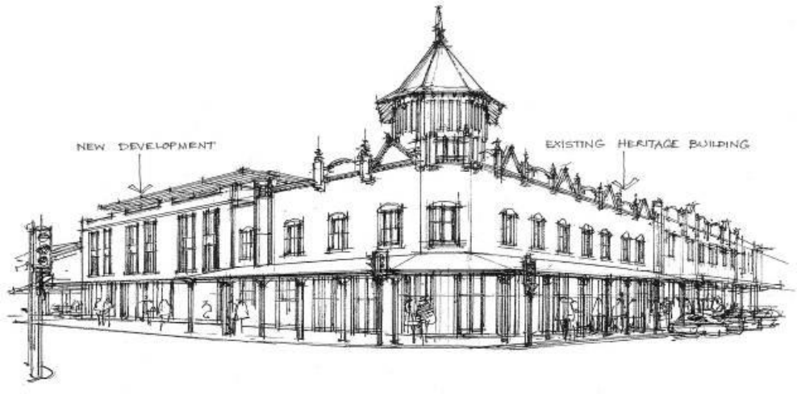

> [Picture on page 12: a picture, saved as a picture (images/ch-04-05-wyong-town-centre-page-12-7.gif, 150 dpi).]

Figure 9 Example of new development compatible with the scale of an adjacent heritage

building

#### Precinct 4 – Administration Area

The buildings along Hely Street, Anzac Avenue and Margaret Street are relatively large-scale free-standing, Modernist design government administrative and community buildings constructed at various times after World War 2. Within the Administration Area is the Council Chambers building (1959), the Wyong Fire Station (c.1960), and the Wyong Memorial Community Hall (1965). The buildings in the Administration Area contribute to the social and historic significance of Wyong as a centre of Government administration.

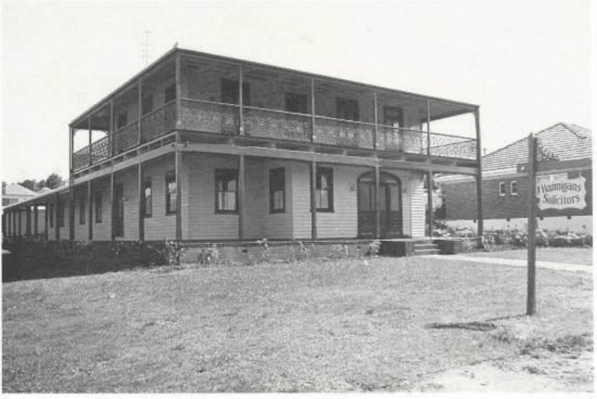

> [Picture on page 13: a picture, saved as a picture (images/ch-04-05-wyong-town-centre-page-13-7.gif, 150 dpi).]

#### Figure 10 Solicitors’ offices in an historic building on Margaret Street

(Source: Stinson)

#### REQUIREMENTS

a Ensure future developments are consistent with and complement the existing characteristics of this area.

b New development should respect boundary setbacks of existing buildings and maintain distinctive freestanding arrangement of buildings.

#### Precinct 5 – Residential Cottages

This area is characterised by its uniformity of freestanding single storey typically timber dwellings on large allotments of land on gentle hill-slopes. The dwellings are of modest proportions, with larger, more substantial and opulent buildings in select locations nearer the top of the hill and adjacent to the Wyong River. The houses in the Residential Cottages area are from all periods of the 20th century and are representative of the housing stock evident throughout the Wyong Town Centre. The houses are of aesthetic and cultural/historic significance for their potential to demonstrate the architectural styles, forms, scale and materials of residential living in the Wyong Town Centre.

#### REQUIREMENTS

a Design of new houses on existing allotments should complement, not imitate, nearby existing houses.

b The setback of new houses on existing allotments should match adjacent existing houses.

c Any infill development must be set back behind the existing stock.

d The form, bulk, scale and detailing of new houses on existing allotments should be consistent with nearby houses. An example of new development that is compatible with the existing form, bulk, scale and detailing of an adjacent heritage building is provided below at Figure 11.

Example of Residential Heritage Infill Development:

Figure 11 below shows a well-considered example of Residential Heritage Infill Development behind an existing heritage cottage on Hope Street. The new development is set back behind the existing heritage cottage. The width of the development mimics the scale of the cottage and the three storey height of the development is set down the hill from the cottage, so that the overall form does not overwhelm the existing cottage when viewed from the street. In addition, the change of materials on the façade further breaks up the apparent scale. The new development has a masonry base and the timber used as a highlight on the gable end reinterprets the timber used in the historic cottage.

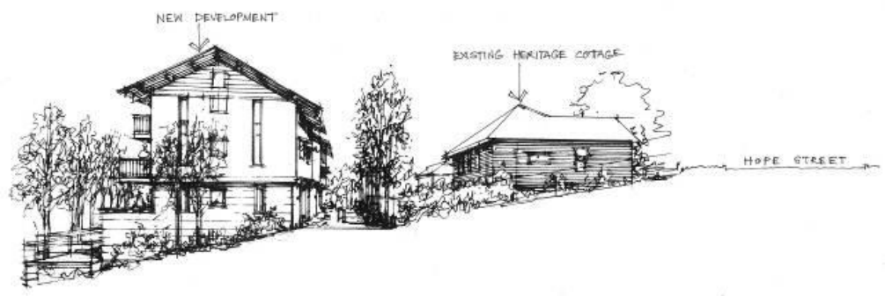

> [Picture on page 14: a picture, saved as a picture (images/ch-04-05-wyong-town-centre-page-14-14.gif, 150 dpi).]

#### Figure 11 Example of residential heritage infill development at Hope Street

#### 4.5.2.2.5 Heritage Setbacks OBJECTIVE

▪ To provide sufficient separation so that new development does not have a negative impact on heritage buildings and permits appreciation of the significant aspects of the adjoining heritage building

#### REQUIREMENTS

a Buildings adjacent to heritage buildings are to have a maximum height of four storeys stepping down to two storeys at street frontages.

b Buildings adjacent to heritage buildings are required to have sufficient appropriate setback from significant parts of the heritage item. This is especially important at the street address and should be in the order of 3-5 metres. The exception to this requirement is in urban commercial areas where zero lot setbacks are permitted and are part of the existing character of the streetscape.

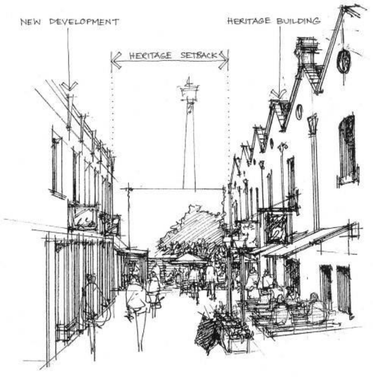

> [Picture on page 15: a picture, saved as a picture (images/ch-04-05-wyong-town-centre-page-15-12.gif, 150 dpi).]

Figure 12 Example of separation between a heritage building and new development on Hely

#### Street

#### 4.5.2.2.6 Heritage Materials and Colours

In order to maintain the overall integrity of Heritage Buildings, any new work should incorporate the use of traditional materials and colours in the external façade where appropriate. Traditional materials and colours can also be used for detailing in new development in the Wyong Town Centre to support the Heritage Theme.

#### OBJECTIVE

To maintain a traditional materials and colour palette for heritage buildings and to incorporate some reference to traditional materials and colours into new buildings

#### REQUIREMENTS

a Refer to the requirements in the Chapter 3.6: Heritage Conservation for new works to Heritage Buildings.

b For works in other areas of the Wyong Town Centre consider reinterpreting and incorporating some heritage materials into new buildings. Heritage materials that are characteristic of the Wyong Town Centre include sandstone, timber, brickwork and metal roofing as shown in Figure 13 below.

c For development that does not involve works to Heritage Buildings, consider incorporating some traditional heritage colours in certain areas. For example, colour can be used to highlight a repetitive building element that introduces a human scale to a contemporary design.

d Commercial ranges of ‘heritage’ colours from major paint suppliers and reference texts are available to assist selection. An example of a traditional range of paint colours is shown in Figure 15 below.

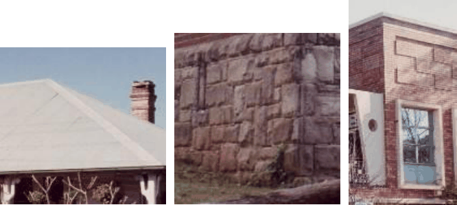

> [Picture on page 16: a picture, saved as a picture (images/ch-04-05-wyong-town-centre-page-16-20.gif, 150 dpi).]

Metal Roofing

Sandstone

Brickwork

Timber

Figure 13 Examples of traditional materials found in the Wyong Town Centre heritage buildings

Example of heritage materials in new Development:

An example of heritage materials used in a masonry base of a new development adjacent to a heritage building is shown at Figure 14.

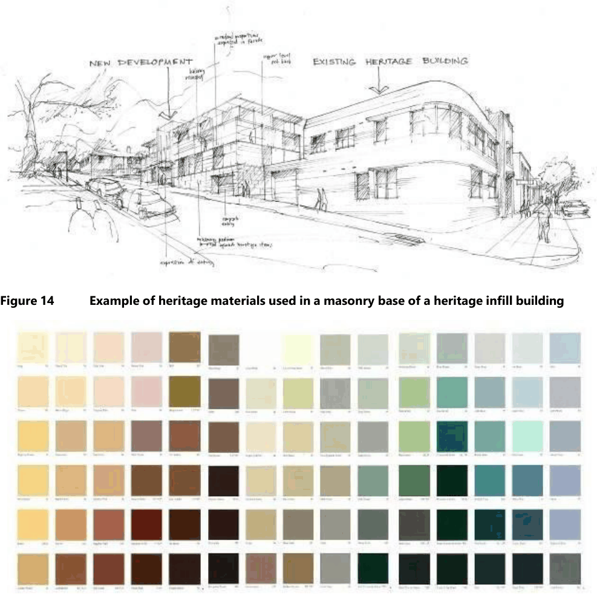

> [Picture on page 17: a picture, saved as a picture (images/ch-04-05-wyong-town-centre-page-17-4.gif, 150 dpi).]

Figure 14 Example of heritage materials used in a masonry base of a heritage infill building

#### Figure 15 Example of heritage colours by Dulux
