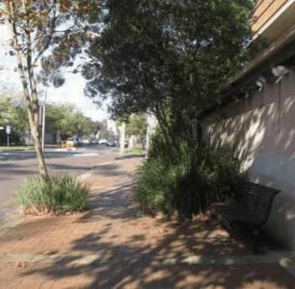
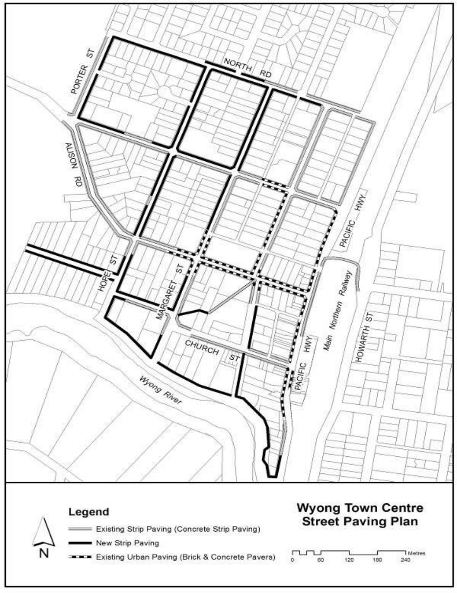
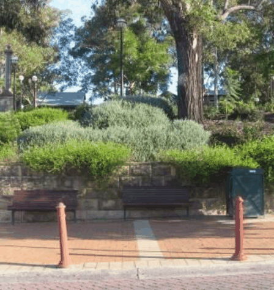

#### 4.5.2.3 Streetscape and Public Areas

#### OBJECTIVES

▪ To provide a range of features which create an identifiable heritage character for the public realm of the Wyong Town Centre and the surrounding residential areas

▪ To provide street furniture in appropriate locations that is well designed, distinctive and will complement existing items, including the heritage theme

▪ To provide unique lighting for the public realm that is high quality, well designed, appropriate to the location, adds safety and liveliness to the town and is of a scale suited to pedestrian activity

▪ To ensure a practical and safe ground surface for the public realm which must meet specific criteria in terms of appearance, structural properties, cost, quality control and cleaning

#### REQUIREMENTS

#### 4.5.2.3.1 Paving

a Provide street paving in front of new development in accordance with Figures 16 and 17 below.

b The individual character of special precincts or places should be identified and enhanced with lighting, planting, street furniture, public art, signage, and paving material provided that is consistent with the location.

c Heritage items or buildings of significance are to be highlighted and interpreted by the use of bronze plaques in the paving, which provide a brief history of the particular building. An example of a plaque is shown in Figure 21 of this Chapter. The content and the design of the plaque is to be approved by Council.

d Adjacent public and private owned outdoor spaces should be integrated through the choice of consistent paving materials and detailing.

> [Picture on page 18: a picture, saved as a picture (images/ch-04-05-wyong-town-centre-page-18-23.gif, 150 dpi).]

#### Figure 16 Example of urban street paving in the Wyong Town Centre

> [Picture on page 19: a picture, saved as a picture (images/ch-04-05-wyong-town-centre-page-19-1.gif, 150 dpi).]

#### Figure 17 Street paving plan for the Wyong Town Centre

#### 4.5.2.3.2 Lighting

a The public realm should be illuminated by high quality, well designed fittings appropriate to the location and of a scale suited to pedestrian activity.

b The materials, colours, finishes or detailing of lighting fixtures should provide a reference to the heritage town.

c Lighting for the public realm of the Wyong Town Centre should:

i accentuate the entrances and major gateways;

ii highlight special elements and features;

iii increase the understanding and navigation of the town at night by highlighting major streets, open spaces and single elements;

iv improve the attractiveness and appeal of the town at night.

v assist security

#### 4.5.2.3.3 Street Furniture REQUIREMENTS

a Provide street furniture that harmonises with the Heritage Theme for the Wyong Town Centre. Examples of existing street furniture in the Wyong Town Centre are shown in Figure 18.

b Seating should be ergonomically designed to provide comfort and ease of use (including for the elderly and very young). Materials should maximise comfort and amenity in relation to climate, safety and maintenance issues.

c The location of seating should be based on public need, especially considering the aged and parents with children.

d The form and structural strength of bollards should be adequate to meet function requirements. Removable and hinged bollards should be provided to meet the needs of service access.

e Bollards should be attractive in appearance, especially with regard to situations where a number of bollards are required.

f Rubbish bins should be located in a clear line-of-site to seating, public transport stops, or pedestrian routes.

g The form and strength of bin enclosures should be adequate to meet functional requirements. Bin enclosures should be aesthetically well designed with an obvious indication of purpose.

> [Picture on page 21: a picture, saved as a picture (images/ch-04-05-wyong-town-centre-page-21-1.gif, 150 dpi).]

#### Figure 18 An example of street furniture in the Wyong Town Centre
