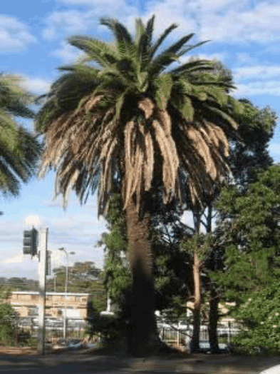
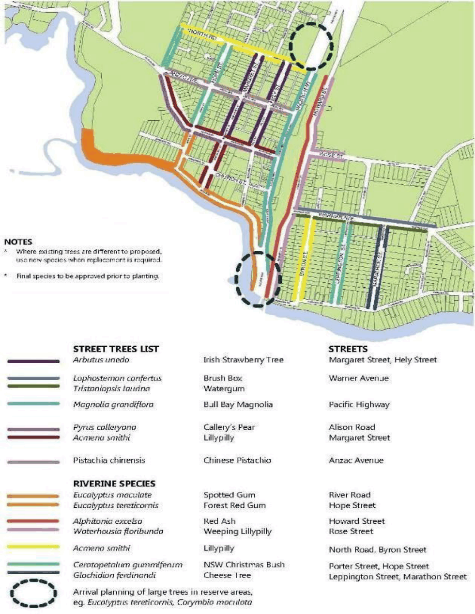

#### 4.5.2.4 Landscape Design

The history of Wyong as a timber and farming town has resulted in a mix of vegetation. Remnant native forest trees, salt marshes and coastal tree species dominate the town’s canopy. Cultural planting of Phoenix canariensis (Date Palm) in the 1920s along the Pacific Highway gives a strong focal point to the town. Street trees should be provided wherever possible to improve the appearance and amenity of the Wyong Town Centre.

> [Picture on page 21: a picture, saved as a picture (images/ch-04-05-wyong-town-centre-page-21-9.gif, 150 dpi).]

#### Figure 19 An example of a date palm along the Pacific Highway

#### OBJECTIVES

▪ To retain any existing landscaping that complements the existing buildings and the public realm generally

▪ To provide additional street trees and plantings wherever possible, that are consistent with the Street Tree Masterplan for the Wyong Town Centre, in order to improve the appearance and amenity of the public realm

#### REQUIREMENTS

a Council requires a high standard of landscaping fitting for a town centre, especially around Gateway sites therefore, landscape design should be prepared by a suitably qualified landscape professional.

b Development is to provide a structured and ordered landscape treatment within the Town Centre and Business/ Administration Precinct which reinforces and enhances the urban and civic character.

c The entry to Wyong at the Pacific Highway and River Road intersection is to be emphasised through the use of distinctive plant forms and colours.

d Landscape treatment is to express the transition from naturalistic and informal along the Wyong River to structured and formal within the Town Centre through the use of indigenous species in ordered layouts, clustered planting of single tree species and the use of a mix of indigenous and exotic species.

e Where possible and appropriate, native plant species, particularly those endemic to the locality should be used. In the Wyong Town Centre, some exotic species have been used or are suggested as they relate better to the adjoining built form.

f The planting of canopy trees at street level is encouraged to soften the visual impact of surrounding buildings.

g New development and landscaping is to have minimal impact on significant cultural plantings which form the setting of heritage buildings.

h Street tree planting should support the scale, hierarchy, continuity and amenity of streets.

i Major streets should use large urban trees and minor streets should use smaller clean-trunked trees. In some situations such as narrow lanes or adjacent to heritage buildings or special features, street trees should be omitted or used to frame the special features.

j The hierarchy of streets in the town should be reinforced by a selection of species appropriate to the scale and type of street. The Greening Wyong Strategy, prepared by Council’s Landscape Architects, identifies appropriate street trees for the Wyong Town Centre. The Street Tree Masterplan that was current in May 2011 is shown in Figure 20.

> [Picture on page 23: a picture, saved as a picture (images/ch-04-05-wyong-town-centre-page-23-1.gif, 150 dpi).]

#### Figure 20 Street tree masterplan for the Wyong Town Centre as at May 2011
