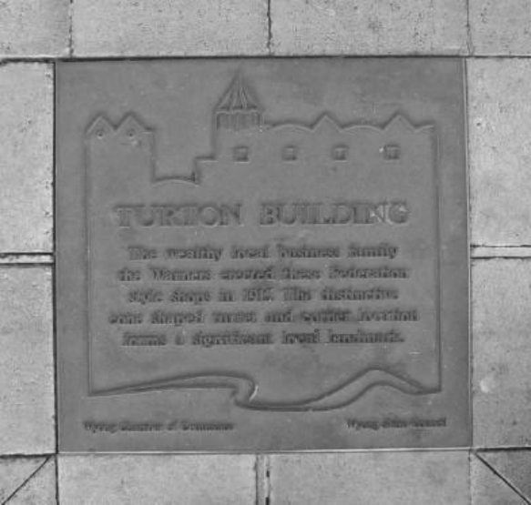
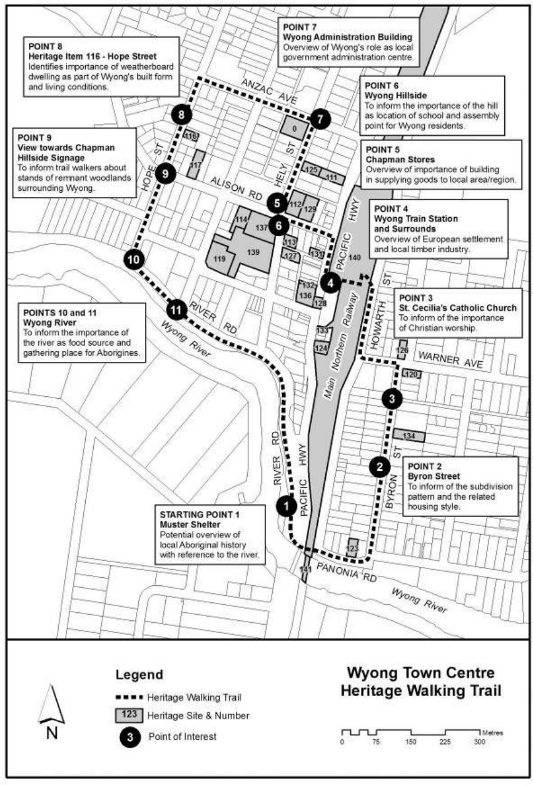

#### 4.5.2.5 Public Art

The Wyong Town Centre has a long association with the arts and many local artists’ groups currently have their facilities in buildings in the Town Centre area. If the Wyong Town Centre is to become a cultural and heritage focus for the Central Coast, it is important that some consideration be given to the provision of public art in new development.

#### OBJECTIVE

To physically express the cultural and heritage focus of the Wyong Town Centre through the provision of public art in new development

#### REQUIREMENTS

a Major developments valued at $5 million or greater must implement public art as part of the development in accordance with Chapter 5.48: Northern Areas -Public Art

b Developments valued between $1 million and $5 million are strongly encouraged to provide the opportunity for public art in new development.

c For developments under $5 million, public art could include an item of work commissioned by a local artist, a custom designed mural on an external surface, a heritage image superimposed onto an external structure, or a contribution made to the Heritage Walking Trail.

d The proposed Heritage Walking Trail takes in the major heritage sites in the Wyong Town Centre and is shown in Figure 22. A contribution to the Heritage Walking Trail could include the provision of paving around heritage or significant buildings or an indication of the significance of the item by providing a plaque as shown in Figure 21 below.

> [Picture on page 24: a picture, saved as a picture (images/ch-04-05-wyong-town-centre-page-24-21.gif, 150 dpi).]

Figure 21 Heritage plaque laid in paving in front of the Turton Building on the Pacific Highway

> [Picture on page 25: a picture, saved as a picture (images/ch-04-05-wyong-town-centre-page-25-1.gif, 150 dpi).]

#### Figure 22 Proposed heritage walking trail for the Wyong Town Centre
