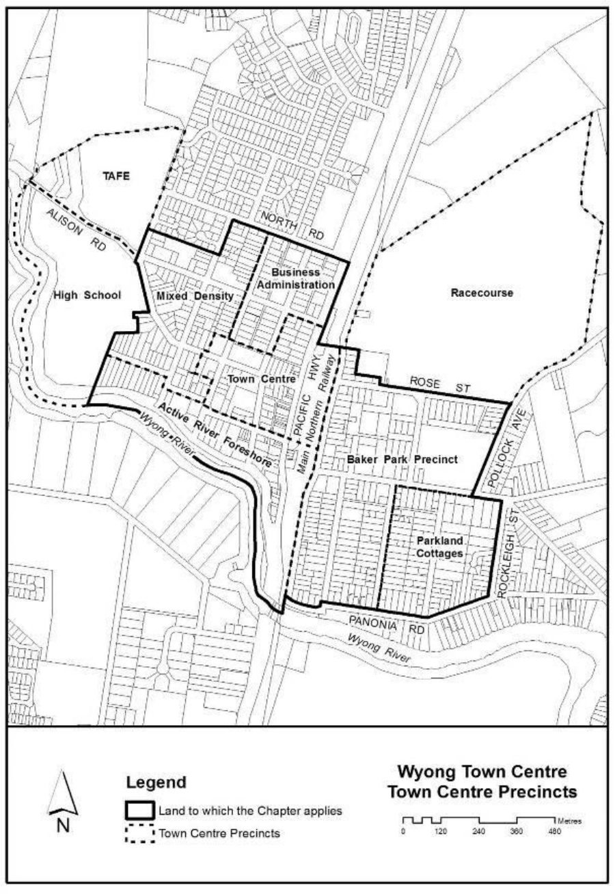
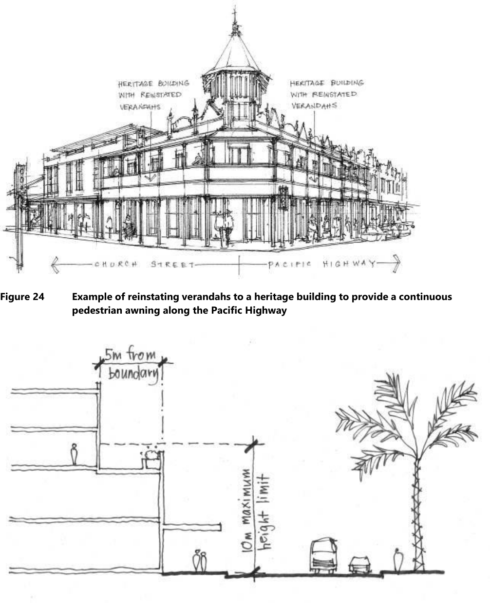
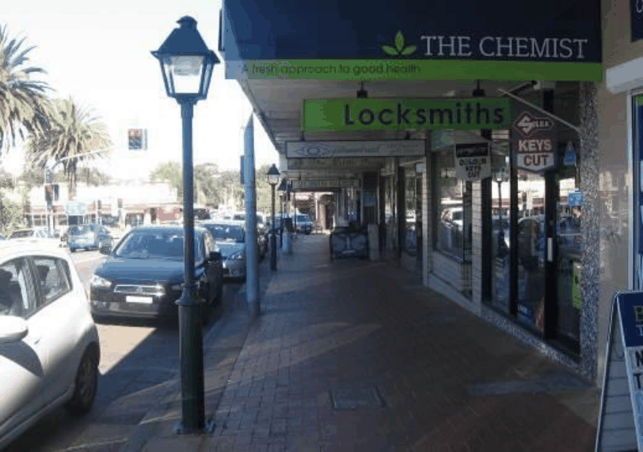

#### 4.5.3 SPECIAL PROVISIONS FOR SPECIFIC AREAS

#### 4.5.3.1 Precincts

Six precincts, as shown below, have been identified in the Wyong Town Centre and are shown in Figure 23:

▪ Town Centre

▪ Business Administration

▪ Mixed Density

▪ Active River Foreshore

▪ Baker Park Precinct

▪ Parkland Cottages

#### OBJECTIVE

To enable new development that is consistent and compatible with the functions of the precincts and respects the existing features and character of the area

#### 4.5.3.1.1 Town Centre

The Town Centre is a mixed-use precinct incorporating a range of retail, commercial and community functions. Several prominent heritage buildings and landscape elements are located in the Centre.

#### REQUIREMENTS

a Promote heritage buildings as a point of difference for retail and strengthen the heritage character of the precinct.

b Continuous awnings are to be provided along the Pacific Highway.

c Lots fronting the Pacific Highway and Anzac Avenue are to have noise attenuation and security measures provided to achieve adequate amenity.

d Buildings are to create a consistent edge to the Pacific Highway, Hely Street, Margaret Street, Alison Road, and Anzac Avenue.

e In order to maintain the heritage scale of the Wyong Town Centre, a stepped setback is required for selected sites on Alison Road and the Pacific Highway in accordance with Central Coast LEP 2022. An illustration of this setback is provided below in Figure 25.

> [Picture on page 27: a picture, saved as a picture (images/ch-04-05-wyong-town-centre-page-27-1.gif, 150 dpi).]

#### Figure 23 Wyong Town Centre Precincts

> [Picture on page 28: a picture, saved as a picture (images/ch-04-05-wyong-town-centre-page-28-1.gif, 150 dpi).]

Figure 24 Example of reinstating verandahs to a heritage building to provide a continuous

pedestrian awning along the Pacific Highway

#### Figure 25 Heritage stepped setback

#### 4.5.3.1.2 Business Administration

The Business / Administration precinct provides regional administrative and commercial functions. Civic functions include the Court House, Council offices, Civic Centre and Memorial Hall. This precinct has low-lying areas along an old creek line in the centre of the precinct.

#### REQUIREMENTS

a Extend existing streetscape improvements to reinforce the civic character of the precinct.

b Extend streetscape improvements along the Pacific Highway to upgrade the approach to the Town Centre.

c Upgrade existing laneways for pedestrian access.

d Provide connections from Hardware and Pauline Lanes to Hely and Margaret Streets adjacent to the public / special use lands.

e Buildings are to create a consistent edge to the Pacific Highway, Hely Street, Margaret Street, Anzac Avenue and North Road.

> [Picture on page 29: a picture, saved as a picture (images/ch-04-05-wyong-town-centre-page-29-10.gif, 150 dpi).]

Figure 26 Example of buildings creating a consistent edge along the Pacific Highway

#### 4.5.3.1.3 Mixed Density

This is a residential precinct predominantly comprised of detached dwellings with small areas of new medium density development consisting of single storey villa and two storey townhouses. The area is characterised by moderate to gentle slopes falling to a low-lying central zone.

#### REQUIREMENTS

a Buildings are to create a consistent edge to Margaret Street, Alison Road, Anzac Avenue and North Road.

b Ensure medium density buildings address the street and are not orientated to an access driveway running down a deep lot.

c Upgrade streetscapes through such measures as street tree planting and landscaped frontages to medium density residential buildings.

#### 4.5.3.1.4 Active River Foreshore

The Active River Foreshore has a mix of commercial and retail uses along the Pacific Highway and commercial / residential areas adjacent to Wyong River.

#### REQUIREMENTS

a Buildings are to create a consistent edge to the Pacific Highway and Margaret Street.

b For further requirements for this precinct refer to Section 4.5.3.7 Local Area Masterplans in this Chapter.

#### 4.5.3.1.5 Baker Park Precinct

A residential and sporting precinct incorporating extensive active recreation facilities including Baker Park oval, netball courts, tennis courts, public swimming pool, and the Wyong Racecourse.

#### REQUIREMENT

For requirements for this precinct refer to Section 4.5.3.7 Local Area Masterplans in this Chapter.

#### 4.5.3.1.6 Parkland Cottages

A predominantly residential precinct comprised of single cottages as well as some single storey unit and villa developments.

#### REQUIREMENT

Upgrade streetscapes through such measures as street tree planting and landscaped frontages to residential buildings.
