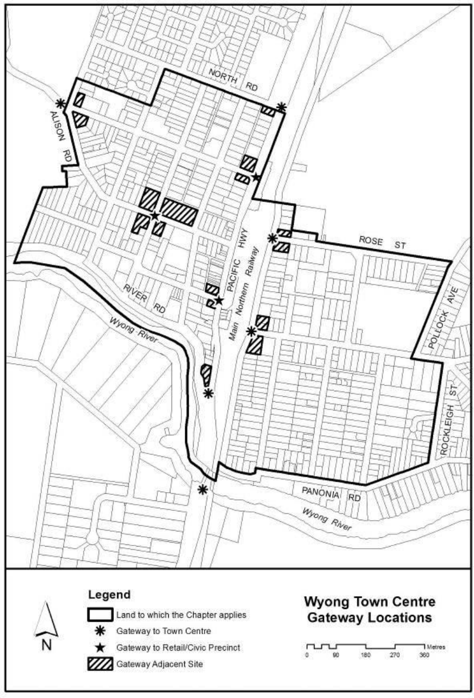

#### 4.5.3.2 Gateways

Five (5) main ‘gateway’ locations to the Wyong Town Centre have been identified for special attention to establish attractive entrance features to the township. Three (3) minor entry points to the retail/commercial precinct have also been identified. Figure 27 is a map showing the sites adjacent to the ‘gateways’ in the Wyong Town Centre. Two of the main gateway locations are adjacent to previously identified Key Sites as indicated in Figure 32 of this Chapter.

#### OBJECTIVE

▪ To establish “gateway” locations to the Wyong Town Centre to ensure a favourable first impression which projects a sense of arrival and encourages visitors to stay and explore

#### REQUIREMENTS

a Development of Gateway Adjacent Sites is to be of particularly high quality to assist in creating a favourable first impression, project a sense of arrival and encourage visitors to stay and explore.

b A landscape assessment and design report prepared by a suitably qualified landscape professional is required to accompany applications for development at these critical locations. Council’s Landscape Architect should be contacted to ascertain any specific landscaping requirements.

c Gateway Signage is to be located at strategic entrances, particularly those Gateways to the Town Centre. Such signage should be developed in consultation with the community.

> [Picture on page 32: a picture, saved as a picture (images/ch-04-05-wyong-town-centre-page-32-1.gif, 150 dpi).]

#### Figure 27 Map showing sites adjacent to gateways in the Wyong Town Centre
