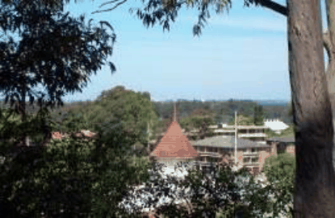
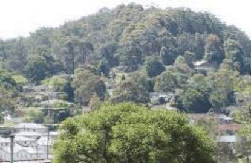
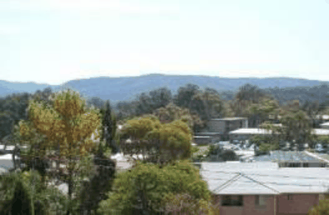
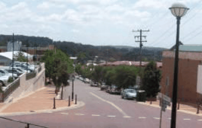
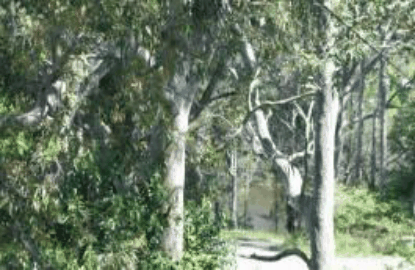
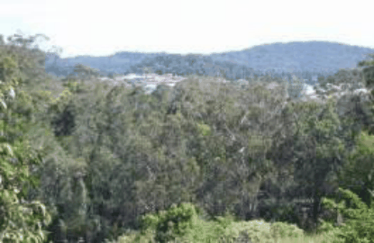
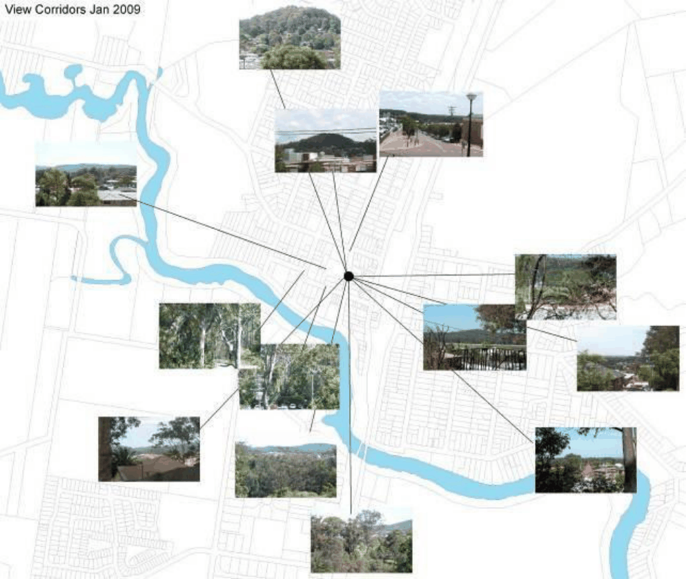

#### 4.5.3.3 View Corridors

> [Picture on page 33: a picture, saved as a picture (images/ch-04-05-wyong-town-centre-page-33-2.gif, 150 dpi).]

> [Picture on page 33: a picture, saved as a picture (images/ch-04-05-wyong-town-centre-page-33-3.gif, 150 dpi).]

Looking towards The Entrance from Wyong Town Park Hill Looking towards Chapman Hill from Wyong

> [Picture on page 33: a picture, saved as a picture (images/ch-04-05-wyong-town-centre-page-33-5.gif, 150 dpi).]

Town Park Hill

> [Picture on page 33: a picture, saved as a picture (images/ch-04-05-wyong-town-centre-page-33-7.gif, 150 dpi).]

Looking down Hely Street from Wyong Town Park Hill Looking towards Jilliby from Wyong Town Park Hill

> [Picture on page 33: a picture, saved as a picture (images/ch-04-05-wyong-town-centre-page-33-9.gif, 150 dpi).]

> [Picture on page 33: a picture, saved as a picture (images/ch-04-05-wyong-town-centre-page-33-10.gif, 150 dpi).]

Looking towards Wyong River from the Corner of Looking towards Mardi from Wyong Town Park Hill

Church and Margaret Streets

#### Figure 28 Examples of existing views in the Wyong Town Centre to be retained

#### OBJECTIVES

▪ To ensure that Wyong Park remains the dominant element in the townscape emphasising the hill and the landscape elements of the town

▪ To encourage development and allow for increased height while ensuring that existing significant view corridors are maintained

a View corridors are to be maintained from Town Park Hill west to Ourimbah State Forest, east and south to The Entrance, Tuggerah Lake, Long Jetty, Glenning Valley and Tumbi Umbi, north along Hely Street and north-west to Chapman’s Hill.

b View corridors are to be maintained along Hely Street from Town Park Hill to Wyong Grove Primary School.

c View corridors are to be maintained across the Active River Foreshore precinct from Wyong Town Park Hill to McPhersons Road, south of Wyong River, and to Mardi and Kangy Angy Mountain.

d View corridors are to be maintained across the Baker Park precinct from Wyong Town Park Hill to Noraville and Toukley and The Entrance and Tuggerah Lake.

e Provide view corridors between buildings from Church Street to Wyong River.

> [Picture on page 34: a picture, saved as a picture (images/ch-04-05-wyong-town-centre-page-34-11.gif, 150 dpi).]

#### Figure 29 View corridors to be maintained in the Wyong Town Centre
