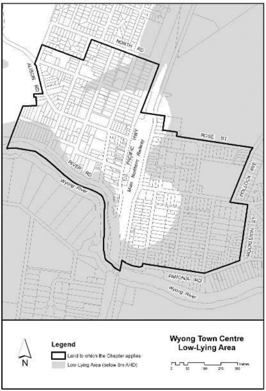

#### 4.5.3.4 Low-Lying Areas

Low-lying areas within the Wyong Town Centre may experience high ground water levels and/or potential acid sulphate soils due to the location of the town on the Wyong River.

#### OBJECTIVE

▪ To identify those sites at risk of high ground water levels, and/or potential acid sulphate soils, and assess their suitability for development

#### REQUIREMENT

a A geo-technical assessment is required for low-lying areas to assess the suitability of sub-strata to support development. A ground-water study is also required to be submitted for all development in these areas addressing the requirements contained in Section 5.2.5 Stormwater Management. In the Wyong Town Centre, low-lying areas are defined as those sites below 8 metres AHD and shown grey on Figure 30 below

> [Picture on page 35: a picture, saved as a picture (images/ch-04-05-wyong-town-centre-page-35-10.gif, 150 dpi).]

#### Figure 30 Map showing general location of the low-lying area (below 8m AHD)
