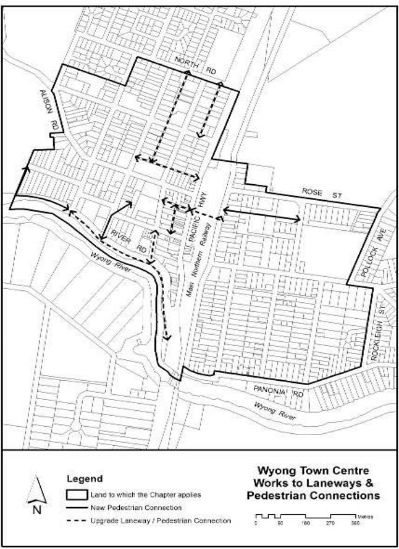

#### 4.5.3.5 Laneways

#### OBJECTIVE

▪ To create a pedestrian and bicycle focussed environment by enhancing or providing new pedestrian connections in the local area

#### REQUIREMENT

a New development on sites adjoining the laneways and pedestrian connections illustrated in Figure 31 below shall contribute to these works as directed by Council.

> [Picture on page 36: a picture, saved as a picture (images/ch-04-05-wyong-town-centre-page-36-8.gif, 150 dpi).]

Figure 31 Map showing proposed new pedestrian connections and upgrades to laneways
