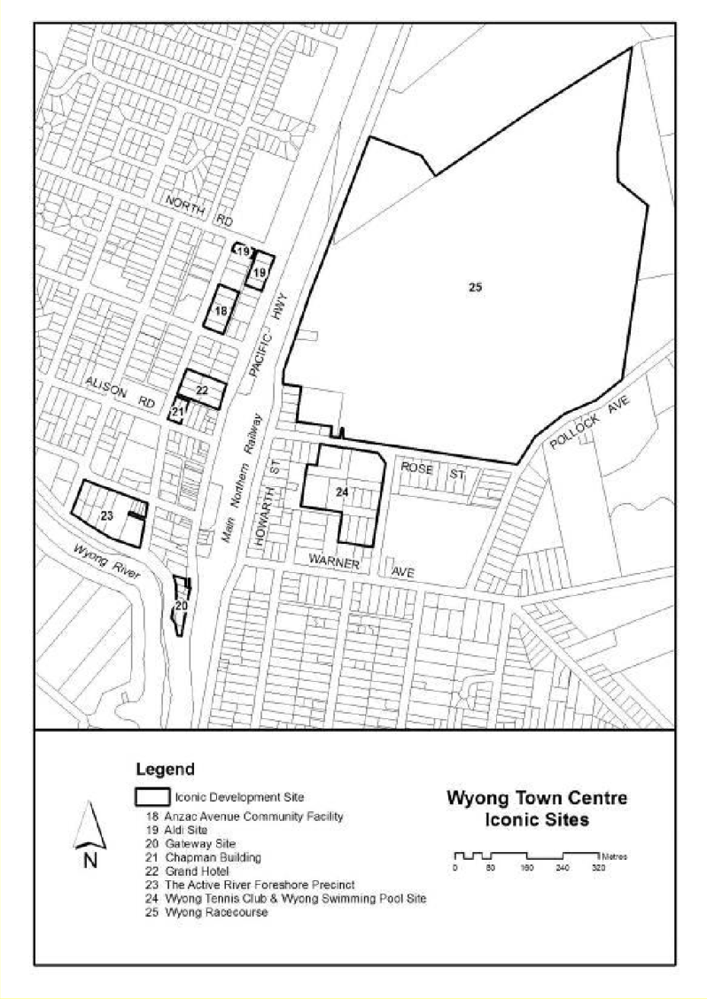
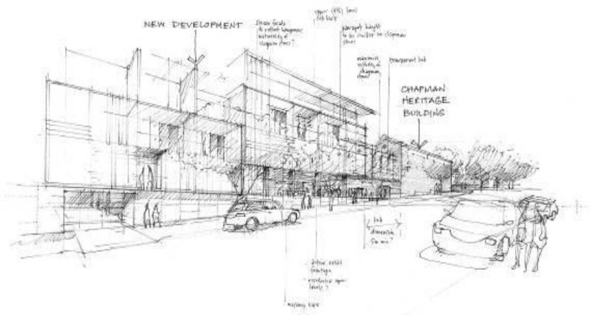
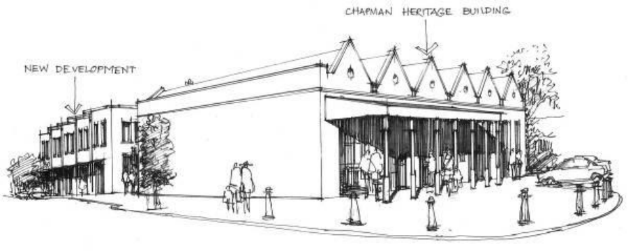

#### 4.5.3.6 Key Sites

Wyong LEP 2013 identified Key Sites that have the potential to be a catalyst for economic growth and development confidence. Several of these sites are within the Wyong Town Centre area and are identified in Figure 32. Applicants should verify the current status of the Key Sites with Council and if any sites relevant to their area have been added or subtracted.

> [Picture on page 37: a picture, saved as a picture (images/ch-04-05-wyong-town-centre-page-37-6.gif, 150 dpi).]

#### Figure 32 Map showing the location of key sites

▪ To facilitate the economic growth by identifying sites within the various commercial/retail centres that would provide a significant economic benefit if they were developed to a suitable standard

▪ To ensure that any redevelopment of nominated Key Sites considers the existing heritage character of the Wyong Town Centre

#### REQUIREMENT

a For the requirements for development of Key Sites, applicants should refer to Chapter 5.49 Northern Are Key Sites where relevant.

b Figures 33 and 34 show two examples of the possible reuse and redevelopment of the Chapman Building Key Site. This site contains a heritage building fronting Alison Road that is to be considered by proponents when proposing to redevelop the subject site and other sites in this locality.

> [Picture on page 38: a picture, saved as a picture (images/ch-04-05-wyong-town-centre-page-38-11.gif, 150 dpi).]

Figure 33 First example of the possible reuse and redevelopment of the Chapman Building Key

#### Site viewed from Hely Street

> [Picture on page 38: a picture, saved as a picture (images/ch-04-05-wyong-town-centre-page-38-14.gif, 150 dpi).]

Figure 34 Second example of the possible reuse and redevelopment of the Chapman Building

#### Key Site viewed from the corner of Hely Street and Alison Road
