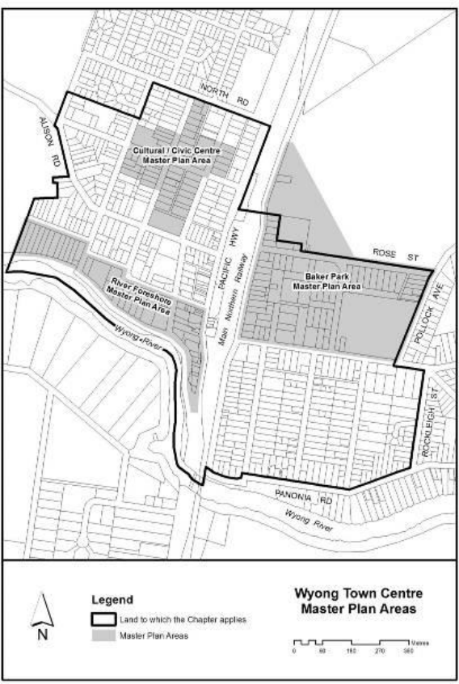
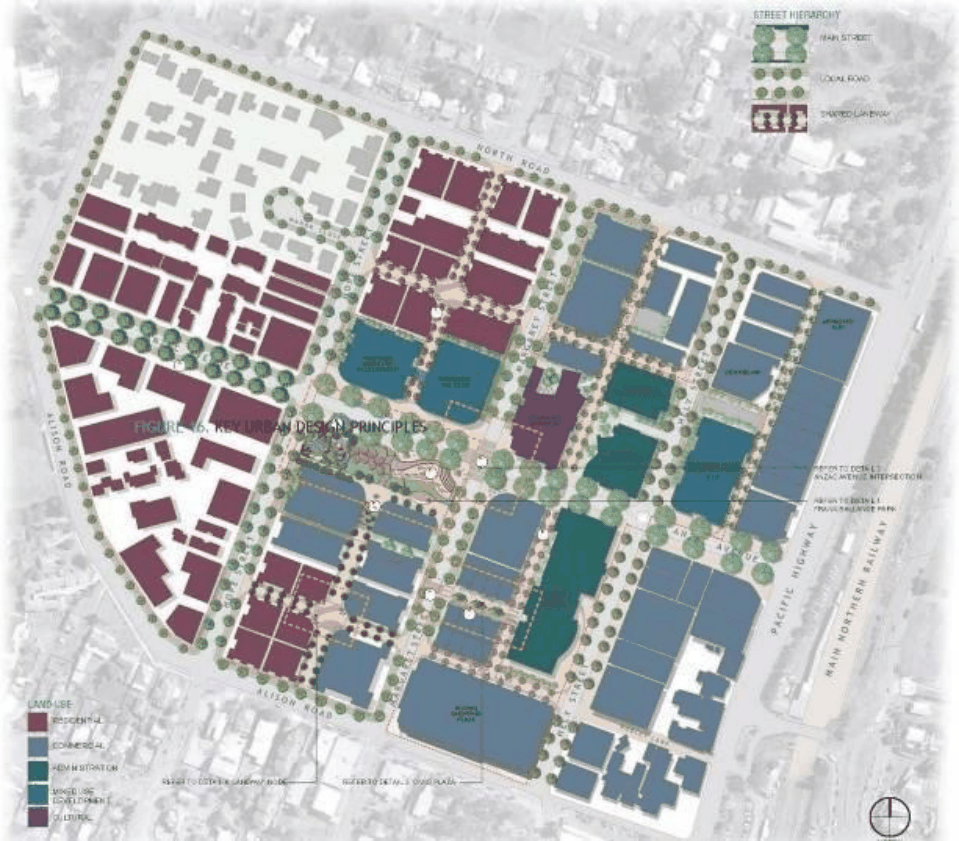
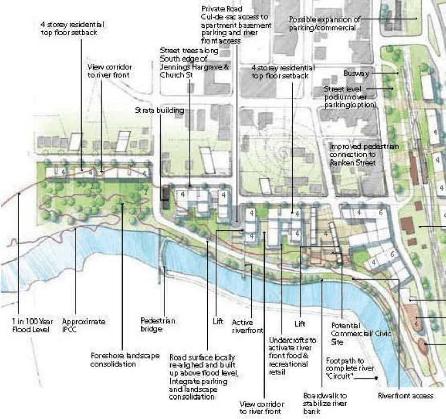
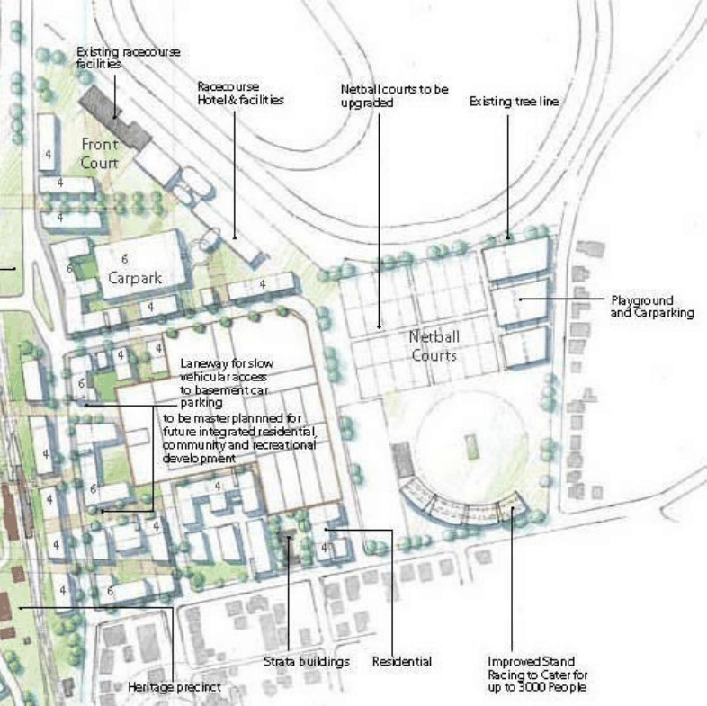

#### 4.5.3.7 Local Area Masterplans

A Masterplan is a long term strategic planning document that describes visually and by narrative the desired future of an area. Masterplans seek to provide a general land use plan based upon the opportunities and constraints that exist. A Masterplan will generally focus on a smaller area and provide a higher level of detail compared to a local planning strategy, but will not provide the level of detail found in detailed design plans. They are not statutory documents but provide a detailed vision for an area which informs planning instruments such as Local Environmental Plans and Development Control Plans.

The following Local Area Masterplans apply to development within the Wyong Town Centre:

▪ Active River Foreshore Masterplan;

▪ Baker Park Masterplan; and

▪ Wyong Cultural and Civic Centre Masterplan

> [Picture on page 39: a picture, saved as a picture (images/ch-04-05-wyong-town-centre-page-39-12.gif, 150 dpi).]

▪ Figure 35 Map showing the masterplan areas for the Baker Park, River Foreshore and Cultural /

#### Civic Centre Areas

#### 4.5.3.7.1 Wyong Cultural and Civic Centre Masterplan

The Wyong Cultural and Civic Precinct Masterplan forms part of the implementation program of the Wyong/Tuggerah Planning Strategy adopted in October 2007. The Masterplan seeks to provide a framework for the future cultural and civic precinct, based on a clear vision and a comprehensive set of design principles. The masterplan aims to aesthetically strengthen the area as the civic and cultural hub.

The adopted masterplan identifies particular key proposals that include significant public domain improvement works. These have been developed from the analysis of the opportunities and constraints in existence and how they could be applied. These projects include the Anzac Avenue Cultural Precinct, Frank Balance Park and also the Civic Plaza.

#### OBJECTIVE

To improve the urban fabric of the precinct in order to aesthetically strengthen the area as the civic and cultural hub

#### REQUIREMENTS

a Minimise development in the low–lying areas of Anzac Avenue to mitigate potential storm water issues.

b Development is to continue any new paving works commenced within the precinct in accordance with the principles outlined in the masterplan.

c Development on the corner of Margaret Street and Anzac Avenue shall provide public open space to enable pedestrian activity in the cultural hub.

d Development surrounding Frank Balance Park should relate to the scale of the park. Buildings should be set back from the boundary and step down towards the park.

e Development must not excessively overshadow Frank Balance Park.

f Development on sites on Anzac Avenue to the north of Frank Balance Park should have a minimum six metre setback to the boundary adjacent to Anzac Avenue.

g Development occurring immediately to the south of Frank Balance Park must visually address both the street and the park and provide passive surveillance opportunities. Long windowless or unarticulated walls will not be permitted along the park boundary.

> [Picture on page 41: a picture, saved as a picture (images/ch-04-05-wyong-town-centre-page-41-1.gif, 150 dpi).]

#### Figure 36 Wyong Cultural and Civic Centre Masterplan dated July 2011

#### 4.5.3.7.2 Active River Foreshore Masterplan

The former Wyong Shire Council adopted the Active River Foreshore Masterplan in 2009. The intent of the Masterplan is to provide a long term vision with directions to sustainably manage the reactivation of the Wyong River Foreshore over the next 20 years. A copy of the Active River Foreshore Masterplan can be obtained by contacting Council or can be downloaded from Council’s website at Wyong Active River Foreshore & Baker Park Masterplan

The Active River Foreshore Masterplan looks at reactivating the river frontage and creating a visual and physical link with the Wyong Town Centre. The focus is on residential development orientated to the river and commercial/civic development along the Pacific Highway and the Rankens Court laneway. A site plan of the preferred option for development on the Active River Foreshore precinct is provided in Figure 37. Some objectives and requirements for development in this area are also listed below.

> [Picture on page 42: a picture, saved as a picture (images/ch-04-05-wyong-town-centre-page-42-1.gif, 150 dpi).]

Figure 37 Site plan of the preferred masterplan option for the Active River Foreshore Area

#### OBJECTIVES

▪ To encourage amalgamation of smaller sites while retaining and promoting fine grain frontage to Hargrave Street and River Road as well as encouraging address to side access down to riverfront areas

▪ To activate a retail precinct to Church Street and Hargrave Street

▪ To allow an increase in residential uses and height in key sites where additional height can be demonstrated to have an overall positive effect upon the built form of the Precinct

▪ To ensure a consistent contemporary and modern architectural form and treatment

▪ To encourage a degree of unity in the built form through adherence to a typology that encourages a cohesive pattern with which buildings occupy the block and address the street

▪ To create an active frontage and definition of public domain

▪ To maintain and enhance where possible the amenity of the Active River Foreshore area

a Overland flow paths to be provided at four locations: adjacent to Hope Street, adjacent to Margaret Street, midway between Margaret Street and Rankens Court, and at the end of Rankens Court leading down to the River Foreshore.

b Development is to maintain or enhance view corridors looking towards Wyong River.

c View corridors along Rankens Court and Margaret Street are to be retained and building forms are to respond to view corridor vantage points.

d Development is to provide views between building forms and enable view sharing of the river to the south.

e Development to be elevated above the adopted flood level as per Council’s requirements. Development must provide pedestrian egress to Church Street, Hargrave Street, Jennings Road or the Pacific Highway in the event of a flood.

f Development is to avoid extensively overshadowing Wyong River parkland.

g Building form and location is to minimise overshadowing of public open space, in particular along River Road. Applicants are to demonstrate the impacts of overshadowing on open space through different times of the year.

h Buildings are to formally address Church Street and River Road and provide an active frontage to both these streets.

i Buildings are to create a consistent edge and continuous awnings are to be provided along the Pacific Highway.

j Development is to activate the pedestrian connection from Rankens Court to Wyong River with retail and commercial uses. Investigate and consider opportunities to incorporate commercial activity along River Road, at street level, adjacent to the Rankens Court walkway.

k Development is to provide clear public domain areas to Rankens Court and Margaret Street and view corridors to the south looking over Wyong River.

l A continuous podium along Church Street and Hargrave Street to define the street frontage is encouraged.

m Development west of Hope Street along Jennings Road is to be lower scaled, consistent with the existing character of area.

n Differentiate and emphasise Gateway Sites through use of landmark buildings in particular at the Junction of River Road and Pacific Highway and at Rankens Court.

o Continuous awnings along Church Street and Hargrave Street should be provided.

p Housing choice and mix should be determined through consideration of the whole precinct, not just particular lots or street frontages.

q Development should provide for a mix of apartments, attached and semi-detached dwellings across the site. The housing mix should also relate to the topography of the site.

#### 4.5.3.7.3 Baker Park Masterplan

The former Wyong Shire Council adopted the Baker Park Masterplan in 2009. The intent of the Masterplan is to provide a long term vision with directions to reinforce the role of the recreation precinct of Baker Park over the next 20 years. A copy of the Baker Park Masterplan can be obtained by contacting Council.

The Baker Park Masterplan looks at reinforcing the recreational precinct in the Wyong Town Centre. Commercial development and car parking is located to the west of Howarth Street and mixed use is encouraged to the east, and residential development surrounds the recreational facilities. There is the opportunity for northern orientation and visual links between the Town Centre and new development. A site plan of the preferred option for development in the Baker Park precinct is provided in Figure 38. Some objectives and requirements for development in this area are also listed below.

> [Picture on page 44: a picture, saved as a picture (images/ch-04-05-wyong-town-centre-page-44-11.gif, 150 dpi).]

#### Figure 38 Site plan of the preferred masterplan option for the Baker Park Area

▪ To create improved car parking opportunities that do not detract from the streetscape and quality of built form in the Precinct

▪ To promote the integration of basement car parking for all developable sites in particular residential apartment buildings

▪ To strengthen open space linkages to Wyong Town Centre by integration of open corridor extension from Alison Road over Railway Corridor through existing Tennis Courts and Wyong Pool

▪ To improve connectivity to Wyong Race Course at intersection with Rose Street and south to Warner Avenue

▪ To provide improved Open Space recreational facilities to Baker Park

▪ To promote the acquisition of private lots along Pollock Avenue

▪ To create stronger identity through built form differentiation and diversity

▪ To create residential opportunities through the provision of more floor space with higher density residential development ranging between four and six storeys

▪ To maintain and enhance where possible the amenity of the Baker Park area

#### REQUIREMENTS

a Maintain view corridors from the Wyong Town Centre to Baker Park Sports Fields and Wyong Pool.

b Promote view corridors to recreational open space at Baker Park Sporting Fields to the east of the site.

c Promote views looking north over Wyong Race Club.

d Maintain a view corridor from Alison Road looking east across Wyong Station to the Baker Park Precinct.

e Orientate apartment buildings to maximise northern aspect for sunlight into living areas whilst respecting the existing urban block form.

f Provide noise attenuation measures to achieve adequate amenity for lots fronting Howarth Street and the Main Northern Railway Line.

g Address the presence of existing high voltage power lines for development of lots fronting Howarth Street.

h Provide high density residential development with low level retail space at ground floor along Howarth Street on the eastern and western sides close to the railway line.

i Reinforce the existing urban grid and block structure between Warner Avenue and Rose Street.

j Ensure housing choice and mix is determined through a consideration of the whole precinct, not only particular lots or street frontages.

k Provide for a mix of apartments, and attached dwellings across the site. The housing mix should generally be promoted as having a high quality urban character.
