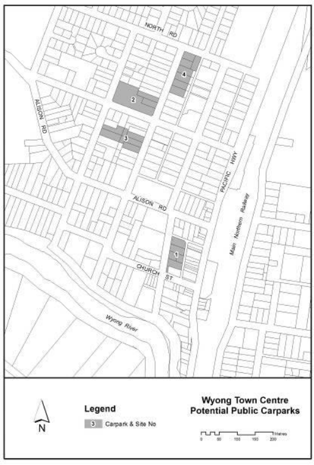

#### 4.5.4.1 Public Car parking

Four sites have been identified by Council as having potential to be developed into public car parking locations. The public car parking locations are proposed to contain a mix of at-grade and multi-level car parking, and are expected to be developed as demand and development increases. The location of these sites is shown on the map at Figure 39.

> [Picture on page 46: a picture, saved as a picture (images/ch-04-05-wyong-town-centre-page-46-14.gif, 150 dpi).]

#### Figure 39 Wyong Town Centre potential public carpark locations
