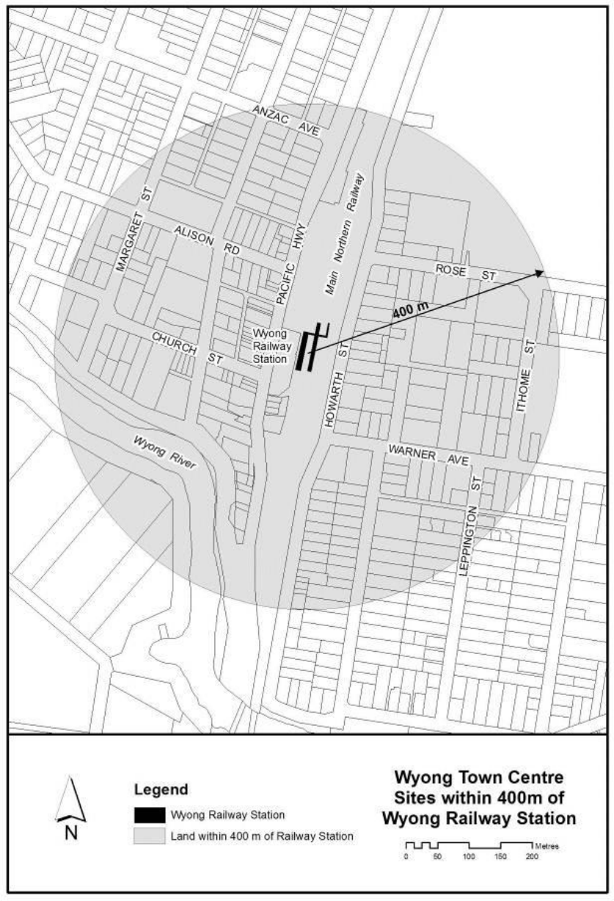

#### 4.5.4.2 Commercial Development Car parking

#### OBJECTIVE

To provide provisions relating to car parking for commercial development in the Wyong Town Centre

#### REQUIREMENTS

a All car parking for commercial development must be provided on-site, where this is not possible, Council may accept developer contributions up to a maximum of 10% of the required car parking. Refer to the Wyong Town Centre Section 7.11 Contribution Plan for rates.

b For commercial development on sites within 400 metres of the railway station, concessions may be considered for the number of required car parking spaces if the proposal is accompanied by a Transport Management Plan. For further details of this concession refer to Chapter 2.13: Transport and Parking. This clause relates only to development on sites that have their main pedestrian entrance located within 400 metres of the railway station as shown in Figure 40 below.

c The above clause only applies to commercial development and does not apply to the residential component of mixed use development. Residential development will need to comply with the requirements of Chapter 2.13: Transport and Parking.

> [Picture on page 48: a picture, saved as a picture (images/ch-04-05-wyong-town-centre-page-48-1.gif, 150 dpi).]

#### Figure 40 Sites within 400 metres of the Wyong Railway Station
